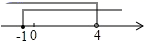

# Mathematics - 题目 590

**ID**: 6f4783f9b0534d93abbcd9689edf9fcf
**年级**: Grade 9
**难度**: Easy
**题型**: Multiple-choice

## 题目
把某不等式组中两个不等式的解集表示在数轴上，如图所示，则这个不等式组可能是（      ）​​​​​​​‌

## 解答

1. 解：由数轴可知， $x<4$ 且 $x\geqslant -1$ ，
2. ∴这个不等式组可能是 $\begin{cases}x<4\\x\geqslant -1\end{cases}$
3. 故答案为：D．

## 知识点

**中文**:
  - 一元一次不等式组的应用

**English**:
  - Applications of Systems of Inequalities

---
