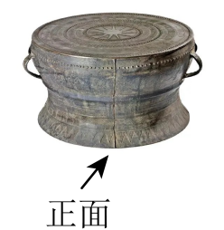

# Mathematics - 题目 454

**ID**: 88bbe802fb7044bda2acf32725297ddf
**年级**: Grade 9
**难度**: Easy
**题型**: Multiple-choice

## 题目
铜鼓是我国古代南方少数民族使用的打击乐器和礼器，世界上最重的铜鼓王出土于广西．如图是铜鼓的实物图，它的左视图是（      ）​​​​​​​‌

## 解答

1. 解：从左边看，可得选项B的图形，
2. 故此题答案为B．

## 知识点

**中文**:
  - 判断几何体的三视图

**English**:
  - Determining Three Views

---
