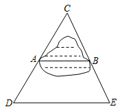

# Mathematics - 题目 3861

**ID**: 8cbfb54b28d44ee09781d5bbf11fe161
**年级**: Grade 9
**难度**: Easy
**题型**: Multiple-choice

## 题目
如图，为了测量池塘边A、B两地之间的距离，在线段AB的同侧取一点C，连结CA并延长至点D，连结CB并延长至点E，使得A、B分别是CD、CE的中点，若DE＝18m，则线段AB的长度是（      ）​​​​​​​‌

## 解答

1. 解：∵A、B分别是CD、CE的中点，DE＝18m，
2. ∴AB＝ $\frac {1}{2}$ DE＝9m，
3. 故选：A．

## 知识点

**中文**:
  - 三角形中位线

**English**:
  - Triangle Midsegment

---
