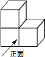

# Mathematics - 题目 3411

**ID**: 92f646af2207444e86447b8747a986e5
**年级**: Grade 9
**难度**: Easy
**题型**: Multiple-choice

## 题目
如图是由3个完全相同的小正方体组成的立体图形，它的左视图是（      ）​​​​​​​‌

## 解答

1. 解：从左边看第一层一个小正方形，第二层一个小正方形，
2. 故选A．

## 知识点

**中文**:
  - 判断几何体的三视图

**English**:
  - Determining Three Views

---
