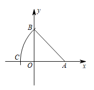

# Mathematics - 题目 3402

**ID**: 953f645b0b794fecbae17e18fdcfd7df
**年级**: Grade 9
**难度**: Easy
**题型**: Multiple-choice

## 题目
如图所示， $A\left ({2\sqrt {2},0}\right )$ ， $AB=3\sqrt {2}$ ，以点A为圆心，AB长为半径画弧交x轴负半轴于点C，则点C的坐标为（      ）​​​​​​​‌

## 解答

1. 解：∵ $A\left ({2\sqrt {2},0}\right )$ ，
2. ∴OA= $2\sqrt {2}$ ，
3. ∵ $AB=3\sqrt {2}$ ，以点A为圆心，AB长为半径画弧交x轴负半轴于点C，
4. ∴ $AC=AB=3\sqrt {2}$ ，
5. ∴ $OC=AC-OA=3\sqrt {2}-2\sqrt {2}=\sqrt {2}$ ，
6. ∵点C为x轴负半轴上的点，
7. ∴C$\left ({-\sqrt {2},0}\right )$ ，
8. 故此题答案为C．

## 知识点

**中文**:
  - 勾股定理
  - 坐标与图形性质

**English**:
  - Pythagorean Theorem
  - Coordinates and Geometric Properties

---
