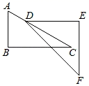

# Mathematics - 题目 3229

**ID**: 9e4132e36196421b9983108550d0c5e7
**年级**: Grade 9
**难度**: Easy
**题型**: Multiple-choice

## 题目
如图，Rt△ABC中，∠B＝90°，∠A＝55°，45°的直三角板DEF的锐角顶点D在斜边AC上，直角边DE//BC，则∠FDC的度数为（      ）​​​​​​​‌

## 解答

1. 解：∵∠B＝90°，∠A＝55°，
2. ∴∠C＝180°－∠B－∠A=35°，
3. ∵DE//BC，
4. ∴∠C＝∠EDC＝35°，
5. ∵∠EDF＝45°，
6. ∴∠FDC＝∠EDF﹣∠EDC＝45°﹣35°＝10°，
7. 故选：A．

## 知识点

**中文**:
  - 三角形内角和定理
  - 两直线平行内错角相等

**English**:
  - Angle Sum Theorem
  - Parallel Lines have Equal Alternate Interior Angles

---
