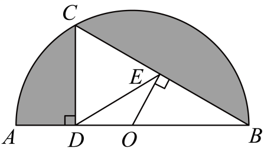

# Mathematics - 题目 3554

**ID**: a01435b8de634f70980c139909bfd5ef
**年级**: Grade 9
**难度**: Easy
**题型**: Multiple-choice

## 题目
如图，以 $AB$ 为直径画半圆 ${\rm \mathit{O}，}BC$ 为半圆上一条弦，过点C作 $CD\bot AB$ 于点D，过点O作 $OE\bot BC$ 于点E．连接 $DE$ ，若半径 $OB=2$ ， $DE=\sqrt {3}$ ，则图中阴影部分的面积为（      ）​​​​​​​‌

## 解答

1. 解：∵ $OE\bot BC$ ，
2. ∴ $CE=BE$ ，
3. ∵ $CD\bot AB$ ， $DE=\sqrt {3}$ ，
4. ∴ $CE=BE=DE=\sqrt {3}$ ，
5. ∵ $OB=2$ ，
6. ∴ ${\cos}\angle DBC=\frac {\sqrt {3}}{2}$ ，
7. ∴ $\angle B=30{}\degree $ ，
8. ∴ $CD=\frac {1}{2}BC=\sqrt {3}$ ，
9. ∴ $BD=\sqrt {BC{^{2}}-CD{^{2}}}=3$ ，
10. ∴图中阴影部分的面积 $=\frac {1}{2}{\rm{π}}\times 2{^{2}}-\frac {1}{2}\times 3\times \sqrt {3}=2{\rm{π}}-\frac {3\sqrt {3}}{2}$ ，
11. 故此题答案为D．

## 知识点

**中文**:
  - 勾股定理
  - 含30度角的直角三角形

**English**:
  - Pythagorean Theorem
  - Right Triangle with 30° Angle

---
