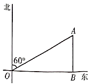

# Mathematics - 题目 1312

**ID**: a5ada2c98c744ba3a1d02d1893d06616
**年级**: Grade 9
**难度**: Easy
**题型**: Multiple-choice

## 题目
如图，小明在一条东西走向公路的O处，测得图书馆A在他的北偏东 $60^\circ $ 方向，且与他相距 $200{\rm{m}}$ ，则图书馆A到公路的距离 $AB$ 为（      ）​​​​​​​‌

## 解答

1. 解：由已知得，∠AOB=90° $\mathbf{-}$ 60°=30°，OA=200m．
2. 则AB= $\frac {1}{2}$ OA=100m．
3. 故选：A．

## 知识点

**中文**:
  - 解直角三角形的实际应用

**English**:
  - Applications of Solving Right Triangles

---
