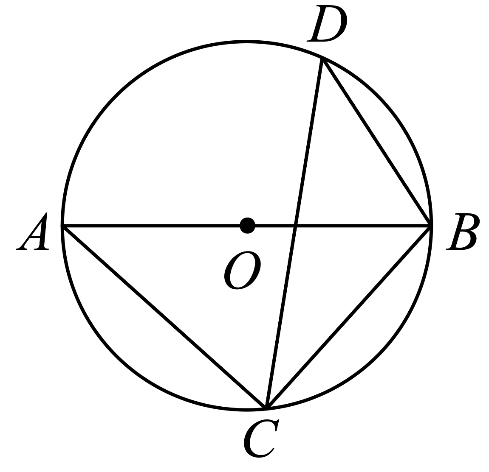

# Mathematics - 题目 3381

**ID**: aa94d8376ff04b0abc60671ed5c1b4af
**年级**: Grade 9
**难度**: Easy
**题型**: Multiple-choice

## 题目
如图， $\vartriangle BCD$ 内接于 $\odot O$ ，  $AB$ 是 $\odot O$ 的直径， $\angle CDB=42{}\degree $ ，则 $∠ABC$ 的度数为（      ）​​​​​​​‌

## 解答

1. 解：∵ $\angle CDB=42{}\degree $ ，
2. ∴ $\angle CAB=\angle CDB=42{}\degree $ ，
3. ∵ $AB$ 是 $\odot O$ 的直径，
4. ∴ $\angle ACB\mathrm{=}90{}\degree $ ，
5. ∴ $\angle ABC=90{}\degree -42{}\degree =48{}\degree $ ，
6. 故此题答案为B．

## 知识点

**中文**:
  - 圆周角定理及推论

**English**:
  - Inscribed Angle Theorem

---
