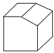

# Mathematics - 题目 3538

**ID**: c0934b7e36d54ff28327d83da885a0e3
**年级**: Grade 9
**难度**: Easy
**题型**: Multiple-choice

## 题目
如图所示的几何体，它的左视图是（      ）​​​​​​​‌

## 解答

1. 解：如图所示，几何体的左视图是：
2. 
3. 故选：D．

## 知识点

**中文**:
  - 判断几何体的三视图

**English**:
  - Determining Three Views

---
