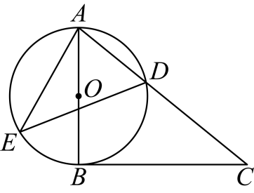

# Mathematics - 题目 1928

**ID**: c1c6b22e79004148a6f98955c5d41854
**年级**: Grade 9
**难度**: Easy
**题型**: Multiple-choice

## 题目
如图，以 $AB$ 为直径的 $\odot O$ ，与 $BC$ 切于点 ${\rm \mathit{B}，}AC$ 与 $\odot O$ 交于点 ${\rm \mathit{D}，\mathit{E}}$ 是 $\odot O$ 上的一点，若 $\angle E=40{}^\circ $ ，则 $∠C$ 等于（      ）​​​​​​​‌

## 解答

1. 解：如图，连接 $BD$ ，
2. 
3. $\because BC$ 为切线，
4. $∴AB⊥BC$ ，
5. $\therefore \angle ABC=90{}^\circ $ ，
6. $\because AB$ 为直径，
7. $\therefore \angle ADB=90{}^\circ $ ，
8. $\because \angle ABD=\angle E=40{}^\circ $ ，
9. $\therefore \angle BAD=90{}^\circ -40{}^\circ =50{}^\circ $ ，
10. $\therefore \angle C=90{}^\circ -\angle BAC=40{}^\circ $ ，
11. 故此题答案为C．

## 知识点

**中文**:
  - 三角形内角和定理
  - 圆周角定理及推论
  - 切线的性质定理

**English**:
  - Angle Sum Theorem
  - Inscribed Angle Theorem
  - Tangent Properties Theorem

---
