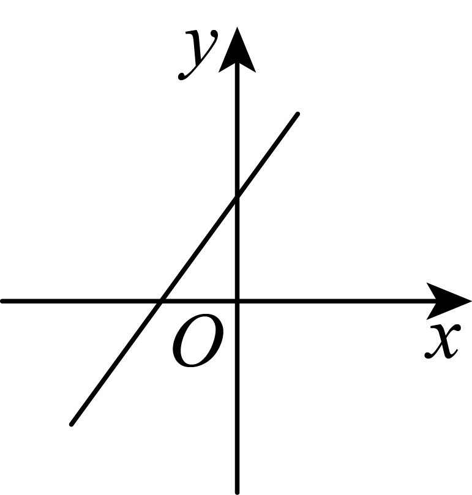

# Mathematics - 题目 556

**ID**: c270d5081c6142e98b985760de73afba
**年级**: Grade 9
**难度**: Easy
**题型**: Multiple-choice

## 题目
已知一次函数 $y=\frac {b}{a}x+c$ 的图象如图，则二次函数 $y=ax{^{2}}+bx+c$ 在平面直角坐标系中的图象可能是（      ）​​​​​​​‌

## 解答

1. 解：观察函数图象可知： $\frac {b}{a}>0,c>0$ ，
2. ∴二次函数 $y=ax{^{2}}+bx+c$ 的图象对称轴 $x=-\frac {b}{2a}<0$ ，与y轴的交点在y轴正半轴．
3. 故选C．

## 知识点

**中文**:
  - y=ax²+bx+c的图象与性质
  - 一次函数的图象和性质

**English**:
  - Graph and Properties of y=ax²+bx+c
  - Graphs and Properties of Linear Functions

---
