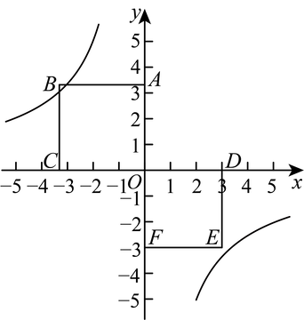

# Mathematics - 题目 1082

**ID**: c71f9220782348e086932e1967fc6779
**年级**: Grade 9
**难度**: Easy
**题型**: Multiple-choice

## 题目
反比例函数 $y=\frac {k}{x}\left ({k\ne 0}\right )$ 的图象如图所示，已知正方形 $ABCO$ 的面积为11，点 $E$ 的坐标为 $\left ({3,-3}\right )$ ，则 $k$ 的值可能是（      ）​​​​​​​‌

## 解答

1. 解：设 $B\left ({m,n}\right )$ ,则 $BC=n,OC=-m$ ，
2. ∵正方形 $ABCO$ 的面积为11，
3. ∴ $-mn=11$ ，即 $mn=-11$
4. ∵由图象可知，点 $B$ 在双曲线第二象限的一支的上方，
5. ∴ $k>-11$ ，
6. ∵点 $E$ 的坐标为 $\left ({3,-3}\right )$ ，且点 $E$ 在双曲线第四象限的一支的上方， $3\times \left ({-3}\right )=-9$
7. ∴ $k<-9$ ，
8. ∴ $-11<k<-9$ ，
9. 则 $k$ 的值可能是 $-10$ ，
10. 故选B．

## 知识点

**中文**:
  - 反比例函数系数k的几何意义及应用
  - 正方形的性质

**English**:
  - Geometric Meaning and Application of Coefficient k
  - Properties of Squares

---
