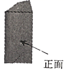

# Mathematics - 题目 2285

**ID**: cf6d0bdde24d415bb5de4330ef6f007e
**年级**: Grade 9
**难度**: Easy
**题型**: Multiple-choice

## 题目
如图所示的四棱柱的主视图为（      ）​​​​​​​‌

## 解答

1. 解：正面看易得四棱柱的两条棱位于四棱柱的主视图内, 且为虚线.
2. 故选B.

## 知识点

**中文**:
  - 判断几何体的三视图

**English**:
  - Determining Three Views

---
