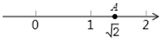

# Mathematics - 题目 1897

**ID**: d53a08ec0be94e75aee0ff7523efebd7
**年级**: Grade 9
**难度**: Easy
**题型**: Multiple-choice

## 题目
如图，数轴上表示 $\sqrt {2}$ 的数对应的点为 $A$ 点，若点 $B$ 为在数轴上到点 $A$ 的距离为1个单位长度的点，则点 $B$ 所表示的数是（      ）​​​​​​​‌

## 解答

1. $\sqrt {2}$ 距离为1的单位有:  $\sqrt {2}-1$ , $\sqrt {2}+1$ .
2. 故选D.

## 知识点

**中文**:

**English**:

---
