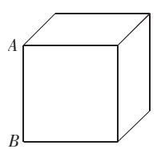

# Mathematics - 题目 3677

**ID**: d7428ae185e54c6fb112e025428cbc75
**年级**: Grade 9
**难度**: Easy
**题型**: Multiple-choice

## 题目
如图， $AB$ 是质地均匀正方体木块的一条棱，将正方体木块随机掷在水平桌面上，则棱 $AB$ 完全落在桌面上的概率是（      ）​​​​​​​‌

## 解答

1. 解：∵棱AB属于2个平面，正方体一共有6个平面，
2. ∴棱 $AB$ 完全落在桌面上的概率是 $\frac {2}{6}=\frac {1}{3}$ ，
3. 故选C

## 知识点

**中文**:
  - 简单的概率计算

**English**:
  - Simple Probability Calculations

---
