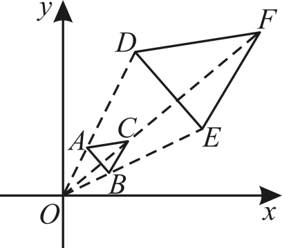

# Mathematics - 题目 420

**ID**: e8f83c30ba244142bce340b9b44b2de8
**年级**: Grade 9
**难度**: Easy
**题型**: Multiple-choice

## 题目
如图，在平面直角坐标系中， $\vartriangle ABC$ 与 $\vartriangle DEF$ 是以原点 $O$ 为位似中心的位似图形（点 $\mathrm{A}$ ， $B$ ， $C$ 的对应点分别为点 $D$ ， $E$ ， $F$ ），已知 $\vartriangle ABC$ 的顶点 $A\left ({2,4}\right )$ ，若 $OC:CF=1:2$ ，则点 $D$ 的坐标为（      ）​​​​​​​‌

## 解答

1. 解：∵ $\vartriangle ABC$ 与 $\vartriangle DEF$ 是以原点 $O$ 为位似中心的位似图形， $OC:CF=1:2$ ，
2. ∴ $OC:OF=1:3$ ，
3. ∴ $\vartriangle ABC$ 与 $\vartriangle DEF$ 的位似比为 $1:3$
4. ∵ $\vartriangle ABC$ 的顶点 $A\left ({2,4}\right )$ ，
5. ∴点 $D$ 的坐标为 $\left ({2\times 3,4\times 3}\right )$ 即 $\left ({6,12}\right )$ ．

## 知识点

**中文**:
  - 坐标系与位似图形

**English**:
  - Coordinates and Homothetic Figures

---
