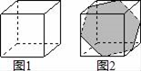

# Mathematics - 题目 1201

**ID**: ebdbe82146f44176b20e4ae45ba77c12
**年级**: Grade 9
**难度**: Easy
**题型**: Multiple-choice

## 题目
图1是一个正六面体，把它按图2中所示方法切割，可以得到一个正六边形的截面，则下列展开图中正确画出所有的切割线的是（      ）​​​​​​​‌

## 解答

1. 解：动手操作可知，画出所有的切割线的是图形C．
2. 故选C．

## 知识点

**中文**:
  - 几何体的展开图
  - 认识立体图形

**English**:
  - Nets of Geometric Solids
  - Recognizing Solid Figures

---
