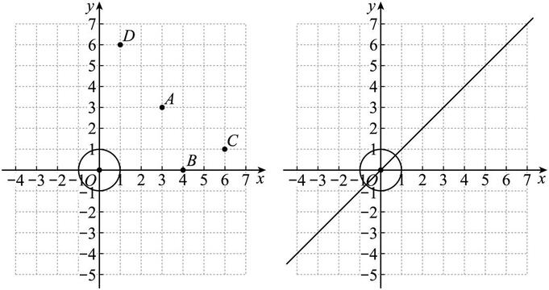

# Mathematics - 题目 1281

**ID**: 03aba35e6da44919b07e9903240ae1bf
**年级**: Grade 9
**难度**: Hard
**题型**: Calculation

## 题目
在平面直角坐标系 $xOy$ 中， $\odot O$ 的半径为 $1$ ，对于平面上的点 $N$ 和 $M$ 给出如下定义：若在 $\odot O$ 上能找到一点 $P$ ，使得 $NM=k\cdot NP$ （ $k$ 为常数），且 $\angle PNM=α\left ({0<α\leqslant 180{}\degree }\right )$ ，则称点 $M$ 是 $\odot O$ 关于点 $N$ 的 $\left ({k,α}\right )$ 关联点．(1)已知点 $A\left ({3,3}\right )$ ．$①$ 点 $B\left ({4,0}\right ),C\left ({6,1}\right ),D\left ({1,6}\right )$ 中，是 $\odot O$ 关于点 $A\left ({1,90{}\degree }\right )$ 关联点的是；​​​​​​​‌$②$ 若点 $E\left ({a,b}\right )$ 是 $\odot O$ 关于点 $\mathrm{A}$ 的 $\left ({2,90{}\degree }\right )$ 关联点，则 $b$ 的取值范围是；(2)点 $F\left ({x{{}_{1}},y{{}_{1}}}\right )$ 是直线 $y=x$ 上一点，点 $G$ 是 $\odot O$ 关于点 $F$ 的 $\left ({\sqrt {2},45{}\degree }\right )$ 关联点，若存在点 $G$ 在直线 $x=-2$ 上，求点 $F$ 横坐标 $x{{}_{1}}$ 的取值范围．

## 解答

1. （1）解：∵ $A\left ({3,3}\right )$ ， $B\left ({4,0}\right ),C\left ({6,1}\right ),D\left ({1,6}\right )$ ，
2. ∴ $AB{^{2}}={\left({3-4}\right)^{2}}+{\left({3-0}\right)^{2}}=10$ ， $AC{^{2}}={\left({3-6}\right)^{2}}+{\left({3-1}\right)^{2}}=13$ ， $AD{^{2}}={\left({3-1}\right)^{2}}+{\left({3-3}\right)^{2}}=13$ ，
3. 设 $\odot O$ 上的点 $P(x,y)$ ，则 $PA{^{2}}={\left({x-3}\right)^{2}}+{\left({y-3}\right)^{2}}$ ，
4. ∵点 $P(x,y)$ 是 $\odot O$ 上的点， $\odot O$ 的半径为1，
5. ∴ $x{^{2}}+y{^{2}}=1$ ，
6. $①$ 根据新定义知：当 $PA\bot AB$ 时，则 $AB=1\times PA$ ，
7. ∴ $AB{^{2}}=PA{^{2}}$ ，
8. 即 ${\left({x-3}\right)^{2}}+{\left({y-3}\right)^{2}}=10$ ，
9. ∴ $x{^{2}}-6x+9+y{^{2}}-6y+9=10$ ，
10. ∴ $x+y=\frac {3}{2}$ ，
11. ∴ $y=\frac {3}{2}-x$ ，
12. ∴ $x{^{2}}+{\left({\frac {3}{2}-x}\right)^{2}}=1$ ，
13. 化简整理，得 $8x{^{2}}-12x+5=0$ ，
14. ${\rm{Δ}}={\left({-12}\right)^{2}}-4\times 8\times 5=-16<0$ ，
15. ∴方程无解，
16. ∴点 $B$ 不是 $\odot O$ 关于点 $A\left ({1,90{}\degree }\right )$ 关联点；
17. 根据新定义知：当 $PA\bot AC$ 时，则 $AC=1\times PA$ ，
18. ∴ $AC{^{2}}=PA{^{2}}$ ，
19. 即 ${\left({x-3}\right)^{2}}+{\left({y-3}\right)^{2}}=13$ ，
20. ∴ $x{^{2}}-6x+9+y{^{2}}-6y+9=13$ ，
21. ∴ $x+y=1$ ，
22. ∴ $y=1-x$ ，
23. ∴ $x{^{2}}+{\left({1-x}\right)^{2}}=1$ ，
24. 化简整理，得 $x{^{2}}-x=0$ ，
25. 解得： $x{{}_{1}}=0$ ， $x{{}_{2}}=1$ ，
26. ∴ $P\left ({0,1}\right )$ 或 $P\left ({1,0}\right )$ ，
27. ∴点 $C$ 是 $\odot O$ 关于点 $A\left ({1,90{}\degree }\right )$ 关联点；
28. 同理点 $D$ 是 $\odot O$ 关于点 $A\left ({1,90{}\degree }\right )$ 关联点；
29. 故答案为： $\odot O$ 关于点 $A\left ({1,90{}\degree }\right )$ 关联点的是点 $C$ 、点 $D$ 点；
30. $②$ ∵点 $E\left ({a,b}\right )$ 是 $\odot O$ 关于点 $\mathrm{A}$ 的 $\left ({2,90{}\degree }\right )$ 关联点，即 $\angle PAE=90{}\degree $ ，且 $AE=2AP$ ，
31. ∴将 $O$ 绕点 $\mathrm{A}$ 顺时针旋转 $90{}\degree $ ，并延长使得 $AA{{}_{1}}=2OA$ ，同理将 $O$ 绕点 $\mathrm{A}$ 逆时针旋转 $90{}\degree $ ，并延长使得 $AA{{}_{2}}=2OA$ ，
32. 则 $\odot O$ 关于点 $\mathrm{A}$ 的 $\left ({2{\rm{,}}90{}\degree }\right )$ 关联点在以 $A{{}_{1}}$ 与 $A{{}_{2}}$ 为圆心，半径为 $2$ 的圆上，
33. 如图，
34. 
35. ∴ $7\leqslant b\leqslant 11$ 或 $-5\leqslant b\leqslant -1$ ；
36. （2）解：∵点 $F\left ({x{{}_{1}},y{{}_{1}}}\right )$ 是直线 $y=x$ 上一点，
37. ∴先任取一点 $F\left ({m,m}\right )$ ，
38. ∵点 $G$ 是 $\odot O$ 关于点 $F$ 的 $\left ({\sqrt {2}{\rm{,}}45{}\degree }\right )$ 关联点，
39. ∴ $\angle PFG=45{}\degree $ ，且 $FG=\sqrt {2}PF$ ，
40. ∴作等腰 ${\rm{R}}{\rm{t}}\vartriangle OF{{}_{1}}F$ 与等腰 ${\rm{R}}{\rm{t}}\vartriangle OF{{}_{2}}F$ ，
41. ∵点 $G$ 是 $\odot O$ 关于点 $F$ 的 $\left ({\sqrt {2}{\rm{,}}45{}\degree }\right )$ 关联点，
42. ∴点 $G$ 在以 $F{{}_{1}}\left ({-m{\rm{,}}m}\right )$ 为圆心，半径为 $\sqrt {2}$ 的 $\odot F{{}_{1}}$ 上，或以 $F{{}_{2}}\left ({m{\rm{,}}-m}\right )$ 为圆心，半径为 $\sqrt {2}$ 的 $\odot F{{}_{2}}$ 上，
43. 如图，
44. 
45. 若存在点 $G$ 在直线 $x=-2$ 上，则 $-m-\sqrt {2}\leqslant -2\leqslant -m+\sqrt {2}$ 或 $m-\sqrt {2}\leqslant -2\leqslant m+\sqrt {2}$ ，
46. 解得 $2-\sqrt {2}\leqslant m\leqslant 2+\sqrt {2}$ 或 $-2-\sqrt {2}\leqslant m\leqslant -2+\sqrt {2}$ ，
47. 即 $-2-\sqrt {2}\leqslant x\leqslant -2+\sqrt {2}$ 或 $2-\sqrt {2}\leqslant x\leqslant 2+\sqrt {2}$ ．

## 知识点

**中文**:
  - 一元二次方程根的判别式
  - 坐标与图形性质
  - 圆的综合问题

**English**:
  - Discriminant of Quadratic Equations
  - Coordinates and Geometric Properties
  - Comprehensive Circle Problems

---
