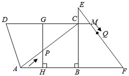

# Mathematics - 题目 1303

**ID**: 03cbf153f90b4e4490d934560ceaf70f
**年级**: Grade 9
**难度**: Hard
**题型**: Calculation

## 题目
已知：如图，在四边形ABCD和Rt△EBF中，AB∥CD，CD＞AB，点C在EB上，∠ABC＝∠EBF＝90°，AB＝BE＝8cm，BC＝BF＝6cm，延长DC交EF于点M．点P从点A出发，沿AC方向匀速运动，速度为2cm/s；​​​​​​​‌同时，点Q从点M出发，沿MF方向匀速运动，速度为1cm/s．过点P作GH⊥AB于点H，交CD于点G．设运动时间为t（s）（0＜t＜5）．解答下列问题：（1）当t为何值时，点M在线段CQ的垂直平分线上？（2）连接PQ，作QN⊥AF于点N，当四边形PQNH为矩形时，求t的值；（3）连接QC，QH，设四边形QCGH的面积为S（cm^{2}），求S与t的函数关系式；（4）点P在运动过程中，是否存在某一时刻t，使点P在∠AFE的平分线上？若存在，求出t的值；若不存在，请说明理由．

## 解答

1. 解：（1）∵AB∥CD，
2. ∴ $\frac {CM}{BF}=\frac {CE}{BE}$ ，
3. ∴ $\frac {8-6}{8}=\frac {CM}{6}$ ，
4. ∴CM=$\frac {3}{2}$ ，
5. ∵点M在线段CQ的垂直平分线上，
6. ∴CM＝MQ，
7. ∴1×t=$\frac {3}{2}$ ，
8. ∴t=$\frac {3}{2}$ ；
9. （2）如图1，过点Q作QN⊥AF于点N，
10. 
11. ∵∠ABC＝∠EBF＝90°，AB＝BE＝8cm，BC＝BF＝6cm，
12. ∴AC$=\sqrt {AB{^{2}}+BC{^{2}}}=\sqrt {64+36}=$ 10cm，EF$=\sqrt {BF{^{2}}+BE{^{2}}}=\sqrt {64+36}=$ 10cm，
13. ∵CE＝2cm，CM=$\frac {3}{2}$ cm，
14. ∴EM$=\sqrt {EC{^{2}}+CM{^{2}}}=\sqrt {4+\frac {9}{4}}=\frac {5}{2}$ ，
15. ∵sin∠PAH＝sin∠CAB，
16. ∴ $\frac {BC}{AC}=\frac {PH}{AP}$ ，
17. ∴ $\frac {6}{10}=\frac {PH}{2t}$ ，
18. ∴PH=$\frac {6}{5}$t，
19. 同理可求QN＝6 $-\frac {4}{5}$t，
20. ∵四边形PQNH是矩形，
21. ∴PH＝NQ，
22. ∴6 $-\frac {4}{5}$t$=\frac {6}{5}$t，
23. ∴t＝3；
24. ∴当t＝3时，四边形PQNH为矩形；
25. （3）如图2，过点Q作QN⊥AF于点N，
26. 
27. 由（2）可知QN＝6 $-\frac {4}{5}$t，
28. ∵cos∠PAH＝cos∠CAB，
29. ∴ $\frac {AH}{AP}=\frac {AB}{AC}$ ，
30. ∴ $\frac {AH}{2t}=\frac {8}{10}$ ，
31. ∴AH$=\frac {8}{5}$t，
32. ∵四边形QCGH的面积为S＝S_{梯形}GMFH﹣S_{△}CMQ﹣S_{△}HFQ，
33. ∴S=$\frac {1}{2}\times $ 6×（8 $-\frac {8}{5}$t+6+8 $-\frac {8}{5}$t$+\frac {3}{2}$ ） $-\frac {1}{2}\times \frac {3}{2}\times $ [6﹣（6 $-\frac {4}{5}$t）] $-\frac {1}{2}\times $ （6 $-\frac {4}{5}$t）（8 $-\frac {8}{5}$t+6）= $-\frac {16}{25}t{^{2}}+\frac {1}{5}t+\frac {57}{2}$ ；
34. （4）存在，
35. 理由如下：如图3，连接PF，延长AC交EF于K，
36. 
37. ∵AB＝BE＝8cm，BC＝BF＝6cm，AC＝EF＝10cm，
38. ∴△ABC≌△EBF（SSS），
39. ∴∠E＝∠CAB，
40. 又∵∠ACB＝∠ECK，
41. ∴∠ABC＝∠EKC＝90°，
42. ∵S_{△}CEM$=\frac {1}{2}\times $EC×CM$=\frac {1}{2}\times $EM×CK，
43. ∴CK$=\frac {2\times \frac {3}{2}}{\frac {5}{2}}=\frac {6}{5}$ ，
44. ∵PF平分∠AFE，PH⊥AF，PK⊥EF，
45. ∴PH＝PK，
46. ∴ $\frac {6}{5}$t＝10﹣2t$+\frac {6}{5}$ ，
47. ∴t$=\frac {7}{2}$ ，
48. ∴当t$=\frac {7}{2}$ 时，使点P在∠AFE的平分线上．

## 知识点

**中文**:
  - 全等三角形的判定与性质
  - 相似三角形的判定与性质综合
  - 解直角三角形
  - 线段垂直平分线的性质

**English**:
  - Determination and Properties
  - Determination and Properties
  - Solving Right Triangles
  - Properties of Perpendicular Bisectors

---
