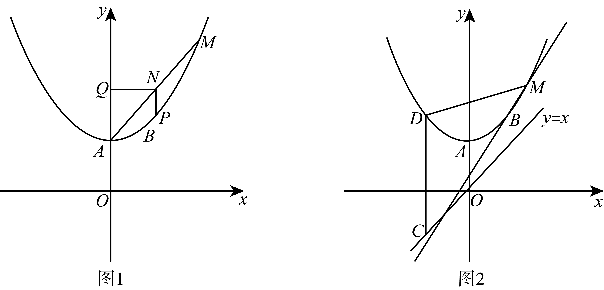

# Mathematics - 题目 3080

**ID**: 050cbfca603146ee871ec8d5bd7b8c51
**年级**: Grade 9
**难度**: Hard
**题型**: Calculation

## 题目
如图，二次函数 $y=ax{^{2}}+c$ 的图像的顶点为 $A\left ({0,3}\right )$ ，点 $B\left ({2,4}\right )$ 在二次函数的图像上， $M$ 为二次函数图像上的一动点．(1)求二次函数的表达式．(2)如图1，当点 $M$ 的横坐标为 $8$ 时，连接 $AM$ ， $N$ 为线段 $AM$ 上的一动点，过点 $N$ 作 $NP{\rm{/\mskip-4mu/}}y$ 轴，交抛物线于点 $P$ ，作 $NQ\bot y$ 轴，交 $y$ 轴于点 $Q$ ，求 $NP+NQ$ 的最大值．(3)如图2，连接 $MB$ 并延长，交一次函数 $y=x$ 的图像于点 $C$ ，过点 $C$ 作 $CD{\rm{/\mskip-4mu/}}y$ 轴，交二次函数的图像于点 $D$ ，连接 $MD$ ．小林发现，在点 $M$ 运动的过程中，直线 $MD$ 始终经过某个定点，请直接写出该定点的坐标，不必说明理由．​​​​​​​‌

## 解答

1. （1）解：把点 $A\left ({0,3}\right )$ 和点 $B\left ({2,4}\right )$ 代入 $y=ax{^{2}}+c$ ，
2. 得 $\begin{cases}c=3\\4a+c=2\end{cases}$ ，
3. 解得 $\begin{cases}a=\frac {1}{4}\\c=3\end{cases}$ ，
4. $\therefore $ 二次函数的表达式为 $y=\frac {1}{4}x{^{2}}+3$ ；
5. ${\rm （2）}\because M$ 为二次函数图象上的点，且点 $M$ 的横坐标为 $8$ ，
6. $\therefore y=-\frac {1}{4}\times 8{^{2}}+3=19$ ，即点 $M\left ({8,19}\right )$ ．
7. 设直线 $AM$ 的表达式为 $y=kx+b$ ，
8. 将点 $A\left ({0,3}\right )$ ， $M\left ({8,19}\right )$ 代入，
9. 得 $\begin{cases}b=3\\8k+b=19\end{cases}$ ，
10. 解得 $\left \{\hspace{-0.5em}\begin{array}{l}{\hspace{-0.5em}\begin{array}{l}k=2\\b=3\end{array}\hspace{-0.5em}}\end{array}\hspace{-0.5em}\right.$ ，
11. $\therefore $ 直线 $AM$ 的表达式为 $y=2x+3$ ，
12. 设点 $N$ 的坐标为 $\left ({n,2n+3}\right )$ ，则点 $P\left ({n,\frac {1}{4}n{^{2}}+3}\right )$ ， $NQ=n$ ，
13. $\therefore NP+NQ=2n+3-\left ({\frac {1}{4}n{^{2}}+3}\right )+n=-\frac {1}{4}n{^{2}}+3n=-\frac {1}{4}{\left({n-6}\right)^{2}}+9$ ，
14. $\because -\frac {1}{4}<0$ ， $0\leqslant n\leqslant 8$ ，
15. $\therefore $ 当 $n=6$ 时， $NP+NQ$ 取得最大值，最大值为 $9$ ；
16. （3）定点 $\left ({2,6}\right )$ ．
17. 理由：设点 $M$ 的坐标为 $\left ({m{\rm{,}}\frac {1}{4}m{^{2}}+3}\right )$ ，直线 $MB$ 的表达式为 $y=k^{′}x+b^{′}$ ，
18. 将点 $B\left ({2，4}\right )$ ， $M$  $\left ({m{\rm{,}}\frac {1}{4}m{^{2}}+3}\right )$ 代入 $y=k^{′}x+b^{′}$ 得 $\begin{cases}k^{′}m+b^{′}=\frac {1}{4}m{^{2}}+3\\2k^{′}+b^{′}=4\end{cases}$ ，
19. 解得 $\begin{cases}k^{′}=\frac {1}{4}\left ({m+2}\right )\\b^{′}=3-\frac {1}{2}m\end{cases}$ ，
20. $\therefore $ 直线 $MB$ 的表达式为 $y=\frac {1}{4}\left ({m+2}\right )x+3-\frac {1}{2}m$ ，
21. 令 $y=x$ ，解得 $x=\frac {2\left ({m-6}\right )}{m-2}$ ，
22. 将 $x=\frac {2\left ({m-6}\right )}{m-2}$ 代入 $y=\frac {1}{4}x{^{2}}+3$ ，得 $y=\frac {{\left({m-6}\right)^{2}}}{{\left({m-2}\right)^{2}}}+3$ ，
23. $\therefore $ 点 $D\left ({\frac {2\left ({m-6}\right )}{m-2}{\rm{,}}\frac {{\left({m-6}\right)^{2}}}{{\left({m-2}\right)^{2}}}+3}\right )$ ，
24. 设直线 $MD$ 的表达式为 $y=k^{′′}x+b^{′′}$ ，
25. 将点 $M\left ({m,\frac {1}{4}m{^{2}}+3}\right )$ ，点 $D\left ({\frac {2\left ({m-6}\right )}{m-2}{\rm{,}}\frac {{\left({m-6}\right)^{2}}}{{\left({m-2}\right)^{2}}}+3}\right )$ 代入，
26. 得 $\begin{cases}mk^{′′}+b^{′′}=\frac {1}{4}m{^{2}}+3\\\frac {2\left ({m-6}\right )}{m-2}k^{′′}+b^{′′}=\frac {{\left({m-6}\right)^{2}}}{{\left({m-2}\right)^{2}}}+3\end{cases}$ ，
27. 解得 $\begin{cases}k^{′′}=\frac {m{^{2}}-12}{4\left ({m-2}\right )}\\b^{′′}=-\frac {m{^{2}}-12m+12}{2\left ({m-2}\right )}\end{cases}$ ，
28. $\therefore $ 直线 $MD$ 的表达式为 $y=\frac {m{^{2}}-12}{4\left ({m-2}\right )}x-\frac {m{^{2}}-12m+12}{2\left ({m-2}\right )}=\frac {\left ({x-2}\right )m{^{2}}+24m-24-12x}{4\left ({m-2}\right )}{\rm \mathit{，}}$
29. $\therefore $ 当 $x=2$ 时， $y=\frac {24m-24-24}{4\left ({m-2}\right )}=\frac {24m-48}{4\left ({m-2}\right )}=6$ ，
30. 即直线 $MD$ 恒过定点 $\left ({2,6}\right )$ ．

## 知识点

**中文**:
  - y=ax²+bx+c的图象与性质
  - 二次函数的综合
  - 待定系数法求二次函数解析式
  - 待定系数法求一次函数解析式

**English**:
  - Graph and Properties of y=ax²+bx+c
  - Comprehensive Quadratic Function Problems
  - Finding Quadratic Expressions by Undetermined Coefficients
  - Finding Expressions by Undetermined Coefficients

---
