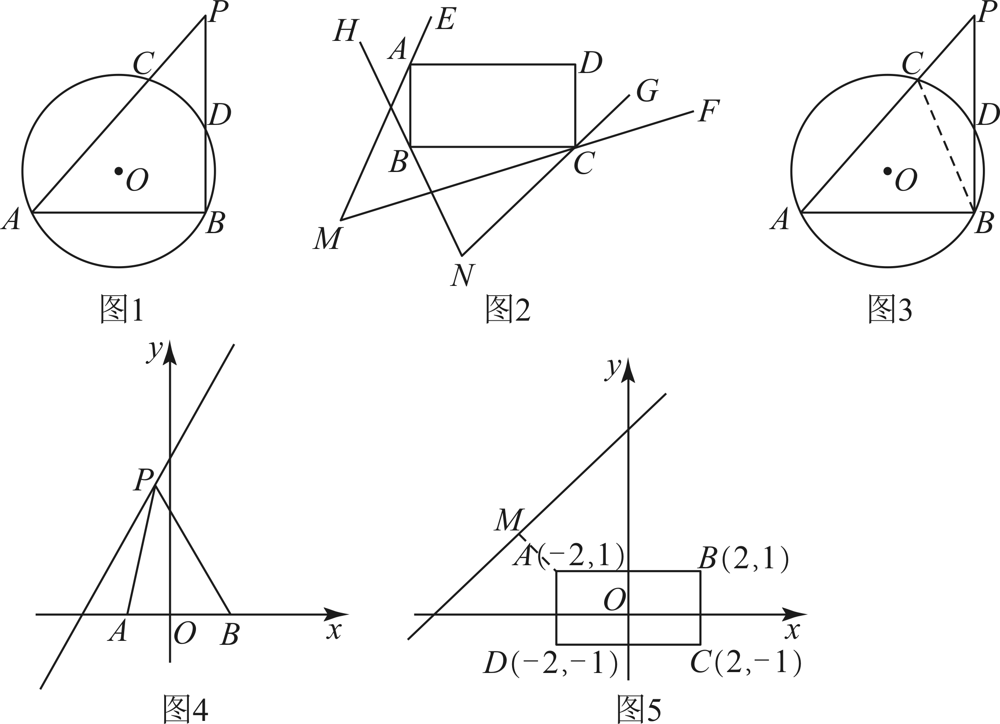

# Mathematics - 题目 3318

**ID**: 0ac751084d0c4aa888d02ac15a1c48a1
**年级**: Grade 9
**难度**: Hard
**题型**: Calculation

## 题目
【定义1】如图1所示，像 $∠APB$ 这样顶点在圆外，两边和圆相交的角叫圆外角；​​​​​​​‌【定义2】站在某一位置观察测物体时，视线范围所成的角度称为视角，如图2，在M和N点对矩形 $ABCD$ 观测，会有不同的视角．(1)【判断】如图3，连接 $BC$ ， $∠APB$$∠ACB$ ．（ $>$ ， $<$ ， $=$ ）(2)【问题解决】如图4，在平面直角坐标系中， $A\left ({-\sqrt {3}，0}\right )$ ， $B\left ({\sqrt {3}，0}\right )$ ，直线 $l:y=\sqrt {3}x+5$ ，P为直线l上一点，连接 $PA,PB$ ，求 $∠APB$ 的最大值．(3)【拓展应用】学校计划组织学生春游，一条北偏东 $45{}^\circ $ 走向的路上经过紫色大厦时，小明发现在观察紫色大厦时的最大视角为 $45{}^\circ $ ，小明认为，可以通过将公路和建筑物放在如图所示的平面直角坐标系中，可以计算出此时公路距离紫色大厦的最近距离 $AM$ 的长度．请你协助小明完成计算，直接写出答案．

## 解答

1. （1）解：∵ $∠ACB=∠APB+∠CBP$ ，
2. ∴ $\mathrm{∠}APB<\mathrm{∠}ACB$ ．
3. （2）解：当以 $AB$ 为弦的圆，与直线l相切时．P即为切点时， $∠APB$ 最大．
4. 因为此时只有点P在圆上，直线上的其它点都在圆外．如图所示：
5. 
6. 令直线l与x轴，y轴的交点记为E，F，
7. 因为直线 $l:y=\sqrt {3}x+5$ ，
8. 则 $E(\frac {5\sqrt {3}}{3},0),F(0,5)$ ，与x轴夹角是 $60{}^\circ $ ，
9. 将这个圆记为 $\odot M$ ，令 $M\left ({\hspace{-0.5em}\begin{array}{}0&,m\end{array}\hspace{-0.5em}}\right )$ ，
10. 则 $MP=MA$ ，即 $MP{^{2}}=MA{^{2}}$ ．
11. 又 $MP=\frac {1}{2}FM=\frac {5-m}{2}$ ， $MA{^{2}}=m{^{2}}+(-\sqrt {3}){^{2}}$ ．
12. 所以 $\left ({\frac {5-m}{2}}\right ){^{2}}=m{^{2}}+3$ ，
13. 解得 $m{{}_{1}}=1$ ， $m{{}_{2}}=-\frac {13}{3}$ （舍去）．
14. 所以 $M(0,1)$ ．
15. 在 ${\rm{R}}{\rm{t}}\mathrm{△}AMO$ 中， $AO=\sqrt {3}MO$ ，所以 $\angle AMO=60{}^\circ $ ，则 $\angle AMB=120{}^\circ $ ．
16. 所以 $∠APB=\frac {1}{2}∠AMB=60{}^\circ $ ．
17. 即 $∠APB$ 的最大值为 $60{}^\circ $ ．
18. （3）解：令公路与x轴，y轴的交点记为E，F； $AB$ 与y轴交点为Q．如图所示：
19. 
20. 当以 $AB$ 为弦的圆P与直线 $EF$ 相切时，切点（H）处观察紫色大厦的视角最大．
21. 令 $P(0,a)$ ，则 $PH=PA$ ．
22. 又 $\angle AHB=45{}^\circ $ ，所以 $\angle APB=90{}^\circ $ ．
23. 则 $\angle APO=45{}^\circ $ ，
24. 所以 $△APQ$ 为等腰直角三角形．
25. 所以 $PQ=AQ=2,PA=2\sqrt {2}$ ，
26. 则 $PH=PA=2\sqrt {2}$ ．
27. 又 $\vartriangle PHF$ 为等腰直角三角形，
28. 所以 $FP=\sqrt {2}HP=4$ ．
29. 故 $FO=4+2+1=7$ ．
30. 所以 $E(-7,0)$ ．
31. 过点 $G(-1,0)$ 作 $EF$ 垂线，则垂线经过点A，且垂线段 $GM$ 的长为 $3\sqrt {2}$ ，
32. 所以最近距离 $AM$ 的长为： $3\sqrt {2}-\sqrt {2}=2\sqrt {2}$ ．
33. 【点睛】本题为一次函数应用的综合题，同时考查了圆的相关知识及解一元二次方程．

## 知识点

**中文**:
  - 一次函数的图象和性质
  - 切线的性质和判定的综合应用
  - 圆的综合问题

**English**:
  - Graphs and Properties of Linear Functions
  - Tangent Applications
  - Comprehensive Circle Problems

---
