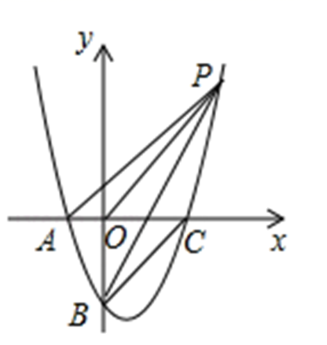

# Mathematics - 题目 1937

**ID**: 0dac3c8756a14ec98859596fd7212d66
**年级**: Grade 9
**难度**: Hard
**题型**: Calculation

## 题目
已知抛物线y= $\frac {1}{2}$ x^{2}+bx+c经过点A(﹣2，0)、B(0、﹣4)与x轴交于另一点C，连接BC．（1）求抛物线的解析式．（2）如图，P是第一象限内抛物线上一点，且 $S{{}_{△PBO}}=S{{}_{△PBC}}$ ，求P点坐标．（3）在抛物线上是否存在点D，直线BD交x轴于点E，使 $\vartriangle $ ABE与以A，B，C，E中的三点为顶点的三角形相似（不重合）？若存在，请求出点D的坐标；​​​​​​​‌若不存在，请说明理由．

## 解答

1. （1）把点A（-2，0），B（0、-4）代入抛物线 $y=\frac {1}{2}x{^{2}}+bx+c$ 得：
2. $\begin{cases}2-2b+c=0\\c=-4\end{cases}$ ，
3. 解得： $\begin{cases}b=-1\\c=-4\end{cases}$ ，
4. ∴抛物线的解析式为 $y=\frac {1}{2}x{^{2}}-x-4$ ；
5. （2）当 $y=0$ 时， $\frac {1}{2}x{^{2}}-x-4=0$ ，
6. 解得： $x=-2$ 或4，
7. ∴点C的坐标为（4，0），
8. 如图1，过O作OG⊥BP于G，过C作CF⊥BP于F，PB交 $x$ 轴于点E，
9. 
10. ∵S_{△PBO}=S_{△PBC}，
11. ∴ $\frac {1}{2}$ BP•OG= $\frac {1}{2}$ BP•CF，
12. ∴OG=CF，
13. ∵∠OEG=∠CEF，∠OGE∠CFE，
14. ∴△OEG≌△CEF（AAS），
15. ∴OE=CE，
16. 点E的坐标为（2，0），
17. 设直线PB的解析式为 $y=kx-4$ ，
18. 把点E（2，0）代入得， $2k-4=0$
19. 解得： $k=2$ ，
20. ∴直线PB的解析式为 $y=2x-4$ ，
21. 解方程组 $\begin{cases}y=2x-4\\y=\frac {1}{2}x{^{2}}-x-4\end{cases}$ 得： $\begin{cases}x{{}_{1}}=0\\y{{}_{1}}=-4\end{cases}$ (舍去)或 $\begin{cases}x{{}_{2}}=6\\y{{}_{2}}=8\end{cases}$ ，
22. ∴点P的坐标为（6，8）；
23. （3）以A，B，C，E中的三点为顶点的三角形有△ABC、△ABE、△ACE、△BCE，四种，其中△ABE重合，不符合条件，△ACE不能构成三角形，
24. ∴当△ABE与以A，B，C，E中的三点为顶点的三角形相似，存在两个三角形：△ABC和△BCE，
25. ①当△ABE与以A，B，C中的三点为顶点的三角形相似，如图2，
26. （3）以A，B，C，E中的三点为顶点的三角形有△ABC、△ABE、△ACE、△BCE，四种，其中△ABE重合，不符合条件，△ACE不能构成三角形，
27. ∴当△ABE与以A，B，C，E中的三点为顶点的三角形相似，存在两个三角形：△ABC和△BCE，
28. ①当△ABE与以A，B，C中的三点为顶点的三角形相似，如图2，
29. 
30. 由（1）得：点A（-2，0），B（0，-4），C（4，0），
31. ∴OB=OC=4，
32. $AB=\sqrt {OA{^{2}}+OB{^{2}}}=\sqrt {2{^{2}}+4{^{2}}}=2\sqrt {5}$ ，
33. $BC=\sqrt {OC{^{2}}+OB{^{2}}}=\sqrt {4{^{2}}+4{^{2}}}=4\sqrt {2}$ ，
34. ∴∠OBC=∠OCB=45°，
35. ∵∠BAE=∠BAC，∠ABE≠∠ABC，
36. ∴∠ABE=∠ACB=45°，
37. ∴△ABE∽△ACB，
38. ∴ $\frac {AB}{AC}=\frac {AE}{AB}$ ，
39. ∴ $\frac {2\sqrt {5}}{6}=\frac {AE}{2\sqrt {5}}$ ，
40. 解得： $AE=\frac {10}{3}$ ， $OE=AE-AO=\frac {10}{3}-2=\frac {4}{3}$ ，
41. 点 $E$ 的坐标为（ $\frac {4}{3}$ ，0）；
42. 设直线BE的解析式为 $y=k{{}_{1}}x-4$ ，
43. 把点E（ $\frac {4}{3}$ ，0）代入得， $k{{}_{1}}=3$ ，
44. ∴直线BE的解析式为 $y=3x-4$ ，
45. 解方程组 $\begin{cases}y=3x-4\\y=\frac {1}{2}x{^{2}}-x-4\end{cases}$ 得： $\begin{cases}x{{}_{1}}=0\\y{{}_{1}}=-4\end{cases}$ (舍去)或 $\begin{cases}x{{}_{2}}=8\\y{{}_{2}}=20\end{cases}$ ，
46. ∴点D的坐标为（8，20）；
47. ②当△ABE与以B，C、E中的三点为顶点的三角形相似，如图3，此时E在C的左边，
48. 
49. ∵∠BEA=∠BEC，
50. ∴当∠ABE=∠BCE时，△ABE∽△BCE，
51. ∴ $\frac {AB}{BC}=\frac {BE}{CE}=\frac {2\sqrt {5}}{4\sqrt {2}}$ ，
52. 设 $BE=2\sqrt {5}n$ ， $CE=4\sqrt {2}n$ ，
53. Rt△BOE中，由勾股定理得： $BE{^{2}}=OE{^{2}}+OB{^{2}}$ ，
54. ∴ ${\left({2\sqrt {5}n}\right)^{2}}={\left({4\sqrt {2}n-4}\right)^{2}}+4{^{2}}$ ，
55. 即 $3n{^{2}}-8\sqrt {2}n+8=0$ ，即 $\left ({n-2\sqrt {2}}\right )\left ({3n-2\sqrt {2}}\right )=0$ ，
56. ∴ $n{{}_{1}}=2\sqrt {2}$ ， $n{{}_{2}}=\frac {2\sqrt {2}}{3}$ ，
57. ∴ $OE=4\sqrt {2}n-4=12$ 或 $\frac {4}{3}$ ，
58. ∵ $OE=\frac {4}{3}<2$ ，∠AEB或∠BEC是钝角，如图4，此时△ABE与以B，C、E中的三点为顶点的三角形不相似，
59. 
60. ∴E（-12，0）；
61. 同理得BE的解析式为： $y=-\frac {1}{3}x-4$ ，
62. 解方程组 $\begin{cases}y=-\frac {1}{3}x-4\\y=\frac {1}{2}x{^{2}}-x-4\end{cases}$ 得： $\begin{cases}x{{}_{1}}=0\\y{{}_{1}}=-4\end{cases}$ (舍去)或 $\begin{cases}x{{}_{2}}=\frac {4}{3}\\y{{}_{2}}=-\frac {40}{9}\end{cases}$ ，
63. ∴点D的坐标为（ $\frac {4}{3}$ ， $-\frac {40}{9}$ ）；
64. 同理可得E在C的右边时，△ABE∽△BCE，
65. ∴ $\frac {AB}{BC}=\frac {AE}{BE}=\frac {2\sqrt {5}}{4\sqrt {2}}$ ，
66. 设 $AE=2\sqrt {5}a$ ， $BE=4\sqrt {2}a$ ，
67. Rt△BOE中，由勾股定理得： $BE{^{2}}=OE{^{2}}+OB{^{2}}$ ，
68. ∴ ${\left({4\sqrt {2}a}\right)^{2}}={\left({2\sqrt {5}a-2}\right)^{2}}+4{^{2}}$ ，
69. 即 $3a{^{2}}+2\sqrt {5}a-5=0$ ，即 $\left ({a+\sqrt {5}}\right )\left ({3a-\sqrt {5}}\right )=0$ ，
70. ∴ $a{{}_{1}}=-\sqrt {5}$ ， $a{{}_{2}}=\frac {\sqrt {5}}{3}$ ，
71. ∴ $OE=-12$ (舍去)或 $\frac {4}{3}$ ，
72. ∵ $OE=\frac {4}{3}<4$ ，∠BEC是钝角，此时△ABE与以B，C、E中的三点为顶点的三角形不相似，
73. 综上，点D的坐标为（8，20）或（ $\frac {4}{3}$ ， $-\frac {40}{9}$ ）．

## 知识点

**中文**:
  - 二次函数的综合
  - 因式分解法解一元二次方程
  - 勾股定理的应用
  - 相似三角形的判定与性质综合

**English**:
  - Comprehensive Quadratic Function Problems
  - Solving by Factorization
  - Applications of Pythagorean Theorem
  - Determination and Properties

---
