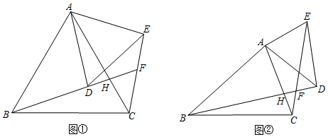
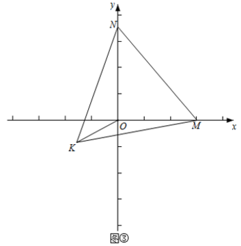

# Mathematics - 题目 1071

**ID**: 137a29899973413487820730d4b34583
**年级**: Grade 9
**难度**: Hard
**题型**: Calculation

## 题目
发现规律：（1）如图①， $\vartriangle ABC$ 与 $\vartriangle ADE$ 都是等边三角形，直线 $BD,CE$ 交于点 $F$ ．直线 $BD$ ， $AC$ 交于点 $H$ ．求 $\angle BFC$ 的度数（2）已知： $\vartriangle ABC$ 与 $\vartriangle ADE$ 的位置如图②所示，直线 $BD,CE$ 交于点 $F$ ．直线 $BD$ ， $AC$ 交于点 $H$ ．若 $\angle ABC=\angle ADE=α$ ， $\angle ACB=\angle AED=β$ ，求 $\angle BFC$ 的度数应用结论：（3）如图③，在平面直角坐标系中，点 $O$ 的坐标为 $(0,0)$ ，点 $M$ 的坐标为 $(3,0)$ ， $N$ 为 $y$ 轴上一动点，连接 $MN$ ．将线段 $MN$ 绕点 $M$ 逆时针旋转 $60{^{\circ }}$ 得到线段 $MK$ ，连接 $NK$ ， $OK$ ，求线段 $OK$ 长度的最小值​​​​​​​‌

## 解答

1. （1）∵ $\vartriangle ABC$ 与 $\vartriangle ADE$ 是等边三角形
2. ∴AB=AC，AD=AE， $\angle BAC=\angle DAE=\angle ABC=\angle ACB=60{}^\circ $
3. ∴ $\angle BAD=\angle CAE$
4. ∴ $\vartriangle BAD\cong \vartriangle CAE(SAS)$
5. ∴ $\angle ABD=\angle ACE$
6. ∵ $\angle ABD+\angle DBC=\angle ABC=60{}^\circ $
7. ∴ $\angle ACE+\angle DBC=60{}^\circ $
8. ∴ $\angle BFC=180{}^\circ -\angle DBC-\angle ACE-\angle ACB=60{}^\circ $ ；
9. （2）∵ $\angle ABC=\angle ADE=α$ ， $\angle ACB=\angle AED=β$
10. ∴ $\vartriangle ABC\sim \vartriangle ADE$
11. ∴ $\angle BAC=\angle DAE$ ， $\frac {AB}{AD}=\frac {AC}{AE}$
12. ∴ $\angle BAD=\angle CAE$ ， $\frac {AB}{AC}=\frac {AD}{AE}$
13. ∴ $\vartriangle ABD\sim \vartriangle ACE$
14. ∴ $\angle ABD=\angle ACE$
15. ∵ $\angle BHC=\angle ABD+\angle BAC=\angle BFC+\angle ACE$
16. ∴ $\angle BFC=\angle BAC$
17. ∵ $\angle BAC+\angle ABC+\angle ACB=180{}^\circ $
18. ∴ $\angle BFC+α+β=180{}^\circ $
19. ∴ $\angle BFC=180{}^\circ -α-β$ ；
20. （3）∵将线段MN绕点M逆时针旋转 $60{}^\circ $ 得到线段MK
21. ∴ $MN=MK$ ， $\angle NMK=60{}^\circ $
22. ∴ $\mathrm{△}MNK$ 是等边三角形
23. ∴ $MK=MN=NK$ ， $\angle NMK=\angle NKM=\angle KNM=60{}^\circ $
24. 如下图，将 $\vartriangle MOK$ 绕点M顺时针旋转 $60{}^\circ $ ，得到 $\mathrm{△}MQN$ ，连接OQ
25. 
26. ∴ $\vartriangle MOK\cong \vartriangle MQN$ ， $\angle OMQ=60{}^\circ $
27. ∴OK=NQ，MO=MQ
28. ∴ $△MOQ$ 是等边三角形
29. ∴ $\angle QOM=60{}^\circ $
30. ∴ $\angle NOQ=30{}^\circ $
31. ∵OK=NQ
32. ∴当NQ为最小值时，OK有最小值，由垂线段最短可得当 $QN\bot y$ 轴时，NQ有最小值
33. ∵点 $M$ 的坐标为 $(3,0)$
34. ∴ $OM=OQ=3$
35. ∵ $QN\bot y$ 轴， $\angle NOQ=30{}^\circ $
36. ∴ $NQ=\frac {1}{2}OQ=\frac {3}{2}$
37. ∴线段OK长度的最小值为 $\frac {3}{2}$ ．

## 知识点

**中文**:
  - 三角形内角和定理
  - 等边三角形的判定与性质
  - 旋转的性质
  - 相似三角形的判定与性质综合
  - 全等三角形的判定与性质

**English**:
  - Angle Sum Theorem
  - Determination and Properties
  - Properties of Rotation
  - Determination and Properties
  - Determination and Properties

---
