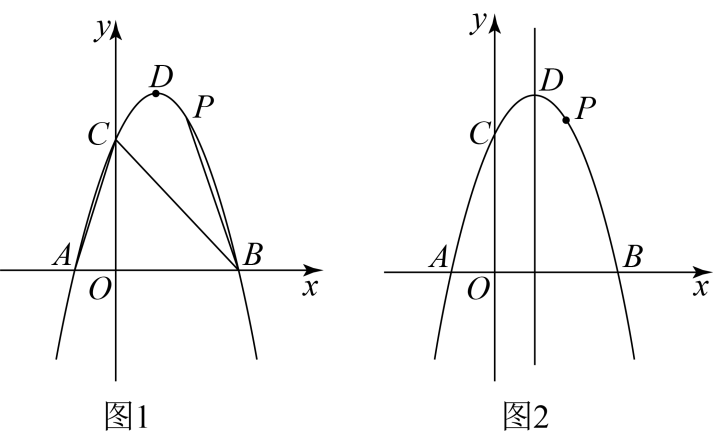

# Mathematics - 题目 417

**ID**: 1eb8af7ed58144768ea53e25a32185ed
**年级**: Grade 9
**难度**: Hard
**题型**: Calculation

## 题目
在平面直角坐标系中，抛物线 $y=-x{^{2}}+2x+3$  与x轴交于点A、B（A在B左侧），与y轴交于点C，顶点为D，对称轴为直线l，点P是抛物线上位于点B、C之间的动点．(1)求 $∠ABC$ 的度数；​​​​​​​‌(2)若 $\angle PBC=\angle ACO$ ，求点P的坐标；(3)已知点 $P\left ({p,n}\right )$ ，若点 $Q\left ({q,n}\right )$ 在抛物线上，且 $p>q$ ；①仅用无刻度的直尺在图2中画出点Q；②若 $PQ=2t$ ，求 $p{^{2}}+tq-3t+2023$ 的值．

## 解答

1. （1）解：当 $x=0$ 时， $y=-x{^{2}}+2x+3=3$ ，
2. ∴点C的坐标是 $\left ({0,3}\right )$ ，
3. ∴ $OC=3$ ，
4. 当 $y=0$ 时， $-x{^{2}}+2x+3=0$ ，解得 $x{{}_{{^{1}}}}=3,x{{}_{{^{2}}}}=-1$ ，
5. ∴点A的坐标是 $\left ({-1,0}\right )$ ，点B的坐标是 $\left ({3,0}\right )$ ，
6. ∴ $OB=3$ ,
7. ∴ $OB=OC$ ,
8. ∵ $\angle BOC=90{}^\circ $ ，
9. ∴ $\vartriangle BOC$ 是等腰直角三角形，
10. ∴ $\angle OBC=\angle OCB=45{}^\circ $ ，
11. ∴ $\angle ABC{\rm{=}}{\rm{4}}{\rm{5}}{}^\circ $ ；
12. （2）延长 $BP$ 与y轴相交于点M，作 $BN\bot AC$ 于点N，
13. 
14. ∵ $AB=AO+OB=4$ ，
15. ∴ $S{{}_{{^{\vartriangle ABC}}}}=\frac {1}{2}AB\cdot OC=\frac {1}{2}\times 4\times 3=6$ ，
16. ∵ $AC=\sqrt {OA{^{2}}+OC{^{2}}}=\sqrt {1{^{2}}+3{^{2}}}=\sqrt {10}$ ，
17. ∴ $S{{}_{{^{\vartriangle ABC}}}}=\frac {1}{2}AC\cdot BN=\frac {1}{2}\times \sqrt {10}\times BN=6$ ，
18. ∴ $BN=\frac {6\sqrt {10}}{5}$ ， $AN=\sqrt {AB{^{2}}-BN{^{2}}}=\sqrt {4{^{2}}-{\left({\frac {6\sqrt {10}}{5}}\right)^{2}}}=\frac {2\sqrt {10}}{5}$ ，
19. ∴ $NC=AC-AN=\sqrt {10}-\frac {2\sqrt {10}}{5}=\frac {3\sqrt {10}}{5}$ ，
20. ∴ ${\tan}\angle BCN=\frac {BN}{NC}=2$ ，
21. ∵ $\angle BCN=\angle OCB+\angle ACO=45{}^\circ +\angle ACO$ ， $\angle OBM=\angle OBC+\angle PBC=45{}^\circ +\angle PBC$ ， $\angle PBC=\angle ACO$ ，
22. ∴ $\angle OBM=\angle NCB$ ，
23. ∴ ${\tan}\angle OBM={\tan}\angle NCB=\frac {OM}{OB}=2$ ，
24. ∴ $OM=6$ ，
25. ∴ $M\left ({0,6}\right )$ ，
26. 设直线 $BP$ 的解析式为 $y=kx+b$ ，将 $M\left ({0,6}\right )$ ， $B\left ({3,0}\right )$ 代入得，
27. $\begin{cases}b=6\\3k+b=0\end{cases}$ ，
28. 解得 $\begin{cases}b=6\\k=-2\end{cases}$ ,
29. ∴直线 $BP$ 的解析式为 $y=-2x+6$ ，
30. 联立得 $\begin{cases}y=-2x+6\\y=-x{^{2}}+2x+3\end{cases}$ ，
31. 解得 $\begin{cases}x=1\\y=4\end{cases}$ 或 $\begin{cases}x=3\\y=0\end{cases}$ （舍去），
32. ∴点P的坐标是 $\left ({1,4}\right )$ ；
33. （3）解：①在y轴上找到点 $N\left ({0,n}\right )$ ，用无刻度直尺连接 $PN$ ，则 $PN$ 与抛物线的交点即为点Q，
34. 
35. ②∵抛物线 $y=-x{^{2}}+2x+3$ 的对称轴为 $x=-\frac {2}{2\times \left ({-1}\right )}=1$ ，点 $P\left ({p,n}\right )$ ，点 $Q\left ({q,n}\right )$ 且 $p>q$ ，
36. ∴ $PQ=p-q$ ， $\frac {p+q}{2}=1$ ，
37. ∴ $p+q=2$ ，即 $p=2-q$ ，
38. ∴ $PQ=2-q-q=2-2q=2\left ({1-q}\right )$ ，
39. ∵ $PQ=2t$ ，
40. ∴ $t=1-q$ ，
41. ∴ $p{^{2}}+tq-3t+2023$
42. $={\left({2-q}\right)^{2}}+q\left ({1-q}\right )-3\left ({1-q}\right )+2023$
43. $=4-4q+q{^{2}}+q-q{^{2}}-3+3q+2023$
44. $=2024$

## 知识点

**中文**:
  - y=ax²+bx+c的图象与性质
  - 二次函数的综合
  - 勾股定理
  - 解直角三角形
  - 待定系数法求一次函数解析式

**English**:
  - Graph and Properties of y=ax²+bx+c
  - Comprehensive Quadratic Function Problems
  - Pythagorean Theorem
  - Solving Right Triangles
  - Finding Expressions by Undetermined Coefficients

---
