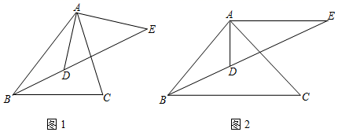

# Mathematics - 题目 2503

**ID**: 2257f13157cb47ad83dc3d15b0381567
**年级**: Grade 9
**难度**: Hard
**题型**: Calculation

## 题目
如图1， $AD,BD$ 分别是 $\vartriangle ABC$ 的内角 $\angle BAC,\angle ABC$ 的平分线，过点 $A$ 作 $AE\bot AD$ ，交 $BD$ 的延长线于点 $E$ ．（1）求证： $\angle E=\frac {1}{2}\angle C$ ；​​​​​​​‌（2）如图2，如果 $AE=AB$ ，且 $BD:DE=2:3$ ，求 ${\cos}\angle ABC$ 的值；（3）如果 $\angle ABC$ 是锐角，且 $\vartriangle ABC$ 与 $\vartriangle ADE$ 相似，求 $\angle ABC$ 的度数，并直接写出 $\frac {S{{}_{\Delta ADE}}}{S{{}_{\Delta ABC}}}$ 的值．

## 解答

1. （1）证明：如图1中，
2. 
3. $\because AE\bot AD$ ，
4. $\therefore \angle DAE=90{}^\circ $ ， $∠E=90{}^\circ -∠ADE$ ，
5. $\because AD$ 平分 $\angle BAC$ ， $BD$ 平分 $\angle ABC$ 的，
6. $\therefore \angle BAD=\frac {1}{2}\angle BAC$ ， $\angle ABD=\frac {1}{2}\angle ABC$ ，
7. $\because \angle ADE=\angle BAD+\angle DBA$ ， $∠BAC+∠ABC=180{}^\circ -∠C$ ，
8. $\therefore \angle ADE=\frac {1}{2}(\angle ABC+\angle BAC)=90{}^\circ -\frac {1}{2}\angle C$ ，
9. $\therefore \angle E=90{}^\circ -(90{}^\circ -\frac {1}{2}\angle C)=\frac {1}{2}\angle C$ ．
10. （2）解：延长 $AD$ 交 $BC$ 于点 $F$ ．
11. 
12. $\because AB=AE$ ，
13. $\therefore \angle ABE=\angle E$ ，
14. 又∵ $\angle ABE=\angle EBC$ ，
15. $\therefore \angle E=\angle CBE$ ，
16. $\therefore AE//BC$ ，
17. $\therefore \angle AFB=\angle EAD=90{}^\circ $ ， $\frac {BF}{AE}=\frac {BD}{DE}$ ，
18. $\because BD:DE=2:3$ ，
19. $\therefore {\cos}\angle ABC=\frac {BF}{AB}=\frac {BF}{AE}=\frac {2}{3}$ ．
20. （3） $\because \vartriangle ABC$ 与 $\vartriangle ADE$ 相似， $\angle DAE=90{}^\circ $ ，
21. $\therefore \angle ABC$ 中必有一个内角为 $90{}^\circ $
22. $\because \angle ABC$ 是锐角，
23. $\therefore \angle ABC\ne 90{}^\circ $ ．
24. ①当 $\vartriangle ABC\sim \vartriangle AED$ 时， $\angle BAC=\angle DAE=90{}^\circ $ ，
25. $\because \angle E=\frac {1}{2}\angle C$ ，
26. $\therefore \angle ABC=\angle E=\frac {1}{2}\angle C$ ，
27. $\because \angle ABC+\angle C=90{}^\circ $ ，
28. $\therefore \angle ABC=30{}^\circ $ ，
29. 如图，过B点作BH⊥AE，
30. 
31. ∵ $\angle BAC=90{}^\circ $ ，AD平分∠BAC，
32. ∴∠BAH=45°，
33. ∴AH=BH， $AB=\sqrt {2}BH$ ，
34. ∵ $\angle {\rm{E}}=30{}^\circ $ ，
35. ∴ $HE=\frac {BH}{{\tan}\angle E}=\sqrt {3}BH$ ，
36. ∴ $AE=HE-AH=(\sqrt {3}-1)BH$ ，
37. ∵ $\vartriangle ABC\sim \vartriangle AED$ ，
38. ∴ $\frac {S{{}_{ΔADE}}}{S{{}_{ΔABC}}}={\left({\frac {AE}{AB}}\right)^{2}}={\left({\frac {\sqrt {3}-1}{\sqrt {2}}}\right)^{2}}=2-\sqrt {3}$ ．
39. ②当 $\vartriangle ABC\sim \vartriangle EDA$ 时，即 $∠C=∠DAE=90{}^\circ $ 时， $∠E=\frac {1}{2}∠C=45{}^\circ $ ，
40. $\therefore \mathrm{∠}EDA=45{}^\circ $ ，
41. $\therefore \angle ABC=\angle EDA=45{}^\circ $ ，
42. 如解图（3）-2；过B点作BH⊥AE，
43. 
44. $\because \angle ABC=BAC=45{}^\circ $ ， $AD,BD$ 分别是 $\vartriangle ABC$ 的内角 $\angle BAC,\angle ABC$ 的平分线，
45. ∴ $\angle ABD=\angle BAD$ ，
46. ∴BD=AD，
47. 又∵ $\angle E=45{}^\circ $ ，
48. ∴ $DE=\sqrt {2}AE$ ， $BE=\sqrt {2}HE$ ，
49. ∴ $BE=BD+BE=(1+\sqrt {2})AE$ ，
50. ∴ $HE=\frac {2+\sqrt {2}}{2}AE$ ，
51. ∴ $AH=HE-AE=\frac {\sqrt {2}}{2}AE$ ，
52. ∴在 $Rt\vartriangle ABH$ 中， $AB{^{2}}=BH{^{2}}+AH{^{2}}={\left({\frac {2+\sqrt {2}}{2}AE}\right)^{2}}+{\left({\frac {\sqrt {2}}{2}AE}\right)^{2}}=\left ({2+\sqrt {2}}\right )AE{^{2}}$
53. ∴ $\frac {S{{}_{ΔADE}}}{S{{}_{ΔABC}}}={\left({\frac {DE}{AB}}\right)^{2}}=\frac {{\left({\sqrt {2}AE}\right)^{2}}}{\left ({2+\sqrt {2}}\right )AE{^{2}}}=2-\sqrt {2}$
54. 综上所述， $\angle ABC=30{}^\circ $ ， $\frac {S{{}_{ΔADE}}}{S{{}_{ΔABC}}}=2-\sqrt {3}$ 或 $\angle ABC=45{}^\circ $ ， $\frac {S{{}_{ΔADE}}}{S{{}_{ΔABC}}}=2-\sqrt {2}$ ．

## 知识点

**中文**:
  - 平行线的判定与性质
  - 相似三角形的判定与性质综合

**English**:
  - Determination and Properties
  - Determination and Properties

---
