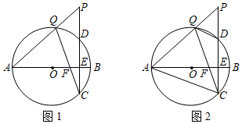

# Mathematics - 题目 2232

**ID**: 2862281f1eb248038d697285e033c4bc
**年级**: Grade 9
**难度**: Hard
**题型**: Calculation

## 题目
（提出问题）如图1，直径 $AB$ 垂直弦 $CD$ 于点 $E$ ， $AB=10$ ， $CD=8$ ，点 $P$ 是 $CD$ 延长线上异于点 $D$ 的一个动点，连结 $AP$ 交 $\odot O$ 于点 $Q$ ，连结 $CQ$ 交 $AB$ 于点 $F$ ，则点 $F$ 的位置随着点 $P$ 位置的改变而改变．（特殊位置探究）（1）当 $DP=2$ 时，求 ${\tan}\angle P$ 和线段 $AQ$ 的长；​​​​​​​‌（一般规律探究）（2）如图2，连结 $AC$ ， $DQ$ ．在点 $P$ 运动过程中，设 $DP=x$ ， $\frac {AF}{BF}=y$ ．①求证： $\angle ACQ=\angle CPA$ ；②求 $y$ 与 $x$ 之间的函数关系式：（解决问题）（3）当 $OF=1$ 时，求 $\vartriangle ACQ$ 和 $\vartriangle CDQ$ 的面积之比．（直接写出答案）

## 解答

1. 解：（1）连结 $OD$ ，
2. 
3. ∵直径 $AB\bot CD,CD=8,$  $AB=10$ ．
4. $\therefore DE=\frac {1}{2}CD=4$ ，
5. $\therefore OE=\sqrt {OD{^{2}}-DE{^{2}}}=3,AE=OA+OE=8$ ．
6. $\because DP=2,$
7. $\therefore {\tan}\angle P=\frac {AE}{PE}=\frac {8}{6}=\frac {4}{3}$ ， $AP=\sqrt {AE{^{2}}+PE{^{2}}}=\sqrt {6{^{2}}+8{^{2}}}=10,$
8. 连结 $BQ$ ，则 $\angle AQB=90{}^\circ $
9. 在 $Rt△ABQ$ 中，
10. $AQ=AB{\cos}\angle BAQ=AB\times \frac {AE}{AP}=10\times \frac {8}{10}=8$ ．
11. （2）①连结 $BQ$ ， $AC,$
12. $\because \overset ⌢{{AQ}}=\overset ⌢{{AQ}},$
13. $\therefore \angle ACQ=\angle ABQ$ ，
14. $\because AB$ 为直径，
15. $\therefore \angle QAB+\angle ABQ=90{}^\circ $
16. $\because AB\bot CP,$
17. $\therefore \angle P+\angle BAP=90{}^\circ $
18. $\therefore \angle ACQ=\angle DPA$ ．
19. 
20. ②连结 $BC$ ，过点 $A$ 作 $AC$ 的垂线交 $CQ$ 的延长线于点 $N$ ，
21. $\because AB$ 为直径，
22. $\therefore \angle ACB=\angle NAC=90{}^\circ ,$
23. $\therefore BC{\rm{/}}{\rm{/}}AN,$
24. $\therefore \vartriangle FCB\mathrm{∽}\vartriangle FNA$
25. $\therefore \frac {FB}{FA}=\frac {BC}{AN}$ ．
26. $\because DC\bot AB,AE=8,CE=4,$
27. $\therefore AC=\sqrt {8{^{2}}+4{^{2}}}=4\sqrt {5},BC=\sqrt {BE{^{2}}+CE{^{2}}}=\sqrt {4{^{2}}+2{^{2}}}=2\sqrt {5},$
28. ${\tan}\angle P=\frac {AE}{PE}=\frac {8}{x+4},$
29. $\because $   $DP=x$ ， $\frac {AF}{BF}=y$ ．
30. $\therefore y=\frac {AN}{BC}=\frac {AC\times {\tan}\angle ACQ}{BC}=\frac {AC\times {\tan}\angle P}{BC}=\frac {4\sqrt {5}\times \frac {8}{x+4}}{2\sqrt {5}}=\frac {16}{x+4}$ ．
31. 
32. （3）当 $OF=1$ 时， $F$ 在 $O$ 的右边时， $AF=6$ ；当 $F$ 在 $O$ 的左边时， $AF=4$ ；
33. 当 $AF=6$ 时，则 $BF=4,$
34. $\therefore $   $y=\frac {3}{2}$ ，
35. $\therefore \frac {16}{x+4}=\frac {3}{2},$
36. 解得 $x=\frac {20}{3}$ ．
37. 经检验： $x=\frac {20}{3}$ 是原方程的根且符合题意，
38. 如图，连接 $QD,$
39. 
40. $\because $  四边形 $ACDQ$ 为 $\odot O$ 的内接四边形，
41. $\therefore \angle CAQ=\angle PDQ,$
42. $\because \angle ACQ=\angle P,$
43. $\therefore \vartriangle PDQ\mathrm{∽}\vartriangle CAQ$
44. $\therefore \frac {S{{}_{\vartriangle PDQ}}}{S{{}_{\vartriangle ACQ}}}={\left({\frac {PD}{AC}}\right)^{2}}={\left({\frac {\frac {20}{3}}{4\sqrt {5}}}\right)^{2}}=\frac {5}{9}$ ．
45. $\because \frac {S{{}_{\vartriangle PDQ}}}{S{{}_{\vartriangle CDQ}}}=\frac {PD}{CD}=\frac {\frac {20}{3}}{8}=\frac {5}{6}.$
46. $\therefore \frac {S{{}_{\vartriangle ACQ}}}{S{{}_{\vartriangle CDQ}}}=\frac {9}{6}=\frac {3}{2}$
47. 当 $AF=4$ 时， $y=\frac {2}{3}$ ，解得 $x=20$ ．同理可得 $\frac {S{{}_{\vartriangle ACQ}}}{S{{}_{\vartriangle CDQ}}}=\frac {1}{2}$ ．
48. ∴当 $OF=1$ 时， $\vartriangle ACQ$ 和 $\vartriangle CDQ$ 的面积之比为 $\frac {3}{2}$ 或 $\frac {1}{2}$ ．

## 知识点

**中文**:
  - 圆的综合问题
  - 相似三角形的判定与性质综合
  - 解直角三角形

**English**:
  - Comprehensive Circle Problems
  - Determination and Properties
  - Solving Right Triangles

---
