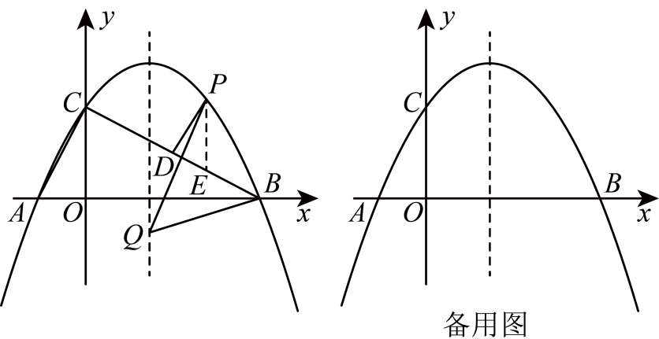

# Mathematics - 题目 1786

**ID**: 2fcff6c5ff6346e29f6c3d3ed3d28526
**年级**: Grade 9
**难度**: Hard
**题型**: Calculation

## 题目
如图，在平面直角坐标系中，抛物 $y=ax{^{2}}+bx+2\left ({a\ne 0}\right )$ 线过点 $\left ({1,3}\right )$ ，交y轴于C点，交x轴于A，B两点（A在B的左侧），连接 $AC$ ， $BC$ ， ${\tan}\angle CBA=\frac {1}{2}$ ．(1)求抛物线的表达式；​​​​​​​‌(2)点P是直线 $BC$ 上方抛物线上的一动点，过点P作 $PD\bot BC$ 于点D，点Q是抛物线对称轴上的一动点，连接 $PQ$ ， $BQ$ ，当线段 $PD$ 长度取得最大值时，求 $PQ+BQ$ 的最小值；(3)在（2）中线段 $PD$ 长度取得最大值的条件下，连接 $PA$ ，将抛物线沿射线 $CB$ 方向平移得到新抛物线 $y^{′}$ ，使得新抛物线 $y^{′}$ 经过点B，且与直线 $CB$ 相交于另一点M，点N为新抛物线 $y^{′}$ 上的一个动点，当 $\angle PAC+\angle BMN=45{}\degree $ ，请直接写出所有符合条件的点N的坐标．

## 解答

1. （1）解：令 $x=0$ 得 $y=2$ ，
2. ∴ $C\left ({0,2}\right )$ ，
3. ∵ ${\tan}\angle CBA=\frac {1}{2}$ ，
4. ∴ $OB=2OC$ ，
5. ∴ $B\left ({4,0}\right )$ ，
6. 把 $B\left ({4,0}\right )$ ， $C\left ({0,2}\right )$ 代入 $y=ax{^{2}}+bx+2\left ({a\ne 0}\right )$ ，得
7. $\begin{cases}16a+4b+2=0\\a+b+2=3\end{cases}$ ，
8. 解得 $\begin{cases}a=-\frac {1}{2}\\b=\frac {3}{2}\end{cases}$ ，
9. ∴ $y=-\frac {1}{2}x{^{2}}+\frac {3}{2}x+2$ ；
10. （2）解：设直线 $BC$ 的解析式为 $y=kx+n$ ，
11. 则 $\begin{cases}4k+n=0\\n=2\end{cases}$ ，
12. ∴ $\begin{cases}k=-\frac {1}{2}\\n=2\end{cases}$ ，
13. $\therefore y=-\frac {1}{2}x+2$ ，
14. $\because $  $B\left ({4,0}\right )$ ， $C\left ({0,2}\right )$ ，
15. $\therefore OB=4$ ， $OC=2$ ，
16. $\therefore BC=\sqrt {2{^{2}}+4{^{2}}}=2\sqrt {5}$ ，
17. 如图过点P作y轴的平行线交 $BC$ 于点E，
18. 
19. ∵ $\angle PDE=\angle COB=90{}\degree $ ，
20. $\angle PED=\angle OCB$
21. ∴ $\mathrm{△}PDE∽\mathrm{△}BOC$ ，
22. $\therefore \frac {PD}{BO}=\frac {PE}{BC}$ ，
23. $\therefore \frac {PD}{4}=\frac {PE}{2\sqrt {5}}$ ，
24. ∴ $PD=\frac {2\sqrt {5}}{5}PE$
25. 设 $P\left ({m{\rm{,}}-\frac {1}{2}m{^{2}}+\frac {3}{2}m+2}\right )$ ，
26. 则 $E\left ({m{\rm{,}}-\frac {1}{2}m+2}\right )$ ，
27. $\therefore $  $PD=\frac {2\sqrt {5}}{5}PE$
28. $=\frac {2\sqrt {5}}{5}\left [\left ({-\frac {1}{2}m{^{2}}+\frac {3}{2}m+2}\right )-\left ({-\frac {1}{2}m+2}\right )\right ]$
29. $=-\frac {\sqrt {5}}{5}m{^{2}}+\frac {4\sqrt {5}}{5}m$
30. $=-\frac {\sqrt {5}}{5}{\left({m-2}\right)^{2}}+\frac {4\sqrt {5}}{5}$ ，
31. ∵ $\frac {\sqrt {5}}{5}<0$ ，
32. ∴当 $m=2$ 时， $PD$ 有最大值 $\frac {4\sqrt {5}}{5}$ ，
33. 此时点P的坐标为 $(2{\rm{,}}3)$ ，
34. 作点B关于对称轴 $x=\frac {3}{2}$ 的对称点 $B^{′}(-1{\rm{,}}0)$ ，
35. ∴ $PQ+BQ=PQ+QB^{′}$ ，
36. ∴当 ${\rm \mathit{P}，\mathit{Q}，}B^{′}$ 共线时， $PQ+QB^{′}$ 取得最小值 $PB^{′}=3\sqrt {2}$ ，
37. ∴ $.PQ+BQ$ 的最小值为 $PB^{′}=3\sqrt {2}$ ；
38. （3）解： $\because $ 将抛物线沿射线 $CB$ 方向平移得到新抛物线 $y^{′}$ ，
39. 且 ${\tan}\angle CBA=\frac {1}{2}$ ，
40. $\therefore $ 设将抛物线沿射线 $CB$ 方向平移 $\sqrt {5}m$ （ $m>0$ ）个长度单位，
41. 则将抛物线沿 $x$ 轴向右平移 $2m$ （ $m>0$ ）个长度单位，向下平移 $m$ 个长度单位，
42. $\therefore y^{′}=-\frac {1}{2}{\left({x-2m}\right)^{2}}+\frac {3}{2}\left ({x-2m}\right )+2-m$ ，
43. $\because $ 新抛物线 $y^{′}$ 经过点B，
44. $\therefore $  $-\frac {1}{2}{\left({4-2m}\right)^{2}}+\frac {3}{2}\left ({4-2m}\right )+2-m=0$ ，
45. 整理得： $m{^{2}}-2m=0$ ，
46. 解得： $m{{}_{1}}=2$ ， $m{{}_{2}}=0$ （舍去），
47. $\therefore y^{′}=-\frac {1}{2}{\left({x-4}\right)^{2}}+\frac {3}{2}\left ({x-4}\right )+2-2$ ，
48. $=-\frac {1}{2}x{^{2}}+\frac {11}{2}x-14$ ，
49. 如图，
50. 
51. 过点 $P$ 作 $PH\bot x$ 轴交于 $H$ ，过点 $\mathrm{A}$ 作直线 $AE{\rm{/\mskip-4mu/}}BC$ 交 $y$ 轴于 $E{{}_{1}}$ ，
52. $\therefore \angle OAE{{}_{1}}=\angle ACB$ ，
53. $\therefore \angle OAE{{}_{1}}=\angle FBM$ ，
54. $\because P\left ({2,3}\right )$ ， $A\left ({-1,0}\right )$ ，
55. $\therefore AH=PH=3$ ，
56. $\therefore {\tan}\angle PAH=\frac {PH}{AH}=1$ ，
57. $\therefore \angle PAH=45{}\degree $ ，
58. $\because AB=4-\left ({-1}\right )=5$ ，
59. $OA=1$ ，
60. $OC=2$ ，
61. $\therefore AC{^{2}}=1{^{2}}+2{^{2}}=5$ ，
62. $BC{^{2}}=2{^{2}}+4{^{2}}=20$ ，
63. $AB{^{2}}=5{^{2}}=25$ ，
64. $\therefore AC{^{2}}+BC{^{2}}=AB{^{2}}$ ，
65. $\therefore \vartriangle ACB$ 是直角三角形，
66. $\therefore \angle ACB=90{}\degree $ ，
67. $\therefore \angle CAE{{}_{1}}=90{}\degree $ ，
68. $\therefore \angle PAC+\angle OAE{{}_{1}}$
69. $=90{}\degree -\angle PAH$
70. $=45{}\degree $ ，
71. ①当 $N$ 在射线 $BC$ 的下方时，如图，
72. 
73. $\therefore $ 当 $MN/\mskip-4mu/x$ 轴时，
74. $\therefore $  $\angle BMN=\angle FBM$ ，
75. $\therefore \angle BMN=\angle OAE{{}_{1}}$ ，
76. $\therefore $  $\angle PAC+\angle BMN=45{}\degree $ ，
77. 联立 $\begin{cases}y=-\frac {1}{2}x+2\\y=-\frac {1}{2}x{^{2}}+\frac {11}{2}x-14\end{cases}$ ，
78. 解得： $\begin{cases}x{{}_{1}}=4\\y{{}_{1}}=0\end{cases}$ ， $\begin{cases}x{{}_{2}}=8\\y{{}_{1}}=-2\end{cases}$ ，
79. $\therefore M\left ({8,-2}\right )$ ，
80. $\therefore y{{}_{N}}=-2$ ，
81. $\therefore $  $-\frac {1}{2}x{^{2}}+\frac {11}{2}x-14=-2$
82. 解得： $x{{}_{3}}=3$ ， $x{{}_{4}}=8$ ，
83. $\therefore N\left ({3,-2}\right )$ ；
84. ②当 $N$ 在射线 $BC$ 的上方时，如图，
85. 
86. 直线 $MN$ 交 $x$ 轴于 $G$ ，
87. 由①得 $\angle FBM=\angle BMN$ ，
88. $\therefore BG=MG$ ，
89. 设直线 $MN$ 的解析式为 $y=k{{}_{1}}x+b{{}_{1}}$ ，则有
90. $8k{{}_{1}}+b{{}_{1}}=-2$ ，
91. 解得： $b{{}_{1}}=-2-8k{{}_{1}}$ ，
92. $\therefore $  $y=k{{}_{1}}x-2-8k{{}_{1}}$ ，
93. 当 $y=0$ 时，
94. $k{{}_{1}}x-2-8k{{}_{1}}=0$ ，
95. 解得： $x=\frac {2}{k{{}_{1}}}+8$ ，
96. $\therefore G\left ({\frac {2}{k{{}_{1}}}+8,0}\right )$ ，
97. $\therefore BG=\frac {2}{k{{}_{1}}}+8-4$
98. $=\frac {2}{k{{}_{1}}}+4$ ，
99. $GM{^{2}}={\left({-2}\right)^{2}}+{\left({8-\frac {2}{k{{}_{1}}}-8}\right)^{2}}$
100. $=\frac {4}{k{{}_{1}^{2}}}$ ，
101. $\therefore $  ${\left({\frac {2}{k{{}_{1}}}+4}\right)^{2}}=\frac {4}{k{{}_{1}^{2}}}$ ，
102. 解得： $k{{}_{1}}=-\frac {4}{3}$ ，
103. 经检验： $k{{}_{1}}=-\frac {4}{3}$ 是此方程的根；
104. $\therefore $  $b{{}_{1}}=-2-8\times \left ({-\frac {4}{3}}\right )=\frac {26}{3}$ ，
105. $\therefore $ 直线 $MN$ 的解析式为 $y=-\frac {4}{3}x+\frac {26}{3}$ ，
106. 联立 $\begin{cases}y=-\frac {4}{3}x+\frac {26}{3}\\y=-\frac {1}{2}x{^{2}}+\frac {11}{2}x-14\end{cases}$ ，
107. 解得： $\begin{cases}x{{}_{5}}=8\\y{{}_{5}}=-2\end{cases}$ ， $\begin{cases}x{{}_{6}}=\frac {17}{3}\\y{{}_{6}}=\frac {10}{9}\end{cases}$ ，
108. $\therefore $  $N\left ({\frac {17}{3}{\rm{,}}\frac {10}{9}}\right )$ ；
109. 综上所述： $N$ 的坐标为 $(3{\rm{,}}-2)$ 或 $\left ({\frac {17}{3}{\rm{,}}\frac {10}{9}}\right )$ ．

## 知识点

**中文**:
  - 二次函数图象的平移
  - 二次函数的综合
  - 相似三角形的判定与性质综合
  - 待定系数法求二次函数解析式

**English**:
  - Translation of Quadratic Graphs
  - Comprehensive Quadratic Function Problems
  - Determination and Properties
  - Finding Quadratic Expressions by Undetermined Coefficients

---
