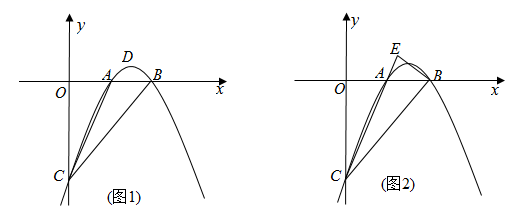

# Mathematics - 题目 463

**ID**: 33bcaa2d878949f686aa7ac665d0fb0b
**年级**: Grade 9
**难度**: Hard
**题型**: Calculation

## 题目
如图1，已知抛物线 $y=ax{^{2}}-6ax+c$ 过点 $A\left ({2,0}\right )$ ， $C\left ({0,-4}\right )$ ，交 $x$ 轴于点 $B$ ，顶点为 $D$ ，连接 $AC$ ， $BC$ ．（1）求抛物线的解析式，并写出 $D$ 点的坐标；​​​​​​​‌（2） $M$ 为抛物线上一点，若 ${\tan}\angle BCM=\frac {1}{3}$ ，求直线 $CM$ 的解析式；（3）如图2， $CA$ ， $BD$ 的延长线交于点 $E$ ，点 $P$ 在（1）中的抛物线的对称轴上， $Q$ 为 $y$ 轴左侧的抛物线上一点，是否存在以点 $O$ ， $P$ ， $Q$ 为顶点的三角形与 $△ABE$ 相似？若存在，求出点 $Q$ 的坐标；若不存在，请说明理由．

## 解答

1. 解：（1）∵抛物线 $y=ax{^{2}}-6ax+c$ 过点 $A\left ({2,0}\right )$ 和 $C\left ({0,-4}\right )$ ，
2. ∴ $\begin{cases}4a-12a+c=0\\c=-4\end{cases}$ ，
3. 解得 $\begin{cases}a=-\frac {1}{2}\\c=-4\end{cases}$ ，
4. ∴ $y=-\frac {1}{2}x{^{2}}+3x-4$ ，
5. 顶点 $D$ 的坐标为 $\left ({3，\frac {1}{2}}\right )$ ；
6. （2）延长 $CA$ ， $BD$ 交于点 $E$ ，
7. 由 $B\left ({4,0}\right )$ ， $D\left ({3,\frac {1}{2}}\right )$ ，
8. 设直线BD解析式为 $y{{}_{BD}}=kx+b$ ，
9. 代入得 $\begin{cases}4k+b=0\\3k+b=\frac {1}{2}\end{cases}$ ，
10. 解得 $\begin{cases}k=-\frac {1}{2}\\b=2\end{cases}$
11. 得 $y{{}_{BD}}=-\frac {1}{2}x+2$ ，
12. ∵ $C\left ({0，-4}\right )$ ， $A\left ({2，0}\right )$ ，
13. 设直线AC解析式为 $y{{}_{AC}}=k{{}_{1}}x+b{{}_{1}}$ ，
14. 代入得 $\begin{cases}2k{{}_{1}}+b{{}_{1}}=0\\b{{}_{1}}=-4\end{cases}$
15. 解得 $\begin{cases}k{{}_{1}}=2\\b{{}_{1}}=-4\end{cases}$
16. 得 $y{{}_{AC}}=2x-4$ ，
17. 由 $\begin{cases}y=-\frac {1}{2}x+2\\y=2x-4\end{cases}$ ，
18. 解得 $\begin{cases}x=\frac {12}{5}\\y=\frac {4}{5}\end{cases}$ ，
19. 点 $E\left ({\frac {12}{5},\frac {4}{5}}\right )$ ，
20. ∴ $AE=\sqrt {{\left({2-\frac {12}{5}}\right)^{2}}+{\left({\frac {4}{5}}\right)^{2}}}=\frac {2}{5}\sqrt {5}$ ， $BE=\sqrt {{\left({4-\frac {12}{5}}\right)^{2}}+{\left({\frac {4}{5}}\right)^{2}}}=\frac {4}{5}\sqrt {5}$ ， $AB=2$
21. ∴ $AE{^{2}}+BE{^{2}}={\left({\frac {2\sqrt {5}}{5}}\right)^{2}}+{\left({\frac {4\sqrt {5}}{5}}\right)^{2}}=4=AB{^{2}}$ ，
22. ∴ $\mathrm{△}AEB$ 是直角三角形，且 $\mathrm{∠}AEB=90{}^\circ $ ，
23. ∴ ${\tan}\angle BCE=\frac {\frac {4}{5}\sqrt {5}}{\frac {12}{5}\sqrt {5}}=\frac {1}{3}$ ，
24. ∴点A即为符合条件的点，
25. ∴ $M{{}_{1}}\left ({2,0}\right )$ ，直线 $CM$ 的解析式为： $y{{}_{CM}}=2x-4$
26. 当 $M$ 在 $BC$ 下方时，如图，设 $CM$ 交对称轴于点 $F$ ，过 $C$ 作 $CN\bot FD$ 于点 $N$ ，
27. ∵OC=OB，∠COB=90°，
28. ∴∠OCB=∠OBC=45°，
29. ∵OB∥CN，
30. ∴ $\angle BCN=45{}^\circ $ ，
31. ∵ $\angle OCB=\angle BCN=45{}^\circ $ ，
32. 点M符合条件，
33. ${\tan}\angle BCM=\frac {1}{3}$
34. ∴ $\angle BCM$ = $\angle BCE$
35. $\angle BCA=\angle BCM$ ，
36. ∴ $\angle FCN=45{}^\circ -\angle MCB=45{}^\circ -\angle ACB=\angle ACO$ ，
37. ∴ ${\tan}\angle FCN={\tan}\angle ACO=\frac {OA}{OC}=\frac {FN}{CN}=\frac {1}{2}$ ，
38. ∴ $FN=\frac {1}{2}CN=\frac {3}{2}$ ，
39. 
40. ∴y_{F}=-4+ $\frac {3}{2}=-\frac {5}{2}$
41. ∴ $F\left ({3,-\frac {5}{2}}\right )$ ，
42. 设直线 $CM$ 解析式为： $y{{}_{CM}}=k{{}_{2}}x+b{{}_{2}}$ 过C、F，
43. 代入得 $\begin{cases}b{{}_{2}}=-4\\3k{{}_{2}}+b{{}_{2}}=-\frac {5}{2}\end{cases}$
44. 解得 $\begin{cases}k{{}_{2}}=\frac {1}{2}\\b{{}_{2}}=-4\end{cases}$
45. 得直线 $CM$ 解析式为 $y{{}_{CM}}=\frac {1}{2}x-4$
46. ∴符合条件的直线 $CM$ 解析式为： $y{{}_{CM{{}_{1}}}}=2x-4$ ， $y{{}_{CM{{}_{2}}}}=\frac {1}{2}x-4$
47. （3）设对称轴交 $x$ 轴于点 $G$ ，
48. ∵点P在抛物线对称轴上
49. 设 $P\left ({3,m}\right )$ ，
50. 由（2）知 $△ABE$ 为直角三角形，且 $\frac {AE}{BE}=\frac {1}{2}$ ，
51. ①当 $\angle OPQ=90{}^\circ $ 时，过 $Q$ 作 $QH\bot PG$ 于点 $H$ ，
52. ∵∠OGP=∠OPQ=∠QHP=90°，∠QPH+∠OPG=∠HQP+∠QPH=90°，
53. ∴∠OPG=∠PQH，
54. ∴ $\mathrm{△}OPG∽\mathrm{△}PQH$ ，
55. ∴ $\frac {OP}{PQ}=\frac {OG}{PH}=\frac {PG}{QH}$ ，
56. 若 $\frac {OP}{PQ}=\frac {OG}{PH}=\frac {PG}{QH}=\frac {AE}{BE}=\frac {1}{2}$ ，
57. 则 $PH=2OG=6$ ， $QH=2PG=-2m$ ，
58. ∴ $Q\left ({2m+3,m-6}\right )$ ，
59. ∴代入抛物线可得方程 $m-6=-\frac {1}{2}{\left({2m+3}\right)^{2}}+3\left ({2m+3}\right )-4$ ，
60. 整理得4m^{2}+2m-13=0，
61. 解得， $m=\frac {-1\pm \sqrt {53}}{4}$ ，
62. ∴ $m=\frac {-1-\sqrt {53}}{4}$ ， $m=\frac {-1{\rm{+}}\sqrt {53}}{4}$ （舍去），
63. $2m+3{\rm{=}}2\times \frac {-1-\sqrt {53}}{4}+3=\frac {5-\sqrt {53}}{2},m-6=\frac {-1-\sqrt {53}}{4}-6=\frac {-25-\sqrt {53}}{4}$ ，
64. ∴符合题意的点 $Q{{}_{1}}\left ({\frac {5-\sqrt {53}}{2},\frac {-25-\sqrt {53}}{4}}\right )$ ；
65. 
66. 若 $\frac {QH}{PH}=\frac {PG}{OG}=\frac {AE}{BE}=\frac {1}{2}$ ，
67. PG= $\frac {1}{2}OG=\frac {3}{2}$ ，QH= $\frac {1}{2}PH$ ，
68. 设Q点的横坐标为x，
69. QH=3-x，PH=2(3-x)，GH= $\frac {3}{2}{\rm{+}}2\left ({-x+3}\right )$ ，
70. Q（x， $-\left [\frac {3}{2}{\rm{+}}2\left ({-x+3}\right )\right ]$ ），
71. ∴代入抛物线可得方程 $-\left [\frac {3}{2}+2\left ({-x+3}\right )\right ]=-\frac {1}{2}x{^{2}}+3x-4$ ，
72. 整理得 $x{^{2}}-2x-7=0$ ，
73. 解得 $x=\frac {2\pm 4\sqrt {2}}{2}$ ，
74. ∴ $x=1-2\sqrt {2}$ ， $x=1{\rm{+}}2\sqrt {2}$ （舍去），
75. ∴ $-\left [\frac {3}{2}{\rm{+}}2\left ({-x+3}\right )\right ]=-\left [\frac {3}{2}+2\left ({-1+2\sqrt {2}+3}\right )\right ]=-\frac {11}{2}-4\sqrt {2}$ ，
76. ∴符合题意的点 $Q{{}_{2}}\left ({1-2\sqrt {2},-\frac {11}{2}-4\sqrt {2}}\right )$ ；
77. 
78. ②当 $\angle PQO=90{}^\circ $ 时，
79. 过Q作QR⊥x轴于R，
80. tan∠EBA=tan∠QOP= $\frac {AE}{BE}=\frac {QP}{OQ}=\frac {1}{2}$ ，
81. ∵∠ORQ=∠PHQ=∠PQO=90°，∠RQO+∠OQH=∠OQH+∠HQP=90°，
82. ∴∠RQO=∠HQP，
83. ∴△RQO∽△HQP，
84. ∴ $\frac {QH}{QR}=\frac {HP}{OQ}=\frac {QP}{OQ}=\frac {1}{2}$ ，
85. 设Q点的横坐标为x，
86. OQ= $-x$ ，PH= $-\frac {1}{2}x$ ，QH=3-x，QH= $OR+OG=3-x$ ，RQ=2QH= $2\left ({3-x}\right )$ ，
87. Q（x， $-2\left ({3-x}\right )$ ），
88. 代入抛物线的方程 $-2\left ({3-x}\right )=-\frac {1}{2}x{^{2}}+3x-4$ ，
89. 整理得 $x{^{2}}-2x-4=0$ ，
90. ∴ $x=\frac {2\pm 2\sqrt {5}}{2}$ ，
91. 所以 $x=1-\sqrt {5}$ ， $x=1{\rm{+}}\sqrt {5}$ （舍去）,
92. $-2\left ({3-x}\right )=-2\left ({3-1+\sqrt {5}}\right )=-4-2\sqrt {5}$ ，
93. ∴符合题意的点 $Q{{}_{3}}\left ({1-\sqrt {5},-4-2\sqrt {5}}\right )$ ，
94. 
95. ③当 $\angle POQ=90{}^\circ $ 时，
96. 过Q作QN⊥y轴于N，
97. ∵tan∠EBA=tan∠OQP= $\frac {AE}{BE}=\frac {OP}{OQ}=\frac {1}{2}$ ，
98. ∵∠ONQ=∠PGQ=∠POQ=90°，∠QON+∠NOP=∠NOP+∠POG=90°，
99. ∴∠QON=∠POG，
100. ∴△QON∽△POG，
101. ∴ $\frac {PG}{QN}=\frac {OG}{ON}=\frac {OP}{OQ}=\frac {1}{2}$ ，
102. 设Q点的横坐标为x，
103. NQ= $-x$ ，PG= $-\frac {1}{2}x$ ，OG=3，ON=2OG=6，
104. Q（x，-6）
105. 代入抛物线的方程 $-6=-\frac {1}{2}x{^{2}}+3x-4$ ，
106. 整理得 $x{^{2}}-6x-4=0$ ，
107. ∴ $x=\frac {6\pm 2\sqrt {13}}{2}$ ，
108. ∴ $x=3{\rm{-}}\sqrt {13}$ ， $x=3{\rm{+}}\sqrt {13}$ （舍去），
109. 
110. ∴符合题意的点 $Q{{}_{4}}\left ({3-\sqrt {13},-6}\right )$ ；
111. 综上所述，Q点的坐标为 $Q{{}_{1}}\left ({\frac {5-\sqrt {53}}{2},\frac {-25-\sqrt {53}}{4}}\right )$ ， $Q{{}_{2}}\left ({1-2\sqrt {2},-\frac {11}{2}-4\sqrt {2}}\right )$ ， $Q{{}_{3}}\left ({1-\sqrt {5},-4-2\sqrt {5}}\right )$ ， $Q{{}_{4}}\left ({3-\sqrt {13},-6}\right )$ ．

## 知识点

**中文**:
  - 勾股定理的逆定理
  - 图形问题
  - 相似三角形的判定与性质综合
  - 正切
  - 待定系数法求二次函数解析式
  - 待定系数法求一次函数解析式

**English**:
  - Converse of Pythagorean Theorem
  - Geometric Problems
  - Determination and Properties
  - Tangent
  - Finding Quadratic Expressions by Undetermined Coefficients
  - Finding Expressions by Undetermined Coefficients

---
