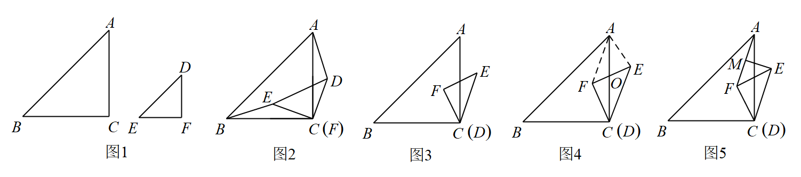

# Mathematics - 题目 1104

**ID**: 35e46686653e42cb93d8e15796d51382
**年级**: Grade 9
**难度**: Hard
**题型**: Calculation

## 题目
小明学习了图形的旋转之后，积极思考，利用两个大小不同的直角三角形与同学做起了数学探究活动．如图1，在 $\vartriangle ABC$ 与 $\vartriangle DEF$ 中， $AC=BC=a$ ， $\angle C=90{}^\circ $ ， $DF=EF=b$ ， $(a>b)$ ， $\angle F=90{}^\circ $ ．(1)【探索发现】将两个三角形顶点 $C$ 与顶点 $F$ 重合，如图2，将 $\vartriangle DEF$ 绕点 $C$ 旋转，他发现 $BE$ 与 $AD$ 的数量关系一直不变，则线段 $BE$ 与 $AD$ 具有怎样的数量关系，请说明理由；​​​​​​​‌(2)【深入思考】将两个三角形的顶点 $C$ 与顶点 $D$ 重合，如图3所示将 $\vartriangle DEF$ 绕点 $C$ 旋转．①当 $B$ 、 $F$ 、 $E$ 三点共线时，连接 $BF$ 、 $AE$ ，线段 $BF$ 、 $CF$ 、 $AE$ 之间的数量关系为；②如图4所示，连接 $AF$ 、 $AE$ ，若线段 $AC$ 、 $EF$ 交于点 $O$ ，试探究四边形 $AECF$ 能否为平行四边形？如果能，求出 $a$ 、 $b$ 之间的数量关系，如果不能，试说明理由．(3)【拓展延伸】如图5，将 $\vartriangle DEF$ 绕点 $C$ 旋转，连接 $AF$ ，取 $AF$ 的中点 $M$ ，连接 $EM$ ，则 $EM$ 的取值范围为（用含 $a$ 、 $b$ 的不等式表示）．

## 解答

1. （1） $BE=AD$ ，理由如下：
2. 
3. $\because \angle ACB=\angle EFD=90{}^\circ $ ，
4. $\therefore \angle ACB-\angle ACE=\angle EFD-\angle ACE$ ，即 $\angle BCE=\angle AFD$ ，
5. 在 $\vartriangle BCE$ 和 $\mathrm{△}AFD$ 中， $\begin{cases}BC=AC\\\angle BCE=\angle AFD\\CE=FD\end{cases}$ ，
6. $\therefore \vartriangle BCE≌\vartriangle AFD({\rm{S}}{\rm{A}}{\rm{S}})$ ，
7. $\therefore BE=AD$ ；
8. （2）① $BF=AE+CF$ ，理由如下：
9. 如图2，在 $FB$ 上截取 $FG=EF$ ，
10. 
11. $\therefore CF=FG=EF$ ，
12. ∴ $\mathrm{△}CGF$ 是等腰直角三角形，
13. ∴ $\vartriangle GCE$ 也为等腰直角三角形．
14. ∴由（1）同理可证 $BG=AE$ ，
15. $\therefore BF=BG+GF=AE+CF$ ．
16. 故此题答案为： $BF=AE+CF$ ；
17. ②四边形 $AECF$ 可以为平行四边形，此时 $OF=OE=\frac {1}{2}b$ ， $OC=OA=\frac {1}{2}a$ ．
18. $\because \angle CFO=90{}^\circ $ ，
19. $\therefore OC{^{2}}=CF{^{2}}+OF{^{2}}=b{^{2}}+(\frac {1}{2}b){^{2}}=\frac {5}{4}b{^{2}}$ ，
20. $\therefore $  $\frac {1}{4}a{^{2}}=\frac {5}{4}b{^{2}}$ ，
21. $\therefore a=\sqrt {5}b$ ；
22. （3）如图3，延长 $FE$ 至 $O$ ，使 $EO=EF$ ，连接 $OA$ ，
23. 
24. $\therefore EM=\frac {1}{2}AO$ ．
25. 在 ${\rm{R}}{\rm{t}}\mathrm{△}COF$ 中， $OF=2EF=2b$ ， $CF=b$ ，
26. $\therefore OC=\sqrt {5}b$ ，
27. $\therefore $ 点 $O$ 在以 $C$ 为圆心， $\sqrt {5}b$ 的圆上运动，
28. $\therefore $ 当点 $O$ 在 $AC$ 的延长线上时， $AO$ 最大，最大值为： $a+\sqrt {5}b$ ，
29. 当点 $O$ 在射线 $CA$ 上时， $AO$ 最小，最小值为 $\left |{a-\sqrt {5}b}\right |$ ，
30. $\therefore EM{{}_{{\rm \max }}}=\frac {a+\sqrt {5}b}{2}$ ， $EM{{}_{{\rm \min }}}=\frac {\left |{a-\sqrt {5}b}\right |}{2}$ ，
31. 故此题答案为： $\frac {\left |{a-\sqrt {5}b}\right |}{2}\leqslant EM\leqslant \frac {a+\sqrt {5}b}{2}$ ．

## 知识点

**中文**:
  - 三角形中位线
  - 平行四边形的判定与性质
  - 几何变换——旋转综合题
  - 等腰直角三角形的性质

**English**:
  - Triangle Midsegment
  - Determination and Properties
  - Rotation Comprehensive Problems
  - Properties of Isosceles Right Triangles

---
