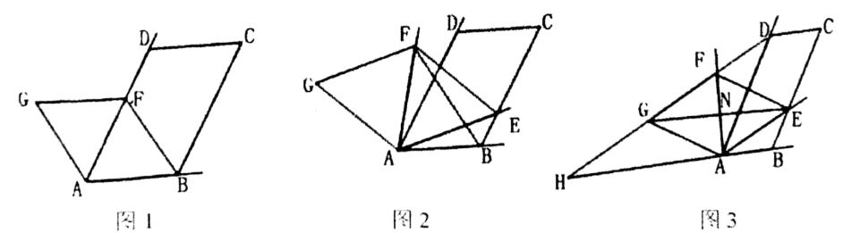

# Mathematics - 题目 1207

**ID**: 45453861f3ce4558bf8f4a6e6d282f31
**年级**: Grade 9
**难度**: Hard
**题型**: Calculation

## 题目
如图1， $\angle DAB$ 是 $▱ABCD$ 的内角， $\angle DAB=60{}^\circ $ ，（1） $BF$ 平分 $\angle ABC$ ，交 $AD$ 于点 $F$ ，过点 $A$ 作 $AG{\rm{/}}{\rm{/}}BF$ ，过点 $F$ 作 $FG{\rm{/}}{\rm{/}}AB$ ，判断四边形 $ABFG$ 的形状：；​​​​​​​‌（2）旋转 $\angle DAB$ 到 $\angle FAE$ ，如图2，边 $AE$ 交 $BC$ 于点 $E$ ，连接 $EF$ ，AE=AF．过点 $A$ 作 $AG{\rm{/}}{\rm{/}}EF$ ，过点 $F$ 作 $FG{\rm{/}}{\rm{/}}AE$ ．问： $BF$ 是否平分 $\angle ABC$ ．若是请证明，若不是请说明理由．（3）四边形 $AEFG$ 在（2）的条件下，若恰好 $EG{\rm{/}}{\rm{/}}AB$ ，如图3．连接 $DG$ 并延长，交 $BA$ 的延长线于点 $H$ ．求证： $BC=3AB$ ．

## 解答

1. 解：（1）∵ $AG{\rm{/}}{\rm{/}}BF$ ， $FG{\rm{/}}{\rm{/}}AB$
2. ∴四边形ABFG为平行四边形
3. ∵ $▱ABCD$ 中， $\angle DAB=60{}^\circ $
4. ∴∠ABC=180°－∠DAB=120°
5. ∵ $BF$ 平分 $\angle ABC$ ，
6. ∴∠ABF= $\frac {1}{2}\angle ABC$ =60°
7. ∴∠AFB=180°－∠ABF－∠FAB=60°
8. ∴△FAB为等边三角形
9. ∴BF=BA
10. ∴四边形ABFG为菱形
11. 故答案为：菱形；
12. （2）答： $BF$ 平分 $\angle ABC$
13. 理由：过点 $F$ 作 $FN\bot AB$ 于N，作 $FM\bot BC$ 于M
14. 
15. ∴ $\angle FNA=\angle FME=90{}^\circ $
16. ∵由题意得： $\angle FAE=\angle DAB=60{}^\circ $ ， AE=AF
17. ∴ $\Delta FAE$ 是等边三角形
18. ∴ $AE=EF=AF$
19. ∴ $\angle FAN=\angle FAE+\angle EAB=60{}^\circ +\angle EAB$
20. ∵ $\angle AEM=\angle EAB+\angle ABC$
21. 即： $\angle AEF+\angle FEM=\angle EAB+\angle ABC$
22. ∵在 $▱ABCD$ 中， $\angle DAB=60{}^\circ $ ，
23. ∴ $\angle ABC=120{}^\circ $
24. ∴ $60{}^\circ +\angle FEM=\angle EAB+120{}^\circ $
25. ∴ $\angle FEM=\angle EAB+120{}^\circ -60{}^\circ =\angle EAB+60{}^\circ $
26. ∴ $\angle FAN=\angle FEM$
27. ∴ $\Delta FAN\cong \Delta FEM$
28. ∴ $FN=FM$
29. 又∵ $FN\bot AB$ ，作 $FM\bot BC$
30. ∴ $BF$ 平分 $\angle ABC$
31. （3）∵ $AG{\rm{/}}{\rm{/}}EF$ ， $FG{\rm{/}}{\rm{/}}AE$
32. ∴四边形 $AEFG$ 是平行四边形
33. ∵由（2）知 $AE=EF$
34. ∴平行四边形 $AEFG$ 是菱形
35. ∴ $EG\bot FA$
36. ∵ $EG{\rm{/}}{\rm{/}}AB$
37. ∴ $\angle FAB=90{}^\circ $
38. ∵ $\angle FAE=\angle FEA=\angle DAB=\angle GFA=\angle FGA=\angle GAF=60{}^\circ $
39. ∴ $\angle FAD=\angle AGE=\angle EAB=\angle OEA=30{}^\circ $ ，
40. ∴ $\angle GAD=90{}^\circ $ ， $\angle DAE=30{}^\circ $
41. 设 $AD$ 、 $EG$ 交于点 $O$
42. 
43. 在 $Rt\Delta GAO$ 中， $GO=2OA$
44. ∵ $EG{\rm{/}}{\rm{/}}AB$ ， $DH{\rm{/}}{\rm{/}}AE$
45. ∴四边形 $AHGE$ 为平行四边形
46. ∴ $AH=GE$
47. ∵ $EG{\rm{/}}{\rm{/}}AB$ ，
48. ∵四边形 $ABCD$ 为平行四边形
49. ∴ $AD{\rm{/}}{\rm{/}}BC$ ， $AD=BC$
50. ∴四边形 $OABE$ 为平行四边形，
51. 又∵ $\angle DAE=\angle OEA=30{}^\circ $
52. ∴ $OE=OA=AB=BE$
53. ∴ $AH=EG=OG+OE=2OA+AB=2AB+AB=3AB$
54. ∵ $EG\bot FA$ ， $\angle GFA=60{}^\circ $
55. ∴ $\angle H=30{}^\circ $ ，
56. ∵ $\angle DAB=\angle H+\angle HDA=60{}^\circ $
57. ∴ $\angle HDA=30{}^\circ $
58. ∴ $AH=AD$
59. ∴ $BC=AD=AH=3AB$

## 知识点

**中文**:
  - 含30度角的直角三角形
  - 等边三角形的判定与性质
  - 平行四边形的判定与性质
  - 菱形的判定与性质综合

**English**:
  - Right Triangle with 30° Angle
  - Determination and Properties
  - Determination and Properties
  - Determination and Properties of Rhombuses

---
