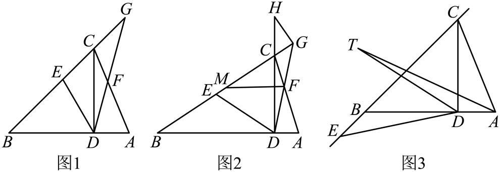

# Mathematics - 题目 2797

**ID**: 4842e593507b48b3983cbfd5abef11fe
**年级**: Grade 9
**难度**: Hard
**题型**: Calculation

## 题目
在 $\vartriangle ABC$ 中， $AB=BC$ ，过点 $C$ 作 $CD\bot AB$ 于点 $D$ ，点 $E$ 是直线 $BC$ 上一点，点 $G$ 是 $BC$ 延长线上一点，连接 $DE$ 、 $DG$ ， $DG$ 与 $AC$ 交于点 $F$ ．(1)如图 $1$ ，当点 $E$ 在线段 $BC$ 上时，若 $BD=CD$ ， $\angle BDE=60{}\degree $ ， $\angle G=30{}\degree $ ， $DE=2\sqrt {2}$ ，求 $EG$ 的长；​​​​​​​‌(2)如图 $2$ ，当点 $E$ 在线段 $BC$ 上时，延长 $DC$ 至点 $H$ ，连接 $GH$ ，满足 $HG\bot BG$ ， $\angle EDC+\angle H=90{}\degree $ ，点 $M$ 为 $BG$ 中点，连接 $MF$ ，若 $DH=2MF$ ， $AD=2EM$ ，请用等式表示线段 $BG$ 、 $GF$ 和 $GH$ 的数量关系，并证明；(3)如图 $3$ ，若 $BD=CD=2\sqrt {2}$ ，将线段 $DE$ 绕点 $D$ 顺时针旋转 $45{}\degree $ 到线段 $DT$ ，连接 $AT$ ，当 $AT$ 取得最小值时， $\vartriangle BDC$ 内部存在一点 $K$ ，使得 $\angle DCK+\angle DBK=30{}\degree $ ，当 $DK$ 取得最小值时，直接写出此时 $\vartriangle ATK$ 的面积．

## 解答

1. （1）解：过点 $E$ 作 $ES\bot DG$ 于点 $\mathrm{S}$ ，
2. 
3. ∵ $BD=CD$ ， $CD\bot AB$ ，
4. ∴ $\angle CDB=90{}\degree $ ， $\angle B=\angle BCD=45{}\degree $ ，
5. ∵ $\angle BDE=60{}\degree $ ，
6. ∴ $\angle BED=180{}\degree -\angle B-\angle BDE=75{}\degree $ ，
7. ∵ $\angle G=30{}\degree $ ，
8. ∴ $\angle EDG=\angle BED-\angle G=45{}\degree $ ，
9. ∴ $\angle DES=90{}\degree -\angle EDG=45{}\degree $ ，
10. ∴ $\angle EDG=\angle DES$ ，
11. ∴ $ES=SD$ ， $△EDS$ 是等腰直角三角形，
12. ∴ $ES=\frac {ED}{\sqrt {2}}=\frac {2\sqrt {2}}{\sqrt {2}}=2$ ，
13. 在 ${\rm{R}}{\rm{t}}△EGS$ 中， $\angle G=30{}\degree $ ，
14. ∴ $EG=2ES=4$ ；
15. （2）解： $BG=GH+2\sqrt {2}GF$ ，理由如下：
16. 如图，过点 $D$ 作 $DQ\parallel BC$ 交 $AC$ 于点 $Q$ ，过点 $D$ 作 $DP\bot DG$ 交 $BG$ 于点 $P$ ，
17. 
18. ∵ $HG\bot BG$ ，
19. ∴ $\angle HGC=90{}\degree $ ，
20. ∴ $\angle HCG+\angle H=90{}\degree $ ，
21. ∵ $\angle HCG=\angle BCD$ ， $\angle EDC+\angle H=90{}\degree $ ，
22. ∴ $\angle BCD=\angle EDC$ ，
23. ∴ $ED=EC$ ，
24. ∵ $CD\bot BD$ ，
25. ∴ $\angle EDC+\angle EDB=90{}\degree $ ， $\angle BCD+\angle B=90{}\degree $ ，
26. ∴ $\angle B=\angle EDB$ ，
27. ∴ $EB=ED=EC=\frac {1}{2}BC$ ，
28. ∵ $M$ 为 $BG$ 中点，
29. ∴ $BM=\frac {1}{2}BG$ ，
30. ∴ $EM=BM-BE=\frac {1}{2}BG-\frac {1}{2}BC=\frac {1}{2}CG$ ，
31. ∵ $AD=2EM$ ，
32. ∴ $AD=CG$ ，
33. ∵ $DQ\parallel BC$ ，
34. ∴ $\angle DQA=\angle BCA$ ， $\angle BGD=\angle FDQ$ ，
35. ∵ $AB=BC$ ，
36. ∴ $\angle A=\angle BCA$ ，
37. ∴ $\angle A=\angle DQA$ ，
38. ∴ $AD=DQ=CG$ ，
39. 在 $\mathrm{△}CGF$ 和 $△QDF$ 中，
40. $\begin{cases}\angle CFG=\angle QFD\\\angle CGF=\angle QDF\\CG=QD\end{cases}$ ，
41. ∴ $\vartriangle CGF≌\vartriangle QDF\left ({{\rm{A}}{\rm{A}}{\rm{S}}}\right )$ ，
42. ∴ $GF=FD$ ，
43. ∵ $M$ 为 $BG$ 中点，
44. ∴ $MF/\mskip-4mu/BD$ ，且 $BD=2MF$ ，
45. ∵ $DH=2MF$ ，
46. ∴ $BD=DH$ ，
47. ∵ $DP\bot DG$ ，
48. ∴ $\angle PDG=\angle BDH=90{}\degree $ ，
49. ∴ $\angle BDP=\angle HDG$ ，
50. ∵ $\angle BDH=\angle BGH=90{}\degree $ ， $\angle HCG=\angle BCD$ ，
51. ∴ $\angle H=\angle B$ ，
52. 在 $\mathrm{△}BDP$ 和 $\mathrm{△}HDG$ 中，
53. $\begin{cases}\angle B=\angle H\\BD=DH\\\angle BDP=\angle HDG\end{cases}$ ，
54. ∴ $\vartriangle BDP≌\vartriangle HDG\left ({{\rm{A}}{\rm{S}}{\rm{A}}}\right )$ ，
55. ∴ $BP=HG$ ， $DP=DG$ ，
56. ∴ $\angle BGD=45{}\degree $ ，
57. ∴ $GP=\sqrt {GD{^{2}}+DP{^{2}}}=\sqrt {2}GD=2\sqrt {2}GF$ ，
58. ∴ $BG=BP+GP=GH+2\sqrt {2}GF$ ，
59. 即 $BG=GH+2\sqrt {2}GF$ ；
60. （3）解：如图，过点 $T$ 作 $TN\bot CD$ 于点 $N$ ，延长 $TN$ 至 $W$ ，过点 $D$ 作 $DQ\bot BC$ 于点 $Q$ ，
61. 
62. ∵ $BD=CD=2\sqrt {2}$ ， $CD\bot AB$ ，
63. ∴ $\angle BDQ=\angle CDQ=45{}\degree $ ， $DQ=\frac {BD}{\sqrt {2}}=2$ ， $BC=\sqrt {2}BD=4$ ，
64. 由旋转可得 $\angle EDT=45{}\degree $ ， $ED=TD$ ，
65. ∴ $\angle EDT=\angle CDQ=45{}\degree $ ，
66. ∴ $\angle EDT+\angle TDQ=\angle CDQ+\angle TDQ$ ，
67. 即 $\angle EDQ=\angle TDN$ ，
68. ∴ $△EDQ≌△TDN$ ，
69. ∴ $DN=DQ=2$ ，
70. 可知直线 $NW$ 是固定直线，
71. ∵点 $T$ 为动点，
72. ∴点 $T$ 的轨迹为直线 $NW$ （也可以直接利用瓜豆原理，点 $E$ 的轨迹为直线 $BC$ ，则点 $T$ 轨迹为直线 $BC$ 绕点 $D$ 顺时针旋转 $45{}\degree $ ），
73. 由点到直线的上一点的最短距离为点到直线的垂线段长度，
74. 过点 $\mathrm{A}$ 作直线 $NW$ 的垂线，垂足 $T^{′}$ 即为 $AT$ 最小值时的点 $T$ ，
75. ∵ $\angle DCK+\angle DBK=30{}\degree $ ，
76. ∴ $\angle KBC+\angle KCB=\left ({\angle DBC-\angle DBK}\right )+\left ({\angle DCB-\angle DCK}\right )=90{}\degree -\left ({\angle DBK+\angle DCK}\right )=60{}\degree $ ，
77. ∴ $\angle BKC=180{}\degree -\left ({\angle KBC+\angle KCB}\right )=120{}\degree $ ，
78. 作 $\vartriangle BCK$ 的外接圆，圆心为 $O$ ，连接 $OB$ ， $OC$ ，在 $\odot O$ 上任取一点 $I$ ，
79. ∴ $\angle I=180{}\degree -\angle BKC=60{}\degree $ ，
80. ∴ $\angle BOC=120{}\degree $ ，
81. ∵ $OB=OC$ ，
82. ∴ $\angle OBC=\angle OCB=30{}\degree $ ，
83. ∵ $BD=CD$ ， $OB=OC$ ，
84. ∴ $OD$ 垂直平分 $BC$ ，设垂足为点 $Q$ ，
85. ∴ $BQ=CQ=QD=\frac {1}{2}BC=2$ ，  $∠QDC=45\mathrm{°}$ ，
86. ∴ $OQ=\frac {BQ}{\sqrt {3}}=\frac {2\sqrt {3}}{3}$ ， $OB=2OQ=\frac {4\sqrt {3}}{3}=OK$ ，
87. ∴ $\odot O$ 是定圆，
88. ∴点 $K$ 轨迹为 $\odot O$ 在三角形 $BCD$ 内部的弧，
89. 利用两点之间线段最短得 $DK+OK\leqslant OD$ ，
90. 且当 $O$ 、 $K$ 、 $D$ 共线时， $DK+OK$ 取得最小值 $OD$ ，此时点 $K^{′}$ 即为 $DK+OK$ 最小时的点 $K$ ，
91. 由 $OK=OB=\frac {4\sqrt {3}}{3}$ 是定值，
92. 则点 $K^{′}$ 即为 $DK$ 最小时的点 $K$ ，
93. 
94. ∵ $OD=OQ+QD=\frac {2}{3}\sqrt {3}+2$ ，
95. ∴ $DK^{′}=OD-OK^{′}=\frac {2}{3}\sqrt {3}+2-\frac {4}{3}\sqrt {3}=2-\frac {2}{3}\sqrt {3}$ ，
96. 过点 $K^{′}$ 作 $K^{′}L\bot AT^{′}$ 于点 $L$ ，交 $DC$ 于点 $P$ ，
97. ∴ $\angle PK^{′}D=K^{′}DP=45{}\degree $ ，
98. ∴ $K^{′}P=PD=\frac {DK^{′}}{\sqrt {2}}=\sqrt {2}-\frac {\sqrt {6}}{3}$ ，
99. ∵ $AT^{′}{\bot }NT^{′}$ ， $DN\bot NT^{′}$ ， $CD\bot AD$ ，
100. ∴四边形 $ADNT^{′}$ 是矩形，
101. ∴ $\angle DAT^{′}=90{}\degree $ ， $AT^{′}=DN=2$ ，
102. ∴四边形 $ADPL$ 是矩形，
103. ∴ $LP=AD=AB-BD=BC-BD=4-2\sqrt {2}$ ，
104. ∴ $K^{′}L=K^{′}P+PL=\sqrt {2}-\frac {\sqrt {6}}{3}+4-2\sqrt {2}=4-\sqrt {2}-\frac {\sqrt {6}}{3}$ ，
105. ∴ $S{{}_{\vartriangle AK^{′}T^{′}}}=\frac {1}{2}AT^{′}{\cdot }K^{′}L=\frac {1}{2}\times 2\times \left ({4-\sqrt {2}-\frac {\sqrt {6}}{3}}\right )=4-\sqrt {2}-\frac {\sqrt {6}}{3}$ ．

## 知识点

**中文**:
  - 全等三角形的判定与性质
  - 垂线段最短
  - 旋转的性质

**English**:
  - Determination and Properties
  - Shortest Perpendicular Segment
  - Properties of Rotation

---
