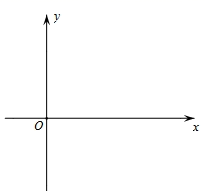

# Mathematics - 题目 3730

**ID**: 494a28551a15457b83b0114bfd9a7078
**年级**: Grade 9
**难度**: Hard
**题型**: Calculation

## 题目
在直角坐标系中，已知抛物线 $y=ax{^{2}}-4ax+c$ (a＜0)与x轴交于A、B两点(点A在点B左侧)，与y轴负半轴交于点C，顶点为D，已知 $S{{}_{\vartriangle ABD}}$ ：S_{四边形}_{ACBD}=1：4．（1）求点D的坐标(用仅含c的代数式表示)；​​​​​​​‌（2）若tan∠ACB= $\frac {1}{2}$ ，求抛物线的解析式．

## 解答

1. 解：（1）抛物线 $y=ax{^{2}}-4ax+c$ 的顶点D的坐标为  $\left ({-\frac {-4a}{2a}，\frac {4ac-(4a){^{2}}}{4a}}\right )$ ，
2. ∵ $y=ax{^{2}}-4ax+c$ 与y轴负半轴交于点C，
3. ∴C(0，c)， $OC=-c$ ，
4. 过点D作 $DG\bot x$ 轴于点G，则 $DG{\rm{=}}c-4a，$
5. 
6. ∵ $S{{}_{\vartriangle ABD}}$ ：S_{四边形}_{ACBD}=1：4,
7. ∴ $S{{}_{\vartriangle ABD}}$ ： $S{{}_{\vartriangle ABC}}$ =1：3,
8. 则 $DG:OC=1:3$ ，即 $3(c-4a)=-c$ ，
9. ∴ $c=3a$
10. ∴顶点D的坐标为(2， $c-4a$ )即（2， $-\frac {c}{3}$  ）
11. （2）由（1）得 $c=3a$ ，
12. ∴抛物线的解析式为： $y=ax{^{2}}-4ax+3a$ 或 $y=\frac {c}{3}x{^{2}}-\frac {4a}{3}x+c$ ， $OC=-c$ = $-\frac {a}{3}$ ， $AC=\sqrt {1+c{^{2}}}$ ，
13. ∴令 $y=ax{^{2}}-4ax+3a$ =0，解得 $x{{}_{1}}=1,x{{}_{2}}=3,$
14. ∴A（1,0），B（3,0）， $AB=2$ ,
15. 过点B作 $BH\bot AC$ 的延长线于点H，
16. 
17. ∴ $\angle AHB=90{}^\circ =\angle AOC,\angle HAB=\angle OAC$ (对顶角相等)，
18. ∴ $\vartriangle AHB$ ∽ $\mathrm{△}AOC$ ，tan∠ACB= $\frac {1}{2}$ = $\frac {BH}{CH}$ ， $AH{^{2}}+BH{^{2}}=AB{^{2}}$ ,
19. ∴ $\frac {BH}{OC}=\frac {AB}{AC}$ ,即 $\frac {BH}{-c}=\frac {2}{\sqrt {1+c{^{2}}}}$ ，
20. ∴ $BH=\frac {-2c}{\sqrt {1+c{^{2}}}}$ ，
21. ∴ $CH=2BH=\frac {-4c}{\sqrt {1+c{^{2}}}}$ ,
22. ∴ $AH=CH-AC=\frac {-4c}{\sqrt {1+c{^{2}}}}-\sqrt {1+c{^{2}}}=$  $\frac {-4c-1-c{^{2}}}{\sqrt {1+c{^{2}}}}$ ,
23. ∴ ${\left({\frac {-4c-1-c{^{2}}}{\sqrt {1+c{^{2}}}}}\right)^{2}}+{\left({\frac {-2c}{\sqrt {1+c{^{2}}}}}\right)^{2}}=2{^{2}}$ ,
24. ∴ $\left ({c{^{2}}+4c+3}\right )\left ({c{^{2}}+4c-1}\right )$ =0，（ $c<0$ ）
25. ∴ $c=$ -1或-3或-2+ $\sqrt {5}$ （舍）或-2- $\sqrt {5}$ （舍使AH为负值），
26. ∴抛物线的解析式为： $y=-\frac {1}{3}x{^{2}}+\frac {4}{3}x-1$ ，或 $y=-x{^{2}}+4x-3$

## 知识点

**中文**:
  - 二次函数的综合
  - 相似三角形的性质
  - 解直角三角形

**English**:
  - Comprehensive Quadratic Function Problems
  - Properties of Similar Triangles
  - Solving Right Triangles

---
