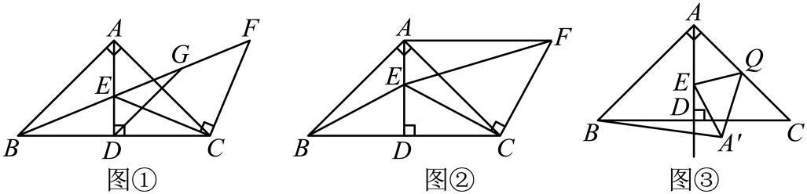

# Mathematics - 题目 779

**ID**: 4dd2a11ad2544a54b237d23c8de49056
**年级**: Grade 9
**难度**: Hard
**题型**: Calculation

## 题目
在 $\vartriangle ABC$ 中， $AB=AC$ ， $\angle BAC=90{}^\circ $ ， $AD⊥BC$ 于D，点E为线段 $AD$ 上一动点，连接 $BE$ 、 $CF$ ．将线段 $CE$ 绕点C顺时针旋转 $90{}^\circ $ 得到线段 $CF$ ，连接 $EF$ ．(1)如图①，当点B、E、F共线时，取 $EF$ 的中点G，连接 $DG$ ，当 $AB=4$ 时，求 $DG$ 的长；​​​​​​​‌(2)如图②，连接 $AF$ ，猜想 $AB$ 、 $AE$ 、 $AF$ 的数量关系，并证明你的结论；(3)如图③，当点E在直线 $AD$ 上运动时，取 $AC$ 的中点Q，连接 $QE$ ，将 $\vartriangle QAE$ 沿 $QE$ 翻折，点A落在点 $A^{′}$ 处，连接 $BA^{′}$ ，已知 $AB=4$ ，当 $BA^{′}$ 取最大值时，直接写出 $\vartriangle A{^{\prime }}BE$ 的面积．

## 解答

1. （1）解：（1）如图1，
2. 
3. 连接 $CG$ ，
4. $\because $ 将线段 $CE$ 绕点 $C$ 顺时针旋转 $90{}^\circ $ 得到线段 $CF$ ，
5. $\therefore CE=CF$ ，
6. $\because G$ 是 $EF$ 的中点，
7. $\therefore CG\bot EF$ ，
8. $\therefore \angle BGC=90{}^\circ $ ，
9. $\because D$ 是 $BC$ 的中点，
10. $\therefore DG=\frac {1}{2}BC$ ，
11. $\because \angle BAC=90{}^\circ $ ， $AB=AC=4$ ，
12. $\therefore BC=\sqrt {2}AB=4\sqrt {2}$ ，
13. $\therefore DG=2\sqrt {2}$ ；
14. （2）解：如图2，
15. 
16. 将 $\mathrm{△}ACF$ 绕点 $C$ 逆时针旋转 $90{}^\circ $ 至 $\vartriangle GCE$ ，连接 $EG$ ，
17. $\therefore CG=AC$ ， $\angle ECG=\angle ACF$ ， $EG=AF$ ，
18. $\therefore \angle ECG+\angle ACE=\angle ACF+\angle ACE$ ，
19. $\therefore \angle ACG=\angle ECF=90{}^\circ $ ，
20. $\therefore \angle CAG=\angle G=45{}^\circ $ ，
21. $\because AB=AC$ ， $\angle BAC=90{}^\circ $ ，点 $D$ 是 $BC$ 的中点，
22. $\therefore \angle CAD=45{}^\circ $ ，
23. $\therefore A$ 、 $D$ 、 $G$ 共线，
24. $\therefore AE+AF=AE+EG=AG=\sqrt {2}AC$ ，
25. $\therefore AE+AF=\sqrt {2}AB$ ；
26. （3）解：如图3，
27. 
28. 连接 $BQ$ ，
29. $\because \angle BAC=90{}^\circ $ ， $AB=4$ ， $AQ=\frac {1}{2}AC=2$ ，
30. $\therefore BQ=2\sqrt {5}$ ，
31. $\because BA^{′}{\leqslant }BQ+QA^{′}=2\sqrt {5}+AQ=2\sqrt {5}+2$ ，
32. $\therefore $ 当 $B$ 、 $Q$ 、 $A^{′}$ 共线时， $BA^{′}$ 最大，此时点 $A^{′}$ 在 $BQ$ 的延长线上 $A^{′′}$ ，
33. 如图4，
34. 
35. 作 $AR\bot BQ$ 于 $R$ ，作 $ET\bot BQ$ 于 $T$ ，设 $AE$ 和 $BQ$ 交于 $X$ ，作 $BV\bot EA^{′}$ 于 $V$ ，
36. $\because AD$ 平分 $\angle BAQ$ ，
37. $\therefore $  $\frac {BX}{XQ}=\frac {AB}{AQ}=2$ ，
38. $\because BQ=2\sqrt {5}$ ，
39. $\therefore XQ=\frac {1}{3}BQ=\frac {2\sqrt {5}}{3}$ ，
40. $\therefore XA^{′}=2+\frac {2\sqrt {5}}{3}$ ，
41. $\because \angle AQR=\angle AQB$ ， $\angle ARQ=\angle BAQ=90{}^\circ $ ，
42. $\therefore \vartriangle ARQ∽\vartriangle BAQ$ ，
43. $\therefore $  $\frac {AR}{AB}=\frac {RQ}{AQ}=\frac {AQ}{BQ}$ ，
44. $\therefore $  $\frac {AR}{4}=\frac {RQ}{2}=\frac {2}{2\sqrt {5}}$ ，
45. $\therefore AR=\frac {4\sqrt {5}}{5}$ ， $RQ=\frac {2\sqrt {5}}{5}$ ，
46. $\therefore XR=XQ-RQ=\frac {2\sqrt {5}}{3}-\frac {2\sqrt {5}}{5}=\frac {4\sqrt {5}}{15}$ ，
47. $\therefore {\tan}\angle EXT={\tan}\angle AXR=\frac {AR}{XR}=\frac {\frac {4\sqrt {5}}{5}}{\frac {4\sqrt {5}}{15}}=3$ ，
48. $\therefore $  $\frac {ET}{XT}=3$ ，
49. 设 $ET=3k$ ， $XT=k$ ，
50. $\because \angle ETX=90{}^\circ $ ， $\angle A^{′}=\angle EAQ=45{}^\circ $ ，
51. $\therefore TA^{′}=ET=3k$ ，
52. 由 $TA^{′}-XT=XA^{′}$ 得，
53. $2k=2+\frac {2\sqrt {5}}{3}$ ，
54. $\therefore k=1+\frac {\sqrt {5}}{3}$ ，
55. $\therefore ET=3k=3+\sqrt {5}$ ，
56. $\therefore EA^{′}=\sqrt {2}ET=\sqrt {2}(3+\sqrt {5})$ ，
57. $\because BV=\frac {\sqrt {2}}{2}BA^{′}=\frac {\sqrt {2}}{2}(2\sqrt {5}+2)$ ，
58. $\therefore S{{}_{\vartriangle A\prime BE}}=\frac {1}{2}EA^{′}{\cdot }BV=\frac {1}{2}\times \sqrt {2}(3+\sqrt {5})\times \frac {\sqrt {2}}{2}(2\sqrt {5}+2)=8+4\sqrt {5}$ ．

## 知识点

**中文**:
  - 几何变换——旋转综合题
  - 直角三角形斜边上的中线
  - 相似三角形的判定与性质综合
  - 解直角三角形

**English**:
  - Rotation Comprehensive Problems
  - Median to Hypotenuse of Right Triangle
  - Determination and Properties
  - Solving Right Triangles

---
