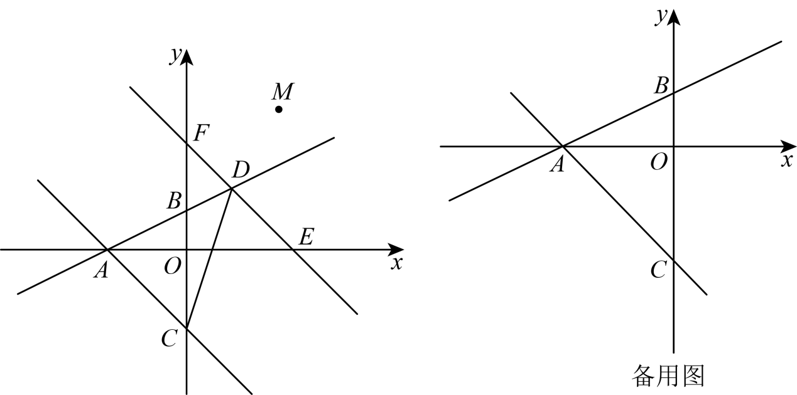

# Mathematics - 题目 2579

**ID**: 4e67e7baeccb4ae1b0de71ee26b93ce0
**年级**: Grade 9
**难度**: Hard
**题型**: Calculation

## 题目
如图，在平面直角坐标系中，直线 $AB$ 与 $x$ 轴交于点 $A(a,0)$ ，与 $y$ 轴交于点 $B\left ({0,b}\right )$ ， $a{\rm{,}}b$ 满足 ${\left({4+a}\right)^{2}}+\sqrt {b-2}=0$ ，直线 $AC$ 经过 $y$ 轴负半轴上的点 $C$ ，且 $\angle ACO=45{}\degree $ ．(1)求直线 $AC$ 的函数表达式；​​​​​​​‌(2)平移直线 $AC$ ，平移后的直线与直线 $AB$ 交于点 $D$ ，与 $y$ 轴交于点 $F\left ({0,t}\right )$ ．①已知平面内有一点 $M\left ({5,6}\right )$ ，连接 $CD{\rm{,}}MD$ ，当 $CD+MD$ 的值最小时，求 $t$ 的值；②若平移后的直线与 $x$ 轴交于点 $E$ ，是否存在点 $F$ ，使以点 $A{\rm{,}}C{\rm{,}}D{\rm{,}}E$ 为顶点的四边形为平行四边形？若存在，请直接写出点 $F$ 的坐标；若不存在，请说明理由．

## 解答

1. （1）解：∵ ${\left({4+a}\right)^{2}}+\sqrt {b-2}=0$ ，
2. 又∵ ${\left({4+a}\right)^{2}}\geqslant 0$ ， $\sqrt {b-2}\geqslant 0$ ，
3. ∴ $4+a=0$ ， $b-2=0$ ，
4. 解得 $a=-4$ ， $b=2$ ，
5. ∴ $A(-4,0)$ ， $B\left ({0,2}\right )$ ，
6. ∴ $OA=4$ ，
7. ∵ $∠AOC{\rm{=}}{{9}}{{0}}{}\degree $ ， $\angle ACO=45{}\degree $ ，
8. ∴ $\angle CAO=90{}\degree -\angle ACO=45{}\degree =\angle ACO$ ，
9. ∴ $OC=OA=4$ ，
10. ∴ $C\left ({0,-4}\right )$ ，
11. 设直线 $AC$ 的函数表达式为 $y=k{{}_{1}}x+b{{}_{1}}\left ({k{{}_{1}}\ne 0}\right )$ ，
12. 将点 $A(-4,0)$ ， $C\left ({0,-4}\right )$ 代入，
13. 可得 $\begin{cases}0=-4k{{}_{1}}+b{{}_{1}}\\-4=b{{}_{1}}\end{cases}$ ，解得 $\begin{cases}k{{}_{1}}=-1\\b{{}_{1}}=-4\end{cases}$ ，
14. ∴直线 $AC$ 的函数表达式为 $y=-x-4$ ；
15. （2）①根据题意，平移直线 $AC$ ，平移后的直线与直线 $AB$ 交于点 $D$ ，与 $y$ 轴交于点 $F\left ({0,t}\right )$ ，
16. 则可设直线 $EF$ 的函数表达式为 $y=-x+t$ ；
17. 设直线 $AB$ 的函数表达式为 $y=k{{}_{2}}x+b{{}_{2}}\left ({k{{}_{2}}\ne 0}\right )$ ，
18. 将点 $A(-4,0)$ ， $B\left ({0,2}\right )$ 代入，
19. 可得 $\begin{cases}0=-4k{{}_{2}}+b{{}_{2}}\\2=b{{}_{2}}\end{cases}$ ，解得 $\begin{cases}k{{}_{2}}=\frac {1}{2}\\b{{}_{2}}=2\end{cases}$ ，
20. ∴直线 $AB$ 的函数表达式为 $y=\frac {1}{2}x+2$ ；
21. 如下图，连接 $DM、CM$ ，
22. 
23. ∵ $CD+MD\geqslant MC$ ，
24. ∴当点 $M、D、C$ 在同一直线上时， $CD+MD$ 取最小值，
25. 此时，设直线 $MC$ 的解析式为 $y=k{{}_{3}}x+b{{}_{3}}\left ({k{{}_{3}}\ne 0}\right )$ ，
26. 将点 $C\left ({0,-4}\right )$ ， $M\left ({5,6}\right )$ 代入，
27. 可得 $\begin{cases}-4=b{{}_{3}}\\6=5k{{}_{3}}+b{{}_{3}}\end{cases}$ ，解得 $\begin{cases}k{{}_{3}}=2\\b{{}_{3}}=-4\end{cases}$ ，
28. ∴直线 $MC$ 的解析式为 $y=2x-4$ ，
29. 联立直线 $MC$ 的解析式 $y=2x-4$ 与直线 $AB$ 的表达式 $y=\frac {1}{2}x+2$ ，
30. 可得 $\begin{cases}y=2x-4\\y=\frac {1}{2}x+2\end{cases}$ ，解得 $\begin{cases}x=4\\y=4\end{cases}$ ，
31. ∴ $D\left ({4,4}\right )$ ，
32. ∴将点 $D\left ({4,4}\right )$ 代入直线 $EF$ 表达式 $y=-x+t$ ，
33. 可得 $4=-4+t$ ，解得 $t=8$ ；
34. ②当点 $E$ 在点 $\mathrm{A}$ 右侧时，如下图，过点 $D$ 作 $DM\bot x$ 轴于点 $M$ ，
35. 
36. ∵四边形 $ACED$ 为平行四边形，
37. ∴ $AC=ED$ ， $AC{\rm{/\mskip-4mu/}}ED$ ，
38. ∴ $\angle OAC=\angle MED$ ，
39. 又∵ $\angle AOC=\angle EMD=90{}\degree $ ，
40. ∴ $\vartriangle AOC≌\vartriangle EMD({\rm{A}}{\rm{A}}{\rm{S}})$ ，
41. ∴ $MD=OC=4$ ，即 $y{{}_{D}}=4$ ，
42. 将 $y{{}_{D}}=4$ 代入直线 $AB$ 的表达式 $y=\frac {1}{2}x+2$ ，
43. 可得 $4=\frac {1}{2}x+2$ ，解得 $x=4$ ，
44. ∴ $D\left ({4,4}\right )$ ，
45. ∴将点 $D\left ({4,4}\right )$ 代入直线 $EF$ 表达式 $y=-x+t$ ，
46. 可得 $4=-4+t$ ，解得 $t=8$ ，即 $F\left ({0,8}\right )$ ；
47. 当点 $E$ 在点 $\mathrm{A}$ 左侧时，如下图，过点 $D^{′}$ 作 $D^{′}N\bot x$ 轴于点 $N$ ，
48. 
49. ∵四边形 $ACD^{′}E^{′}$ 为平行四边形，
50. ∴ $AC=E^{′}D^{′}$ ， $AC{\rm{/\mskip-4mu/}}E^{′}D^{′}$ ，
51. ∴ $\angle OAC=\angle NE^{′}D^{′}$ ，
52. 又∵ $\angle AOC=\angle E^{′}ND^{′}=90{}\degree $ ，
53. ∴ $\vartriangle AOC≌\vartriangle E^{′}ND^{′}({\rm{A}}{\rm{A}}{\rm{S}})$ ，
54. ∴ $ND^{′}=OC=4$ ，即 $y{{}_{D^{′}}}=-4$ ，
55. 将 $y{{}_{D^{′}}}=-4$ 代入直线 $AB$ 的表达式 $y=\frac {1}{2}x+2$ ，
56. 可得 $-4=\frac {1}{2}x+2$ ，解得 $x=-12$ ，
57. ∴ $D^{′}{\left ({-12,-4}\right )}$ ，
58. ∴将点 $D^{′}{\left ({-12,-4}\right )}$ 代入直线 $EF$ 表达式 $y=-x+t$ ，
59. 可得 $-4=12+t$ ，解得 $t=-16$ ，即 $F^{′}{\left ({0,-16}\right )}$ ．
60. 综上所述，点 $F$ 的坐标为 $\left ({0,8}\right )$ 或 $\left ({0,-16}\right )$ ．

## 知识点

**中文**:
  - 全等三角形的判定与性质
  - 待定系数法求一次函数解析式
  - 算术平方根非负性的应用

**English**:
  - Determination and Properties
  - Finding Expressions by Undetermined Coefficients
  - Applications of Non-negativity of Arithmetic Square Roots

---
