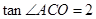
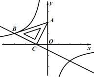

# Mathematics - 题目 1007

**ID**: 564271bb16f84a3486b5c0d64294e6ef
**年级**: Grade 9
**难度**: Hard
**题型**: Calculation

## 题目
如图，在平面直角坐标系中，将一块等腰直角三角板ABC放在第二象限，斜靠在两坐标轴上，点C坐标为（-1，0），．一次函数 $y=kx+b$ 的图象经过点B、C，反比例函数 $y=\frac {m}{x}$ 的图象经过点B．（1）求一次函数和反比例函数的关系式；​​​​​​​‌（2）直接写出当x＜0时， $kx+b-\frac {m}{x}<0$ 的解集；（3）在 $x$ 轴上找一点M，使得AM+BM的值最小，并求出点M的坐标和AM+BM的最小值．

## 解答

1. （1）过B作BD垂直于x轴；
2. 
3. 点C坐标为（-1，0），；
4. 则OC=1；
5. 在直角三角形AOC中AO=OC$\times $  ${\tan}\angle ACO$ =2，
6. $\therefore $AC=  $\sqrt {AO{^{2}}+OC{^{2}}}=\sqrt {5}$ ， ${\sin}\angle CAO=\frac {OC}{AC}=\frac {\sqrt {5}}{5}$ ；
7. 在平面直角坐标系中，将一块等腰直角三角板ABC放在第二象限，则BC=AC= $\sqrt {5}$ ；
8. 易知 $ΔBCD\cong ΔAOC$ ；
9. 则 $\angle BCD=\angle CAO$ ，
10. 所以 ${\sin}\angle BCD={\sin}\angle CAO=\frac {\sqrt {5}}{5}$ ；
11. 在直角三角形BCD中BD=1；CD=  $\sqrt {BC{^{2}}-BD{^{2}}}=2$ ；
12. 所以B的坐标（-3，1），
13. 代入 $y=\frac {m}{x}$ ，解得m=-3，
14. 所以反比例函数的关系式 $y=-\frac {3}{x}$ ；
15. C坐标为（-1，0），
16. 待定系数法解得一次函数的关系式 $y=-\frac {1}{2}x-\frac {1}{2}$
17. （2）不等式 $kx+b-\frac {m}{x}<0$ 的解集即是不等式 $kx+b<\frac {m}{x}$ 的解集，
18. 不等式 $kx+b<\frac {m}{x}$ 可把它看成是一次函数的关系式与反比例函数的关系式 $y=-\frac {3}{x}$ ，
19. 则 $kx+b<\frac {m}{x}$ 的意思是在图象上去找一次函数在反比例函数下方的x的范围
20. 即 $-3<x<0$
21. （3）作点A关于x轴的对称点A′，连接BA′与x轴的交点即为点M，
22. 设直线 $BA^{′}$ 的解析式为 $y=ax+b$ ，将点 $A^{′}$ 及点B的坐标代入可得：
23. $\begin{cases}-3a+b=1\\b=-2\end{cases}$
24. 解得： $\begin{cases}a=-1\\b=-2\end{cases}$
25. 故直线 $BA^{′}$ 的解析式为 $y=-x-2$
26. 令 $y=0$ ，可得 $-x-2=0$
27. 解得： $x=-2$
28. $\therefore $ 点M的坐标为（-2,0），
29. AM+BM= $BM+MA^{′}=BA^{′}=\sqrt {{\left({-3-0}\right)^{2}}+\left [1-\left ({-2}\right )\right ]{^{2}}}=3\sqrt {2}$
30. 综上所述，点M的坐标为（-2，0），AM+BM的最小值为 $3\sqrt {2}$
31. 
32. 考点：一次函数和反比例函数
33. 【点评】本题考查一次函数和反比例函数，会求一次函数和反比例函数的解析式，并会观察函数图象得出不等式的解集

## 知识点

**中文**:
  - 反比例函数综合
  - 反比例函数解析式
  - 解直角三角形
  - 待定系数法求一次函数解析式

**English**:
  - Comprehensive Inverse Proportionality Problems
  - Analytic Expression of Inverse Proportionality
  - Solving Right Triangles
  - Finding Expressions by Undetermined Coefficients

---
