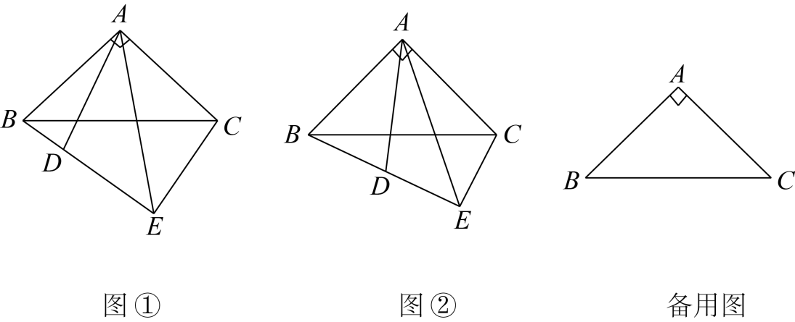

# Mathematics - 题目 700

**ID**: 583f9062950e463796a9f503874e1e32
**年级**: Grade 9
**难度**: Hard
**题型**: Calculation

## 题目
在 $\vartriangle ABC$ 中， $\angle BAC=90{}\degree ,AB=AC$ ，线段 $AB$ 绕点A逆时针旋转至 $AD$ （ $AD$ 不与 $AC$ 重合），旋转角记为 $α$ ， $∠DAC$ 的平分线 $AE$ 与射线 $BD$ 相交于点E，连接 $EC$ ．(1)如图①，当 $α=20{}\degree $ 时， $\angle AEB$ 的度数是；​​​​​​​‌(2)如图②，当 $0{}\degree <α<90{}\degree $ 时，求证： $BD+2CE=\sqrt {2}AE$ ；(3)当 $0{}\degree <α<180{}\degree ,AE=2CE$ 时，请直接写出 $\frac {BD}{ED}$ 的值．

## 解答

1. （1）解：由旋转可知， $AB=AD$ ，当 $α=20{}\degree $ 时，
2. 可知 $\angle ABD=\angle ADB=\frac {180{}\degree -α}{2}=\frac {180{}\degree -20{}\degree }{2}=80{}\degree $ ，
3. ∵ $\angle BAC=90{}\degree $ ， $AE$ 是 $∠DAC$ 的平分线，
4. ∴ $\angle DAE=\frac {\angle BAC-α}{2}=\frac {90{}\degree -20{}\degree }{2}=35{}\degree $ ，
5. ∴ $\angle AEB=\angle ADB-\angle DAE=80{}\degree -35{}\degree =45{}\degree $ ．
6. 故答案为： $45{}\degree $ ；
7. （2）证明：延长 $DB$ 到F，使 $BF=CE$ ，连接 $AF$ ．
8. 
9. ∵ $AB=AC$ ， $AD=AB$ ，
10. ∴ $AD=AC$ ，
11. ∵ $AE$ 平分 $∠DAC$ ，
12. ∴ $\angle DAE=\angle CAE$ ，
13. ∵ $AE=AE$ ，
14. ∴ $△ADE≌△ACE$ ，
15. ∴ $\angle DEA=\angle CEA$ ， $\angle ADE=\angle ACE$ ， $\angle DE=CE$ ，
16. ∵ $AB=AD$ ，
17. ∴ $\angle ABD=\angle ADB$ ，
18. ∵ $\angle ADE+\angle ADB=180{}\degree $ ，
19. ∴ $\angle ACE+\angle ABD=180{}\degree $ ，
20. ∵ $\angle BAC=90{}\degree $ ，
21. ∴ $\angle BEC=360{}\degree -(\angle ACE+\angle ABD)-\angle BAC=360{}\degree -180{}\degree -90{}\degree =90{}\degree $ ，
22. ∵ $\angle DEA=\angle CEA$
23. ∴ $\angle DEA=\angle CEA=\frac {1}{2}\times 90{}\degree =45{}\degree $ ，
24. ∵ $\angle ABF+\angle ABD=180{}\degree $ ， $\angle ACE+\angle ABD=180{}\degree $ ，
25. ∴ $\angle ABF=\angle ACE$ ，
26. ∵ $AB=AC$ ， $BF=CE$ ，
27. ∴ $\mathrm{△}ABF≌\mathrm{△}ACE$ ，
28. ∴ $AF=AE$ ， $\angle AFB=\angle AEC=45{}\degree $ ，
29. ∴ $\angle FAE=180{}\degree -\angle AFB-\angle DEA=180{}\degree -45{}\degree -45{}\degree =90{}\degree $ ，
30. 在 $\mathrm{R}\mathrm{t}\vartriangle \mathrm{A}\mathrm{F}\mathrm{E}$ 中， $\mathrm{∠}FAE=90{}\degree $ ，
31. ∵ ${\cos}\angle AEF=\frac {AE}{EF}$ ，
32. ∴ $EF=\frac {AE}{{\cos}\angle AEF}=\frac {AE}{{\cos}45{}\degree }=\sqrt {2}AE$ ，
33. ∵ $EF=BF+BD+DE=CE+BD+CE=BD+2CE$ ，
34. ∴ $BD+2CE=\sqrt {2}AE$ ；
35. （3）①当 $0{}\degree <α<90{}\degree $ 时，由（2）可知，
36. $DE=CE$ ， $BD+2CE=\sqrt {2}AE$ ，
37. ∴ $BD=\sqrt {2}AE-2CE$ ，
38. 当 $AE=2CE$ 时，可知 $BD=\sqrt {2}\times 2CE-2CE=(2\sqrt {2}-2)CE$ ，
39. ∴ $\frac {BD}{ED}=\frac {(2\sqrt {2}-2)CE}{ED}=\frac {(2\sqrt {2}-2)CE}{CE}=2\sqrt {2}-2$ ；
40. ②当 $90{}\degree \leqslant α<180{}\degree $ 时，如下图，在线段BD上取点F，使得 $BF=CE$ ，
41. 
42. 由（2）可知， $△ADE≌△ACE$ ，
43. ∴ $DE=CE$ ， $\angle ADE=\angle ACE$ ，
44. ∵ $AB=AC$ ，
45. ∴ $∠ABF=∠ADE$ ，
46. ∴ $\angle ABF=\angle ACE$ ，
47. ∵ $BF=CE$ ，
48. ∴ $△ABF≌△ACE(SAS)$ ，
49. ∴ $\angle BAF=\angle CAE$ ， $AE=AF$ ，
50. ∴ $\angle EAF=\angle CAF+\angle CAE=\angle CAF+\angle BAF=\angle BAC=90{}\degree $ ，
51. ∴ $\angle AEF=\angle AFE=\frac {180{}\degree -\angle EAF}{2}=45{}\degree $ ，
52. 在 $\mathrm{R}\mathrm{t}\vartriangle \mathrm{A}\mathrm{F}\mathrm{E}$ 中， ${\cos}\angle AEF=\frac {AE}{EF}$ ，
53. ∴ $EF=\frac {AE}{{\cos}\angle AEF}=\frac {AE}{{\cos}45{}\degree }=\sqrt {2}AE$ ，
54. ∴ $BD=BF+EF+DE=CE+\sqrt {2}AE+CE=\sqrt {2}AE+2CE$ ，
55. 当 $AE=2CE$ 时，可知 $BD=\sqrt {2}\times 2CE+2CE=(2\sqrt {2}+2)CE$ ，
56. ∴ $\frac {BD}{ED}=\frac {(2\sqrt {2}+2)CE}{ED}=\frac {(2\sqrt {2}+2)CE}{CE}=2\sqrt {2}+2$ ．
57. 综上所述，当 $0{}\degree <α<180{}\degree ,AE=2CE$ 时，  $\frac {BD}{ED}=2\sqrt {2}+2$ 或 $\frac {BD}{ED}=2\sqrt {2}-2$ ．

## 知识点

**中文**:
  - 全等三角形的判定与性质
  - 旋转的性质
  - 解直角三角形

**English**:
  - Determination and Properties
  - Properties of Rotation
  - Solving Right Triangles

---
