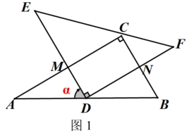
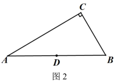
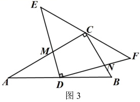

# Mathematics - 题目 1734

**ID**: 66f137128eab4ce7a89116abd1168922
**年级**: Grade 9
**难度**: Hard
**题型**: Calculation

## 题目
已知，在Rt△ABC和Rt△DEF中，∠ACB=∠EDF=90°，∠A=30°，∠E=45°，AB=EF=6，如图1，D是斜边AB的中点，将等腰Rt△DEF绕点D顺时针方向旋转角α（0°<α<90°），在旋转过程中，直线DE，AC相交于点M，直线DF，BC相交于点N．（1）如图1，当α=60°时，求证：DM=BN；​​​​​​​‌（2）在上述旋转过程中， $\frac {DN}{DM}$ 的值是一个定值吗？请在图2中画出图形并加以证明；（3）如图3，在上述旋转过程中，当点C落在斜边EF上时，求两个三角形重合部分四边形CMDN的面积．

## 解答

1. 解：（1）由题意，∵ $α=60{}^\circ $ ， $\angle EDF=90{}^\circ $ ，∴ $\angle BDN=30{}^\circ $ ，
2. ∴ $\angle BDN=\angle A$ ， $\angle B=\angle EDA$ ，
3. ∵点 $D$ 是斜边 $AB$ 的中点，∴ $AD=BD$ ，
4. ∴ $△ADM\mathrm{≌}△DBN$ ，∴ $DM=BN$ ．
5. （2） $\frac {DN}{DM}=\sqrt {3}$ ，是一个定值．
6. 证明：如图1，作 $DP\bot AC$ 于点 $P$ ， $DQ\bot BC$ 于点 $Q$ ，∴ $\angle NQD=\angle MPD=90{}^\circ $ ，
7. 
8. 又∵ $\angle MDN=\angle PDQ=90{}^\circ $ ，∴ $\angle NDQ=\angle MDP$ ，
9. ∴ $△NDQ∽△MDP$ ，∴ $\frac {DN}{DM}=\frac {DQ}{DP}$ ，
10. 在 ${\rm{R}}{\rm{t}}△BDQ$ 中， $\angle B=60{}^\circ $ ，∴tan∠B $=\frac {DQ}{BQ}=\sqrt {3}$
11. 又由（1）可知： $DP=BQ$ ，
12. ∴ $\frac {DQ}{DP}=\sqrt {3}$ ，
13. ∴ $\frac {DN}{DM}=\sqrt {3}$ ．
14. （3）连接 $CD$ ，作 $CG\bot DE$ 于点 $G$ ， $CH\bot DF$ 于点 $H$ ，
15. 
16. 在 $Rt\vartriangle ABC$ 中，点 $D$ 是 $AB$ 的中点，∴ $CD=\frac {1}{2}AB=3$ ，
17. ∵ $AB=EF$ ，∴ $CD=\frac {1}{2}EF$ ，∵ $\angle EDF=90{}^\circ $ ，∴ $C$ 是 $EF$ 中点，
18. ∴ $CD$ 平分 $\angle EDF$ ， $\angle CDE=45{}^\circ $ ，
19. ∵ $CG\bot DE$ ， $CH\bot DF$ ，∴ $CG=CH$ ，
20. ∵ $\angle CGD=\angle CHD=\angle EDF=90{}^\circ $ ，
21. ∴四边形 $CGDH$ 为正方形， $\angle GCH=90{}^\circ $ ，
22. ∴ $\angle GCM=\angle HCN$ ，∴ $△CHN\mathrm{≌}△CGM$ ，
23. ∴ ${\rm{S}}$_{四边形}${{}_{{\rm{C}}{\rm{M}}{\rm{D}}{\rm{N}}}}={\rm{S}}$_{正方形}${{}_{CGDH}}=\frac {1}{2}CD{^{2}}=\frac {9}{2}$ ．

## 知识点

**中文**:
  - 几何变换——旋转综合题

**English**:
  - Rotation Comprehensive Problems

---
