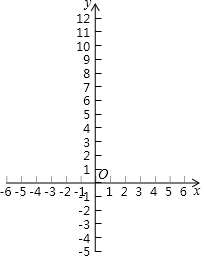

# Mathematics - 题目 2619

**ID**: 707ce6cc545748c791da6166b56a5ce6
**年级**: Grade 9
**难度**: Hard
**题型**: Calculation

## 题目
在平面直角坐标系 $xOy$ 中，抛物线 $C{{}_{1}}:y=x{^{2}}+bx+c$ 与 $x$ 轴交于点 $A,B$ （点 $A$ 在点 $B$ 的左侧），对称轴与 $x$ 轴交于点（3，0），且 $AB=4$ ．（1）求抛物线 $C{{}_{1}}$ 的表达式及顶点坐标；​​​​​​​‌（2）将抛物线 $C{{}_{1}}$ 平移，得到的新抛物线 $C{{}_{2}}$ 的顶点为（0，﹣1），抛物线 $C{{}_{1}}$ 的对称轴与两条抛物线 $C{{}_{1}}$ ， $C{{}_{2}}$ 围成的封闭图形为 $M$ ．直线 $l:y=kx+m\left ({k\ne 0}\right )$ 经过点 $B$ ．若直线 $l$ 与图形 $M$ 有公共点，求 $k$ 的取值范围．

## 解答

1. （1）∵抛物线 $C{{}_{1}}$ 的对称轴与 $x$ 轴交于点（3，0），
2. ∴抛物线 $C{{}_{1}}$ 的对称轴为直线 $x=3$ ．
3. 又∵ $AB=4$ ，
4. ∴ $A\left ({1,0}\right ),B\left ({5,0}\right )$ ．
5. ∴ $\begin{cases}1{\rm{+}}{\rm{b}}{\rm{+}}{\rm{c}}{\rm{=}}{\rm{0}}\\25+5b+c=0\end{cases}$
6. 解得 $\begin{cases}b=-6\\c=5\end{cases}$
7. ∴抛物线 $C{{}_{1}}$ 的表达式为 $y=x{^{2}}-6x+5$.
8. 即 $y={\left({x-3}\right)^{2}}-4$ ．
9. ∴抛物线 $C{{}_{1}}$ 的顶点为 $D\left ({3,-4}\right )$ ．
10. （2）∵平移后得到的新抛物线 $C{{}_{2}}$ 的顶点为 $\left ({0,-1}\right )$ ，
11. ∴抛物线 $C{{}_{2}}$ 的表达式为 $y=x{^{2}}-1$ ．
12. ∴抛物线 $C{{}_{1}}$ 的对称轴 $x=3$ 与抛物线 $C{{}_{2}}$ 的交点为 $E\left ({3,8}\right )$
13. ①当直线 $l$ 过点 $B\left ({5,0}\right )$ 和点 $D\left ({3,-4}\right )$ 时，
14. 得 $\begin{cases}5k+m=0\\3k+m=-4\end{cases}$
15. 解得 $k{{}_{BD}}=2$ ．
16. ②当直线 $l$ 过点 $B\left ({5,0}\right )$ 和点 $E\left ({3.-4}\right )$ 时，
17. 得 $\begin{cases}5k+m=0\\3k+\,m\,=8\end{cases}$
18. 解得 $k{{}_{BE}}=-4$
19. ∴结合函数图象可知， $k$ 的取值范围是 $-4\leqslant k\leqslant 2$ 且 $k\ne 0$ ．
20. 

## 知识点

**中文**:
  - 二次函数的综合

**English**:
  - Comprehensive Quadratic Function Problems

---
