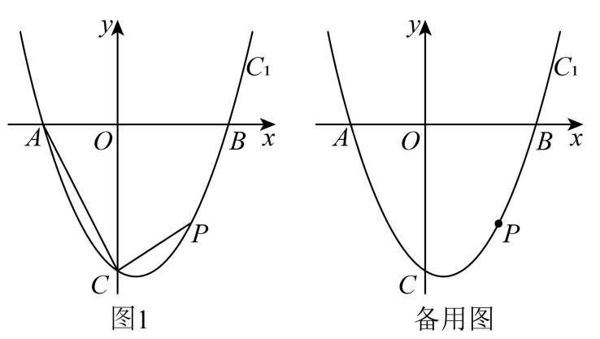

# Mathematics - 题目 3825

**ID**: 717fc97a50984c15a96c5b7e70a0deed
**年级**: Grade 9
**难度**: Hard
**题型**: Calculation

## 题目
已知抛物线 $C{{}_{1}}:y=ax{^{2}}+bx+c\left ({a\ne 0}\right )$ 与x轴交于点 $A\left ({-2,0}\right )$ 和点 $B\left ({3,0}\right )$ ，与y轴交于点 $C\left ({0,-4}\right )$ ．(1)求抛物线 $C{{}_{1}}$ 的解析式；​​​​​​​‌(2)如图1，若点 $P\left ({m,n}\right )$ 是抛物线 $C{{}_{1}}$_{ }在第四象限上的任意一点，①连接 $AC，CP$ ，点D为y轴上一个动点，是否存在这样的点P和点D，使得以A、C、P、D为顶点的四边形是平行四边形，如果存在，请直接写出点P的坐标；如果不存在，请说明理由．②将点P按竖直方向向下平移m个单位到点Q，求点Q到x轴距离的最大值．

## 解答

1. （1）解：∵抛物线 $C{{}_{1}}:y=ax{^{2}}+bx+c\left ({a\ne 0}\right )$ 与y轴交于点 $C\left ({0,-4}\right )$ ，
2. ∴ $c=-4$ ，
3. ∵抛物线 $C{{}_{1}}:y=ax{^{2}}+bx-4\left ({a\ne 0}\right )$ 与x轴交于点 $A\left ({-2,0}\right )$ 和点 $B\left ({3,0}\right )$ ，
4. 可得 $\begin{cases}0=4a-2b-4\\0=9a+3b-4\end{cases}$ ，
5. 解得 $\begin{cases}a=\frac {2}{3}\\b=-\frac {2}{3}\end{cases}$ ，
6. $\therefore $ 抛物线 $C{{}_{1}}$  的解析式为 $y=\frac {2}{3}x{^{2}}-\frac {2}{3}x-4$ ；
7. （2）解：①存在，如图，过点 $P$ 作 $PE\bot y$ 轴，交于点 $E$ ，
8. ，
9. 当四边形 $DACP$ 为平行四边形时， $AD=PC$ ， $AD\mathrm{/\mskip-4mu/}PC$ ，
10. $\therefore \angle ADO=\angle PCE$ ，
11. $\because \angle AOD=\angle PEC=90{}\degree $ ，
12. $\therefore \vartriangle ADO≌\vartriangle PCE\left ({AAS}\right )$ ，
13. $\therefore AO=EP=2$ ，即点 $P$ 的横坐标为 $2$ ，
14. 当 $x=2$ 时， $y=2{^{2}}\times \frac {2}{3}-\frac {2}{3}\times 2-4=-\frac {8}{3}$ ，
15. 则 $P\left ({2,-\frac {8}{3}}\right )$ ，
16. 故存在点 $P\left ({2,-\frac {8}{3}}\right )$ ，使得以A、C、P、D为顶点的四边形是平行四边形；
17. ②∵点 $P\left ({m,n}\right )$ 是抛物线 $C{{}_{1}}$ 在第四象限上的任意一点
18. ∴ $0<m<3$ ， $n=\frac {2}{3}m{^{2}}-\frac {2}{3}m-4$ ，
19. ∵点 $P$ 按竖直方向向下平移 $m$ 个单位到点 $Q$ ，
20. ∴ $Q\left ({m,\frac {2}{3}m{^{2}}-\frac {2}{3}m-4-m}\right )$ ，
21. ∴点 $Q$ 到x轴的距离为 $-\left ({\frac {2}{3}m{^{2}}-\frac {2}{3}m-4-m}\right )=-\frac {2}{3}m{^{2}}+\frac {5}{3}m+4=-\frac {2}{3}{\left({m-\frac {5}{4}}\right)^{2}}+\frac {121}{24}$ ，
22. 此时 $m=\frac {5}{4}$ 满足 $0<m<3$ ，
23. ∴点 $Q$ 到x轴的距离的最大值为 $\frac {121}{24}$ ．

## 知识点

**中文**:
  - 二次函数与一元二次方程
  - 二次函数的最值
  - 二次函数的综合

**English**:
  - Quadratic Functions and Quadratic Equations
  - Maximum/Minimum of Quadratic Functions
  - Comprehensive Quadratic Function Problems

---
