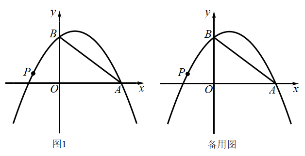

# Mathematics - 题目 3560

**ID**: 83b08613e3404f1ca569b2b5abe9341d
**年级**: Grade 9
**难度**: Hard
**题型**: Calculation

## 题目
如图1，以直线 $x=1$ 为对称轴的抛物线 $=ax{^{2}}+bxtc(a,b,c$ 为常数)经过点A $\left ({4,0}\right )$ 和B $\left ({0,3}\right )$ ．$\left ({1}\right )$ 求该抛物线的解析式；​​​​​​​‌$\left ({2}\right )$ 若点 $P$ 是该抛物线上的一动点，设点 $P$ 的横坐标为 $m$ ．①当 $△PAB$ 是以 $AB$ 为直角边的直角三角形时，求 $m$ 的值；②若 $P$ 满足 $\angle PBA+\angle BAO=45{}^\circ $ ，直接写出 $m$ 的值．

## 解答

1. $\left ({1}\right )$  $\because $  $x=1$ 是抛物线 $y=ax{^{2}}+bx+c{\rm{\;}}(a,b,c$ 为常数)的对称轴，且经过点A $\left ({4,0}\right )$ 和B $\left ({0,3}\right )$
2. $\therefore \begin{cases}-\frac {b}{2a}=1\\16a+4b+c=0\\c=3\end{cases}$
3. 解得： $\begin{cases}a=-\frac {3}{8}\\b=\frac {3}{4}\\c=3\end{cases}$
4. $\therefore $ 该抛物线的解析式为： $y=-\frac {3}{8}x{^{2}}+\frac {3}{4}x+3$
5. $\left ({2}\right )$ 设 $P\left ({m,-\frac {3}{8}m{^{2}}+\frac {3}{4}m+3}\right )$
6. 
7. ① $\left ({I}\right )$ 若点B为直角顶点，作 $PB\bot AB$ ， $PE\bot OB$ 交OB与点E
8. 易证 $△AOB\sim △BEP$
9. $\therefore \frac {AO}{BE}=\frac {OB}{EP}$
10. 即 $\frac {4}{3-\left ({-\frac {3}{8}m{^{2}}+\frac {3}{4}m+3}\right )}=\frac {3}{-m}$
11. 解得： $m=-\frac {14}{9}$ 或 $m=0$ （舍去）
12. $\left ({II}\right )$ 若点A为直角顶点， $P^{′}A\bot AB$ , $P^{′}E^{′}{\bot }x$ 轴
13. 易证 $△AOB\sim △P^{′}E^{′}A$
14. 即 $\frac {4}{-\left ({-\frac {3}{8}m{^{2}}+\frac {3}{4}m+3}\right )}=\frac {3}{4-m}$
15. 解得： $m=-\frac {14}{9}$ 或4（舍去）
16. ② $\left ({I}\right )$ 在 $x$ 轴上找到 $\left ({3，0}\right )$ 记为点C，连接BC并延长交抛物线于点P，此时 $\angle BCO=\angle ABP+\angle BAO=45{}^\circ $
17. 设 $y{{}_{BC}}=kx+b$
18. $\because $ 解析式过点 $B\left ({0,3}\right )$ , $C\left ({3,0}\right )$
19. $\therefore \begin{cases}k=-1\\b=3\end{cases}$
20. $\therefore $ 直线BC所在解析式为 $y{{}_{BC}}=-x+3$
21. $\therefore \begin{cases}y=-x+3\\y=-\frac {3}{8}x{^{2}}+\frac {3}{4}x+3\end{cases}$
22. 解得： $x=\frac {14}{3}$ 或 $x=0$ （舍去）
23. $\therefore m=\frac {14}{3}$
24. $\left ({II}\right )$ 作 $\angle P^{′}BA=\angle PBA$ 交抛物线于点 $P^{′}$ ，过点C作 $CE\bot AB$ 于E并延长交 $BP^{′}$ 于点 $C^{′}$
25. $\therefore CE=CE^{′}$ , $BC=BC^{′}$
26. $\because A\left ({4,0}\right ),B\left ({0,3}\right )$
27. $\therefore AB=5$
28. $\because OC=3,OA=4$
29. $\therefore AC=1$
30. 在 $Rt\vartriangle AEC$ 中， $AE{^{2}}+CE{^{2}}=AC{^{2}}=1①$
31. 在 $Rt△BEC$ 中， $BE{^{2}}+CE{^{2}}=BC{^{2}}=18$
32. 即 ${\left({5-AE}\right)^{2}}+CE{^{2}}=18②$
33. 将①②联立解得： $AE=\frac {4}{5},CE=\frac {3}{5}$
34. 设 $C^{′}{\left ({a,b}\right )}$ ，则点 $E\left ({\frac {3+a}{2},\frac {b}{2}}\right )$
35. $\because C\left ({3,0}\right ),A\left ({4,0}\right ),$
36. $\therefore AE{^{2}}={\left({4-\frac {3+a}{2}}\right)^{2}}+{\left({\frac {b}{2}}\right)^{2}}={\left({\frac {4}{5}}\right)^{2}}①$
37. $CE{^{2}}={\left({3-\frac {3+a}{2}}\right)^{2}}+{\left({\frac {b}{2}}\right)^{2}}={\left({\frac {3}{5}}\right)^{2}}②$
38. 将①②联立解得： $a=3.72,b=0.96$
39. $\therefore C^{′}{\left ({3.72,0.96}\right )}$
40. 设 $BP^{′}$ 直线解析式为： $y{{}_{BP^{′}}}=k{{}_{1}}+b{{}_{1}}$
41. $\therefore \begin{cases}3.72k{{}_{1}}+b{{}_{1}}=0.96\\b{{}_{1}}=3\end{cases}$
42. $\therefore \begin{cases}k{{}_{1}}=-\frac {136}{31}\\b{{}_{1}}=3\end{cases}$
43. $\therefore y{{}_{BP^{′}}}=-\frac {136}{31}x+3$
44. $\therefore \begin{cases}y=-\frac {136}{31}x+3\\y=-\frac {3}{8}x{^{2}}+\frac {3}{4}x+3\end{cases}$
45. 解得： $x=\frac {198}{31}$ 或 $x=0$ （舍去）
46. $\therefore m=\frac {198}{31}$
47. 

## 知识点

**中文**:
  - 二次函数的综合
  - 勾股定理
  - 相似三角形的判定与性质综合

**English**:
  - Comprehensive Quadratic Function Problems
  - Pythagorean Theorem
  - Determination and Properties

---
