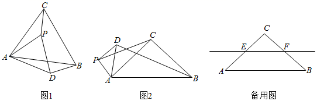

# Mathematics - 题目 166

**ID**: 845ea137ece445bda1dd806930d157fc
**年级**: Grade 9
**难度**: Hard
**题型**: Calculation

## 题目
在 $ΔABC$ ， $CA=CB$ ， $\angle ACB=α$ ．点P是平面内不与点A，C重合的任意一点．连接AP，将线段AP绕点P逆时针旋转α得到线段DP，连接AD，BD，CP．（1）观察猜想如图1，当 $α=60^\circ $ 时， $\frac {BD}{CP}$ 的值是，直线BD与直线CP相交所成的较小角的度数是．（2）类比探究如图2，当 $α=90^\circ $ 时，请写出 $\frac {BD}{CP}$ 的值及直线BD与直线CP相交所成的小角的度数，并就图2的情形说明理由．（3）解决问题当 $α=90^\circ $ 时，若点E，F分别是CA，CB的中点，点P在直线EF上，请直接写出点C，P，D在同一直线上时 $\frac {AD}{CP}$ 的值．​​​​​​​‌

## 解答

1. 解：（1）如图1中，延长CP交BD的延长线于E，设AB交EC于点O．
2. 
3. $\because \angle PAD=\angle CAB=60^\circ $ ，
4. $\therefore \angle CAP=\angle BAD$ ，
5. $\because CA=BA$ ， $PA=DA$ ，
6. $\therefore \Delta CAP\cong \Delta BAD(SAS)$ ，
7. $\therefore PC=BD$ ， $\angle ACP=\angle ABD$ ，
8. $\because \angle AOC=\angle BOE$ ，
9. $\therefore \angle BEO=\angle CAO=60^\circ $ ，
10. $\therefore \frac {BD}{PC}=1$ ，线BD与直线CP相交所成的较小角的度数是 $60^\circ $ ，
11. 故答案为1， $60^\circ $ ．
12. （2）如图2中，设BD交AC于点O，BD交PC于点E．
13. 
14. $\because \angle PAD=\angle CAB=45^\circ $ ，
15. $\therefore \angle PAC=\angle DAB$ ，
16. $\because \frac {AB}{AC}=\frac {AD}{AP}=\sqrt {2}$ ，
17. $\therefore \Delta DAB\sim \Delta PAC$ ，
18. $\therefore \angle PCA=\angle DBA$ ， $\frac {BD}{PC}=\frac {AB}{AC}=\sqrt {2}$ ，
19. $\because \angle EOC=\angle AOB$ ，
20. $\therefore \angle CEO=\angle OAB=45^\circ $ ，
21. $\therefore $ 直线BD与直线CP相交所成的小角的度数为 $45^\circ $ ．
22. （3）如图3﹣1中，当点D在线段PC上时，延长AD交BC的延长线于H．
23. 
24. $\because CE=EA$ ， $CF=FB$ ，
25. $\therefore EF/\mskip-4mu/AB$ ，
26. $\therefore \angle EFC=\angle ABC=45^\circ $ ，
27. $\because \angle PAO=45^\circ $ ，
28. $\therefore \angle PAO=\angle OFH$ ，
29. $\because \angle POA=\angle FOH$ ，
30. $\therefore \angle H=\angle APO$ ，
31. $\because \angle APC=90^\circ $ ， $EA=EC$ ，
32. $\therefore PE=EA=EC$ ，
33. $\therefore \angle EPA=\angle EAP=\angle BAH$ ，
34. $\therefore \angle H=\angle BAH$ ，
35. $\therefore BH=BA$ ，
36. $\because \angle ADP=\angle BDC=45^\circ $ ，
37. $\therefore \angle ADB=90^\circ $ ，
38. $\therefore BD\bot AH$ ，
39. $\therefore \angle DBA=\angle DBC=22.5^\circ $ ，
40. $\because \angle ADB=\angle ACB=90^\circ $ ，
41. $\therefore $ A，D，C，B四点共圆，
42. $\angle DAC=\angle DBC=22.5^\circ $ ， $\angle DCA=\angle ABD=22.5^\circ $ ，
43. $\therefore \angle DAC=\angle DCA=22.5^\circ $ ，
44. $\therefore DA=DC$ ，设 $AD{\rm{=}}a$ ，则 $DC=AD=a$ ， $PD=\frac {\sqrt {2}}{2}a$ ，
45. $\therefore \frac {AD}{CP}=\frac {a}{a+\frac {\sqrt {2}}{2}a}=2-\sqrt {2}$ c．
46. 如图3﹣2中，当点P在线段CD上时，同法可证： $DA{\rm{=}}DC$ ，设 $AD{\rm{=}}a$ ，则 $CD=AD=a$ ， $PD=\frac {\sqrt {2}}{2}a$ ，
47. 
48. $\therefore PC=a-\frac {\sqrt {2}}{2}a$ ，
49. $\therefore \frac {AD}{PC}=\frac {a}{a-\frac {\sqrt {2}}{2}a}=2+\sqrt {2}$ ．

## 知识点

**中文**:
  - 全等三角形的判定与性质
  - 等边三角形的性质
  - 几何变换——旋转综合题
  - 相似三角形的判定与性质综合
  - 相似三角形的综合问题

**English**:
  - Determination and Properties
  - Properties of Equilateral Triangles
  - Rotation Comprehensive Problems
  - Determination and Properties
  - Comprehensive Similar Triangle Problems

---
