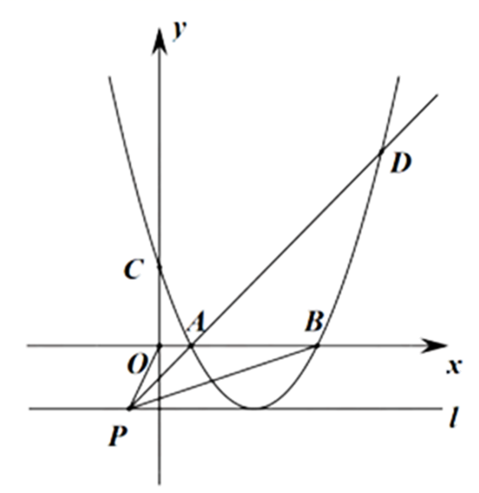

# Mathematics - 题目 2123

**ID**: 85d4b21e73904a3ba0e733177819c9e4
**年级**: Grade 9
**难度**: Hard
**题型**: Calculation

## 题目
如图所示，二次函数 $y=ax{^{2}}+bx+c(a>0)$ 的图像（记为抛物线 $Γ$ ）与y轴交于点C，与x轴分别交于点A、B，点A、B的横坐标分别记为 $x{{}_{1}}$ ， $x{{}_{2}}$ ，且 $0<x{{}_{1}}<x{{}_{2}}$ ．（1）若 $a=c$ ， $b=-3$ ，且过点 $(1,-1)$ ，求该二次函数的表达式；​​​​​​​‌（2）若关于x的一元二次方程 $ax{^{2}}+bx+c=0$ 的判别式 $Δ^{′}=4$ ．求证：当 $b<-\frac {5}{2}$ 时，二次函数 $y{{}_{1}}=ax{^{2}}+(b+1)x+c$ 的图像与x轴没有交点．（3）若 $AB{^{2}}=\frac {c{^{2}}-2c+6}{c}$ ，点P的坐标为 $(-\sqrt {x{{}_{0}}},-1)$ ，过点P作直线l垂直于y轴，且抛物线的 $Γ$ 顶点在直线l上，连接OP、AP、BP，PA的延长线与抛物线 $Γ$ 交于点D，若 $\angle OPB=\angle DAB$ ，求 $x{{}_{0}}$ 的最小值．

## 解答

1. 解：（1）由题意得： $y=ax{^{2}}-3x+a$ ，
2. ∵函数过点 $(1,-1)$ ，
3. ∴ $a-3+a=-1$ ，
4. ∴ $a=c=1$ ，
5. ∴ $y=x{^{2}}-3x+1$ ．
6. （2）由题意，一元二次方程 $ax{^{2}}+bx+c=0$ 的判别式 $Δ^{′}=4$ ．
7. ∴ $Δ=b{^{2}}-4ac=4$ ，
8. ∴ $4ac=b{^{2}}-4$ ，
9. 在函数 $y{{}_{1}}=ax{^{2}}+(b+1)x+c$ 中，
10. $Δ{{}_{1}}=(b+1){^{2}}-4ac=(b+1){^{2}}-\left ({b{^{2}}-4}\right )=2b+5$
11. ∵ $b<-\frac {5}{2}$ ，
12. ∴ $2b+5<0$ ，
13. 即函数图象与x轴没有交点．
14. （3）因为函数顶点在直线l上，则有 $\frac {4ac-b{^{2}}}{4a}=-1$ ，
15. 即 $b{^{2}}-4ac=4a$ ①
16. ∵ $AB{^{2}}=\frac {c{^{2}}-2c+6}{c}$ ，
17. ∴ ${\left({x{{}_{2}}-x{{}_{1}}}\right)^{2}}=\frac {c{^{2}}-2c+6}{c}$ ，
18. 即 ${\left({x{{}_{1}}+x{{}_{2}}}\right)^{2}}-4x{{}_{1}}x{{}_{2}}=\frac {c{^{2}}-2c+6}{c}$ ，
19. ∴ $\frac {b{^{2}}-4ac}{a{^{2}}}=\frac {c{^{2}}-2c+6}{c}$ ，
20. 由①得： $\frac {4}{a}=\frac {c{^{2}}-2c+6}{c}$ ②
21. ∵ $\angle OAP=\angle DAB$ ，
22. ∴ $\angle OAP=\angle OPB$
23. ∵ $\angle OAP=\angle OBP+\angle APB$ ， $\angle OPB=\angle OPA+\angle APB$
24. ∴ $\angle OBP=\angle OPA$ ，
25. 则 $\mathrm{△}OAP∽\mathrm{△}OPB$ ．
26. ∴ $\frac {OA}{OP}=\frac {OP}{OB}$ ，
27. ∴ $OA\cdot OB=OP{^{2}}$ ，
28. ∴ $x{{}_{1}}x{{}_{2}}=(-\sqrt {x{{}_{0}}}){^{2}}+(-1){^{2}}$ ．
29. ∴ $\frac {c}{a}=x{{}_{0}}+1$ ，
30. ∴ $x{{}_{0}}=\frac {c}{a}-1$ ．
31. 由②得： $x{{}_{0}}=\frac {c{^{2}}-2c+6}{4}-1$ ，
32. ∴ $x{{}_{0}}=\frac {1}{4}(c-1){^{2}}+\frac {1}{4}$ ，
33. ∴当 $c=1$ 时， $\left ({x{{}_{0}}}\right ){{}_{{\rm \min }}}=\frac {1}{4}$ ．

## 知识点

**中文**:
  - 二次函数的综合

**English**:
  - Comprehensive Quadratic Function Problems

---
