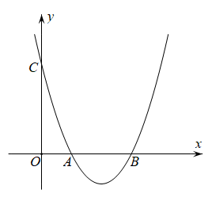

# Mathematics - 题目 3531

**ID**: 88df9a67131b4b47b135a1b97adeec0b
**年级**: Grade 9
**难度**: Hard
**题型**: Calculation

## 题目
已知抛物线 $y=ax{^{2}}-4ax+b$ 与 $x$ 轴交于 $\mathrm{A}$ ， $B$ 两点，（ $\mathrm{A}$ 在 $B$ 的左侧），与 $y$ 轴交于 $C$ ，若 $OB=OC$ ，且 $C（0，3）$ ．(1)求抛物线的解析式；​​​​​​​‌(2)设抛物线的顶点为 $D$ ，点 $P$ 在抛物线的对称轴上，且 $\angle APD=\angle ACB$ ，求点 $P$ 的坐标；(3)在抛物线上是否存在一点 $M$ ，过 $M$ 作 $MN\bot x$ 轴于 $N$ ，以 $\mathrm{A}$ 、 $M$ 、 $N$ 为顶点的三角形与 $ΔAOC$ 相似，若存在，求出所有符合条件的 $M$ 点坐标，若不存在，请说明理由．

## 解答

1. （1）解：∵ $OB=OC$ 且 $C（0，3）$
2. ∴ $B（3，0）$
3. ∴将 $B（3，0），C（0，3）$ 代入抛物线及解析式中，
4. ∴可得：  $\begin{cases}9a-12a+b=0\\b=3\end{cases}$ ，解得 $\begin{cases}a=1\\b=3\end{cases}$ ；
5. ∴ $y=x{^{2}}-4x+3$
6. 故答案为： ${\rm{y}}=x{^{2}}-4x+3$ ．
7. （2）如图：
8. 
9. 解：∵ $OB=OC$ ， $∠{\rm{B}}{\rm{O}}{\rm{C}}=90{}\degree $
10. ∴ $\angle OBC=\angle ADP=45{}\degree $
11. ∴ $OB{^{2}}+OC{^{2}}=BC{^{2}}$
12. ∴ $BC=3\surd 2$
13. ∵函数解析式为： $y=x{^{2}}-4x+3$
14. ∴ $D(2，-1）$
15. ∵ $A（{{1}}{\rm{,}}{{0}}）$
16. ∴ $AD{^{2}}=1{^{2}}+1{^{2}}$
17. ∴ $AD=\sqrt {2}$
18. ∵ $B{\rm{(}}3，0)$
19. ∴ $AB=2$
20. 当点 $P$ 在 $x$ 轴上方时
21. ∵ $\angle APD=\angle ACB$
22. ∴ $\vartriangle APD∽\vartriangle ACB$
23. ∴ $\frac {PD}{BC}{\rm =}$  $\frac {AD}{AB}$
24. ∴ $\frac {PD}{3\sqrt {2}}{\rm =}$  $\frac {\sqrt {2}}{2}$
25. ∴ $PD=3$
26. ∵ $D（2，-1）$
27. ∴ $P（2，2）$
28. 当点 $P$ 在 $x$ 轴下方时
29. ∵ $\angle APD=\angle ACB$
30. ∴点 $P^{′}$ 和点 $P$ 关于 $x$ 轴对称
31. ∴点 $P^{′}$ 的坐标为 $（2，-2）$
32. 故答案为： $P（2,2）$ 或者 $（2，-2）$ ．
33. （3）解：∵ $A（{{1}}，{{0}}），B（0,3）$
34. ∴ $OC{\rm{=}}3，OA{\rm{=}}1$
35. ∵ $\angle AOC=\angle ANM=90{}\degree $
36. 若以 $\mathrm{A}$ ， $M$ ， $N$ 为顶点的三角形与 $\mathrm{△}AOC$ 相似
37. ∴ $\frac {AN}{OC}=\frac {MN}{OA}$ 或者 $\frac {AN}{OA}=\frac {AM}{OC}$
38. ∴ $AN=3MN$ 或者 $3AN=MN$
39. 设 $M（m,m{^{2}}-4m+3）$ 则 $N（m,0)$
40. 如图：
41. 
42. ∵当 $m<1$ 时
43. ∴ $MN=m{^{2}}-4m+3$
44. 若 $AN{\rm{=}}3MN$
45. ∴ $1-m$  $=$  $3\left ({m{^{2}}-4m+3}\right )$
46. 解得 $m{{}_{1}}=\frac {8}{3}$   $m{{}_{2}}=1$
47. 若 $3AN=MN$
48. ∴ $3\left ({1-m}\right )=m{^{2}}-4m+3$
49. 解得 $m{{}_{1}}=0,m{{}_{2}}=1$
50. ∵ $m<1$ 且 $m\ne 0$
51. ∴上述四个结果都不符合题意
52. 如图：
53. 
54. ∵当 $1＜m＜3$ 时， $AN=m-1$
55. ∴ $MN=-\left ({m{^{2}}-4m+3}\right )$
56. 若 $AN=3MN$
57. ∴ $m-1=-3\left ({m{^{2}}-{{4}}m{{+}}{{3}}}\right )$
58. 解得 $m{{}_{1}}=1$ (舍去) $m{{}_{2}}=\frac {8}{3}$
59. 若 $3AN=MN$
60. ∴ $3\left ({m-1}\right )=-\left ({m{^{2}}-4m+3}\right )$
61. 解得 $m{{}_{1}}=0$ (舍去) $m{{}_{2}}=1$ (舍去)
62. ∴ $M（\frac {8}{3}$ ， $-\frac {5}{9}）$
63. 如图
64. 
65. ∵当 $m＞3$ 时， $AN=m-1$
66. ∴ $MN=m{^{2}}-4m+3$
67. 若 $AN=3MN$
68. ∴ $m-1=3(m{^{2}}-4m+3）$
69. 解得 $m{{}_{1}}=1$ （舍去）， $m{{}_{2}}=\frac {10}{3}$
70. 若 $3AN=MN$
71. ∴ $3\left ({m-1}\right )=m{^{2}}-4m+3$
72. 解得： $m{{}_{1}}=1$ (舍去)， $m{{}_{2}}=6$
73. 故 $M（\frac {10}{3}，\frac {7}{9}）$ ）或者 $\left ({6，15}\right )$
74. 综上所述符合，存在符合条件的M点，且坐标 $M{{}_{1}}（\frac {10}{9}，\frac {7}{9}）$ ）， $M{{}_{2}}\left ({6，15}\right )$ ， $M{{}_{3}}\left ({\frac {8}{3}，-\frac {5}{9}}\right )$

## 知识点

**中文**:
  - 二次函数的综合
  - 相似三角形的判定与性质综合
  - 待定系数法求二次函数解析式

**English**:
  - Comprehensive Quadratic Function Problems
  - Determination and Properties
  - Finding Quadratic Expressions by Undetermined Coefficients

---
