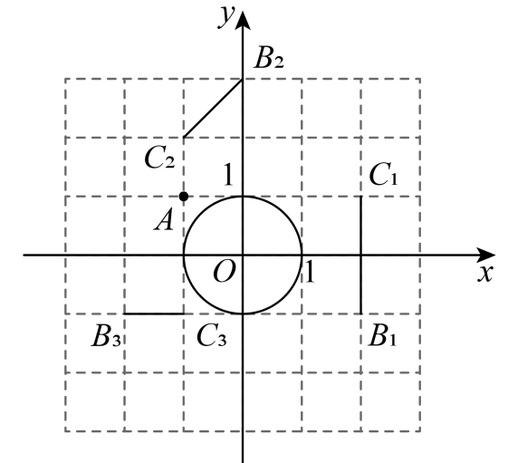

# Mathematics - 题目 1762

**ID**: 8ee79221656440359660137bfec876ac
**年级**: Grade 9
**难度**: Hard
**题型**: Calculation

## 题目
在平面直角坐标系 $xOy$ 中， $\odot O$ 的半径为1．对于点A和线段 $BC$ ，给出如下定义：若将线段 $BC$ 绕点A旋转可以得到 $\odot O$ 的弦 $B^{′}C^{′}$ （ $B^{′}$ ， $C^{′}$ 分别是B，C的对应点），则称线段 $BC$ 是 $\odot O$ 的以点A为中心的“关联线段”．(1)如图，点 $\mathrm{A}$ ， $B{{}_{1}}$ ， $C{{}_{1}}$ ， $B{{}_{2}}$ ， $C{{}_{2}}$ ， $B{{}_{3}}$ ， $C{{}_{3}}$ 的横、纵坐标都是整数．在线段 $B{{}_{1}}C{{}_{1}}$ ， $B{{}_{2}}C{{}_{2}}$ ， $B{{}_{3}}C{{}_{3}}$ 中， $\odot O$ 的以点A为中心的“关联线段”是；​​​​​​​‌(2)等腰直角三角形 $ABC$ 的斜边长 $BC$ 为 $\sqrt {2}$ ，点A不为原点．若 $BC$ 是 $\odot O$ 的以点A为中心的“关联线段”，在坐标系中画出点A组成的图形．(3)在 $\vartriangle ABC$ 中， $AB=3$ ， $AC=2$ ．若 $BC$ 是 $\odot O$ 的以点 $\mathrm{A}$ 为中心的“关联线段”，直接写出 $OA$ 的最小值和最大值，以及相应的 $BC$ 长．

## 解答

1. （1）解：以点 $\mathrm{A}$ 为圆心，分别以 $AB{{}_{1}}$ ， $AC{{}_{1}}$ ， $AB{{}_{2}}$ ， $AC{{}_{2}}$ ， $AB{{}_{3}}$ ， $AC{{}_{3}}$ 为半径画圆，如图，
2. 
3. 观察图象可得，线段 $B{{}_{2}}C{{}_{2}}$ 能绕点 $\mathrm{A}$ 旋转 $90{}\degree $ 得到 $\odot O$ 的“关联线段”， $B{{}_{1}}C{{}_{1}}$ ， $B{{}_{3}}C{{}_{3}}$ 都不能绕点 $\mathrm{A}$ 进行旋转得到．
4. 故答案为： $B{{}_{2}}C{{}_{2}}$ ；
5. （2）解：由题意可得，当 $BC$ 是 $\odot O$ 的以点 $\mathrm{A}$ 为中心的“关联线段”时，
6. 则有 $\mathrm{△}AB^{′}C^{′}$ 是等腰直角三角形，如图，连接 $OA$ ，
7. $\because BC=\sqrt {2}$ ，
8. $\therefore BC{^{2}}=AB{^{2}}+AC{^{2}}$ ，即 ${\left({\sqrt {2}}\right)^{2}}=2AB{^{2}}$ ，
9. $\therefore AB=AC=1$ ，
10. $\therefore AC^{′}=AB^{′}=1$ ， $B^{′}C^{′}=BC=\sqrt {2}$ ，
11. 又 $\because OC^{′}=OB^{′}=1$ ，
12. $\therefore AC^{′}=AB^{′}=OC^{′}=OB^{′}$
13. $\therefore $ 四边形 $OB^{′}AC^{′}$ 为菱形，
14. $\because \angle C^{′}AB^{′}=90{}\degree $ ，
15. $\therefore $ 菱形 $OB^{′}AC^{′}$ 为正方形，
16. $\therefore OA=B^{′}C^{′}=\sqrt {2}$ ，
17. $\therefore $ 点 $\mathrm{A}$ 组成的图形为以点 $\mathrm{A}$ 为圆心， $\sqrt {2}$ 为半径的圆，
18. 故点 $\mathrm{A}$ 组成的图形如下图即为所求，
19. 
20. （3）解： $\because $  $BC$ 是 $\odot O$ 的以点 $\mathrm{A}$ 为中心的“关联线段”，
21. $\therefore $  $B^{′}$ ， $C^{′}$ 都在 $\odot O$ 上，
22. $\because AB=3$ ， $AC=2$ ,
23. $\therefore AB^{′}=AB=3$ ， $AC^{′}=AC=2$ ，
24. $\therefore $ 当以 $B^{′}$ 为圆心，3为半径作圆，然后以点 $\mathrm{A}$ 为圆心，2为半径作圆，
25. 即可得到点 $\mathrm{A}$ 的运动轨迹，如图，连接 $AO$ ， $BO$ ，
26. $\because AO+B^{′}O\geqslant AB^{′}$ ，
27. $\therefore $ 当 $\mathrm{A}$ 、 $O$ 、 $B^{′}$ 共线时 $AO$ 取得最小值，
28. $\because OB^{′}=1$
29. $\therefore $ 最小值为 $AO=AB^{′}-OB^{′}=3-1=2$ ，
30. 如下图，连接 $OC^{′}$ ，作 $C^{′}D\bot AB$ 于点 $D$ ，
31. 
32. 则 $OC^{′}=OB^{′}=1$ ，
33. 设 $OD=x$ ，则 $AD=AO-OD=2-x$ ，
34. $\therefore C^{′}D{^{2}}=OC^{′}{{^{2}}}-OD{^{2}}=1-x{^{2}}$ ，
35. $\therefore AC^{′}{{^{2}}}=AD{^{2}}+C^{′}D{^{2}}$ ，即 $2{^{2}}={\left({2-x}\right)^{2}}+1-x{^{2}}$ ，
36. 解得 $x=\frac {1}{4}$ ，
37. $\therefore C^{′}D{^{2}}=1-{\left({\frac {1}{4}}\right)^{2}}=\frac {15}{16}$ ， $B^{′}D=B^{′}O+OD=1+\frac {1}{4}=\frac {5}{4}$ ，
38. $\therefore B^{′}C^{′}=\sqrt {B^{′}D{^{2}}+C^{′}D{^{2}}}=\sqrt {{\left({\frac {5}{4}}\right)^{2}}+\frac {15}{16}}=\frac {\sqrt {10}}{2}$ ，
39. $\therefore $ 当 $OA$ 取的最小值为2时， $BC=B^{′}C^{′}=\frac {\sqrt {10}}{2}$ ；
40. 同理，当 $\mathrm{A}$ 、 $O$ 、 $C^{′}$ 共线时 $AO$ 取得最大值，如图，
41. $\because OC^{′}=1$
42. $\therefore $ 最大值为 $AO=AC^{′}+OC^{′}=2+1=3$ ，
43. 连接 $OB^{′}$ ，作 $B^{′}E\bot AO$ 于点 $D$ ，
44. 设 $OE=x$ ，则 $AE=AO-OE=3-x$ ，
45. $\therefore B^{′}E{^{2}}=OB^{′}{{^{2}}}-OE{^{2}}=1-x{^{2}}$ ，
46. $\therefore AB^{′}{{^{2}}}=AE{^{2}}+B^{′}E{^{2}}$ ，即 $3{^{2}}={\left({3-x}\right)^{2}}+1-x{^{2}}$ ，
47. 解得 $x=\frac {1}{6}$ ，
48. $\therefore B^{′}E{^{2}}=1-{\left({\frac {1}{6}}\right)^{2}}=\frac {35}{36}$ ， $C^{′}E=C^{′}O-OE=1-\frac {1}{6}=\frac {5}{6}$ ，
49. $\therefore B^{′}C^{′}=\sqrt {C^{′}E{^{2}}+B^{′}E{^{2}}}=\sqrt {{\left({\frac {5}{6}}\right)^{2}}+\frac {35}{36}}=\frac {\sqrt {15}}{3}$ ；
50. $\therefore $ 当 $OA$ 取的最大值为3时， $BC=B^{′}C^{′}=\frac {\sqrt {15}}{3}$
51. 综上所述， $OA$ 最小值为2，此时 $BC=\frac {\sqrt {10}}{2}$ ， $OA$ 最大值为3，此时 $BC=\frac {\sqrt {15}}{3}$ ．

## 知识点

**中文**:
  - 旋转的性质
  - 正方形的判定与性质综合
  - 点和圆的位置关系

**English**:
  - Properties of Rotation
  - Determination and Properties of Squares
  - Point and Circle Relationship

---
