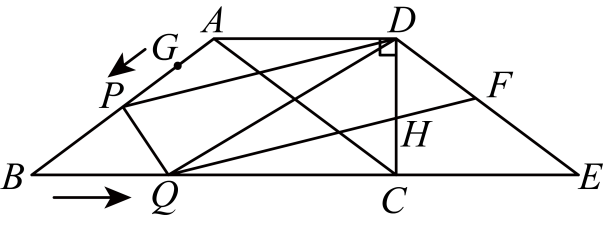

# Mathematics - 题目 608

**ID**: 91fc15a6e90f4d10b03217d9bafb43c5
**年级**: Grade 9
**难度**: Hard
**题型**: Calculation

## 题目
如图，在四边形 $ABCD$ 中， $AD{\rm{/\mskip-4mu/}}BC$ ， $\angle ADC=90{}^\circ $ ， $AD=4{\rm{c}}{\rm{m}}$ ， $BC=8{\rm{c}}{\rm{m}}$ ， $CD=3{\rm{c}}{\rm{m}}$ ， $G$ 是 $AB$ 上一点且 $AG=1{\rm{c}}{\rm{m}}$ ，过点 $D$ 作 $DE{\rm{/\mskip-4mu/}}AC$ ，交 $BC$ 延长线于点 $E$ ，连接 $AC$ ．动点 $P$ 从点 $G$ 出发以 $1{\rm{c}}{\rm{m}}/{\rm{s}}$ 的速度沿线段 $GB$ 向终点 $B$ 匀速运动；​​​​​​​‌同时动点 $Q$ 从点 $B$ 出发以 $2{\rm{c}}{\rm{m}}/{\rm{s}}$ 的速度沿线段 $BC$ 向终点 $C$ 匀速运动，过点 $Q$ 作 $QF{\rm{/\mskip-4mu/}}PD$ ，交 $CD$ 于点 $H$ ，交 $DE$ 于点 $F$ ，当点 $P$ 到达点 $B$ 时，点 $Q$ 也停止运动．设运动时间为 $t\left ({{\rm{s}}}\right )$ ， $0<t<4$ ．解答下列问题：(1)当 $t$ 为何值时，四边形 $PQHD$ 是平行四边形；(2)设 $\vartriangle DPQ$ 的面积为 $S\left ({{\rm{c}}{\rm{m}}{^{2}}}\right )$ ，求 $S$ 与 $t$ 的函数关系式；(3)在运动过程中，是否存在某一时刻 $t$ ，使 $DQ$ 平分四边形 $PQCD$ 的面积？(4)当 $t$ 为何值时， $\vartriangle BPQ$ 为等腰三角形？

## 解答

1. （1）解：过点 $A$ 作 $AM\bot BC$ 于点 $M$ ，如图，
2. 
3. $AD{\rm{/\mskip-4mu/}}BC$ ， $\angle ADC=90{}^\circ $ ，
4. $\therefore $ 四边形 $AMCD$ 为矩形，
5. $\therefore CM=AD=4{\rm{c}}{\rm{m}}$ ， $AM=DC=3{\rm{c}}{\rm{m}}$ ，
6. $\because BC=8{\rm{c}}{\rm{m}}$ ，
7. ∴ $BM=BC-CM=4{\rm{c}}{\rm{m}}$ ，
8. ∴ $AB=\sqrt {AM{^{2}}+BM{^{2}}}=\sqrt {3{^{2}}+4{^{2}}}=5$ ，
9. $\because AG=1{\rm{c}}{\rm{m}}$ ，动点 $P$ 从点 $G$ 出发以 $1{\rm{c}}{\rm{m}}/{\rm{s}}$ 的速度沿线段 $GB$ 向终点 $B$ 匀速运动，动时间为 $t\left ({{\rm{s}}}\right )$ ，
10. $\therefore AP=\left ({t+1}\right ){\rm{c}}{\rm{m}}$ ，
11. $\therefore BP=AB-AP=\left ({4-t}\right ){\rm{c}}{\rm{m}}$ ，
12. $\because $ 动点 $Q$ 从点 $B$ 出发以 $2{\rm{c}}{\rm{m}}/{\rm{s}}$ 的速度沿线段 $BC$ 向终点 $C$ 匀速运动，
13. $\therefore BQ=2t\left ({{\rm{c}}{\rm{m}}}\right )$ ，
14. $\because $ 四边形 $PQHD$ 是平行四边形，
15. ∴ $PQ/\mskip-4mu/CD$ ，
16. ∴ $PQ{\rm{/\mskip-4mu/}}AM$ ，
17. ∴ $\vartriangle BPQ∽\vartriangle BAM$ ，
18. ∴ $\frac {BP}{BA}=\frac {BQ}{BM}$ ，即 $\frac {4-t}{5}=\frac {2t}{4}$ ，
19. 解得 $t=\frac {8}{7}$ ，
20. 故答案为 当 $t=\frac {8}{7}{\rm{s}}$ ，四边形 $PQHD$ 是平行四边形，
21. （2）解：过点 $P$ 作 $PK\bot AD$ ，交 $AD$ 的延长线于点 $K$ ，延长 $KP$ 交 $BC$ 于点 $N$ ，如图，
22. 
23. ∵ $AD{\rm{/\mskip-4mu/}}BC$ ，
24. $\therefore PN\bot BC$ ，
25. $\therefore $ 四边形 $AMNK$ 为矩形，
26. $\therefore KN=AM=3$ ．
27. ∵ $PN{\rm{/\mskip-4mu/}}AM$ ，
28. $\therefore \vartriangle BPN$  $∽\vartriangle BAM$ ，
29. ∴ $\frac {BP}{BA}=\frac {PN}{AM}$ ，即 $\frac {4-t}{5}=\frac {PN}{3}$ ，
30. ∴ $PN=\frac {3}{5}\left ({4-t}\right )=\frac {12}{5}-\frac {3}{5}t$ ，
31. $\therefore PK=KN-PN=\frac {3}{5}t+\frac {3}{5}$ ，
32. ∴ $S=S{{}_{梯形ABCD}}-S{{}_{\vartriangle APD}}-S{{}_{\vartriangle CDQ}}-S{{}_{\vartriangle BPQ}}$ ，
33. $=\frac {1}{2}\left ({4+8}\right )\times 3-\frac {1}{2}AD\cdot PK-\frac {1}{2}BQ\cdot PN-\frac {1}{2}CQ\cdot CD$
34. $=18-\frac {1}{2}\times 4\times \left ({\frac {3}{5}t+\frac {3}{5}}\right )-\frac {1}{2}\times 2t\times \left ({\frac {12}{5}-\frac {3}{5}t}\right )-\frac {1}{2}\times \left ({8-2t}\right )\times 3$
35. $=\frac {3}{5}t{^{2}}-\frac {3}{5}t+\frac {24}{5}$ ，
36. （3）解：存在某一时刻 $t=2$ 时， $DQ$ 平分四边形 $PQCD$ 的面积，理由，
37. ∵ $DQ$ 平分四边形 $PQCD$ 的面积，
38. ∴ $S{{}_{\vartriangle PDQ}}=S{{}_{\vartriangle DCQ}}$ ，
39. ∴ $\frac {3}{5}t{^{2}}-\frac {3}{5}t+\frac {24}{5}=\frac {1}{2}\times \left ({8-2t}\right )\times 3$ ，解得 $t=2$ 或 $t=-6$ （不合题意，舍去）；
40. （4）解：①当 $BP=PQ$ 时，如图，
41. 
42. $\because BP=PQ$ ， $PN\bot BQ$ ，
43. ∴ $BN=NQ=\frac {1}{2}BQ=t$ ，
44. ∵ $PN{\rm{/\mskip-4mu/}}AM$ ，
45. $\therefore \vartriangle BPN$  $∽\vartriangle BAM$ ，
46. ∴ $\frac {BP}{BA}=\frac {BN}{BM}$ ，
47. ∴ $\frac {4-t}{5}=\frac {t}{4}$ ，解得 $t=\frac {16}{9}$ ，
48. ②当 $BP=BQ$ 时，
49. $4-t=2t$ ，
50. $\therefore t=\frac {4}{3}$ ，
51. ③当 $BQ=PQ$ 时，
52. 过点 $Q$ 作 $QL\bot BP$ 于点 $L$ ，如图，
53. 
54. 则： $BL=LP=\frac {1}{2}BP=2-\frac {1}{2}t$ ，
55. $\because ∠B=∠B$ ， $\angle QLB=\angle BMA=90{}^\circ $ ，
56. $\therefore \vartriangle BLQ∽\vartriangle BMA$ ，
57. ∴ $\frac {BL}{BQ}=\frac {BM}{BA}$ ，即： $\frac {2-\frac {1}{2}t}{2t}=\frac {4}{5}$ ，解得 $t=\frac {20}{21}$ .
58. 综上所述，当 $t$ 为 $\frac {16}{9}$ 或 $\frac {4}{3}$ 或 $\frac {20}{21}$ 时， $\vartriangle BPQ$ 为等腰三角形．

## 知识点

**中文**:
  - 相似三角形的判定与性质综合
  - 等腰三角形的性质
  - 矩形的判定与性质综合

**English**:
  - Determination and Properties
  - Properties of Isosceles Triangles
  - Determination and Properties of Rectangles

---
