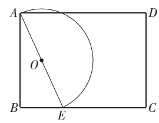

# Mathematics - 题目 2932

**ID**: 95945d7e9cb7471f8e56c9354bcb0206
**年级**: Grade 9
**难度**: Hard
**题型**: Calculation

## 题目
如图，在矩形 $ABCD$ 中， $AB=3$ ， $BC=4$ ，点E从点B出发，沿折线段 $BC-CD$ 以每秒1个单位的速度向点D（不与D点重合）运动，与此同时，以 $AE$ 为直径且在 $AE$ 的右侧作半圆O．设点E的运动时间为 $t\left ({t\geqslant 0}\right )$ ．(1)发现：当点D开始落在半圆O上时， $t=$；​​​​​​​‌此时半圆O的半径为；(2)探究：当 $t=\sqrt {3}$ 秒时，①连接 $OB$ 、 $OC$ ，判断 $OB$ 是否垂直 $OC$ ；②求半圆O与矩形 $ABCD$ 重叠部分的面积；(3)拓展：若半圆O与矩形 $ABCD$ 的边相切时，求点E到 $AC$ 的距离．

## 解答

1. (1)解：∵四边形ABCD是矩形，
2. ∴∠B=∠D=90°．
3. ∵AE是半圆O的直径，
4. ∴当A，D，E组成直角三角形时，且AE是斜边时，点D在半圆O上．
5. ∴当点E与点C重合时，点D开始落在半圆O上．
6. ∵AB=3，BC=4，点E的运动速度是每秒1个单位，
7. ∴ $t=\frac {4}{1}=4$ （秒）， $AC=\sqrt {AB{^{2}}+BC{^{2}}}=5$ ．
8. ∵AE是半圆O的直径，
9. ∴ $OA=OC=\frac {1}{2}AC=\frac {5}{2}$ ．
10. ∴此时半圆O的半径为 $\frac {5}{2}$ ．
11. 故答案为：4； $\frac {5}{2}$ ．
12. (2)解：①如下图所示，取BE的中点为P，连接OP，OB，OC．
13. ∵ $t=\sqrt {3}$ 秒，
14. ∴ $BE=1\times \sqrt {3}=\sqrt {3}$ ．
15. ∵点P是BE中点，
16. ∴ $BP=EP=\frac {1}{2}BE=\frac {\sqrt {3}}{2}$ ．
17. ∵BC=4，
18. ∴ $CP=BC-BP=4-\frac {\sqrt {3}}{2}$ ， $BC{^{2}}=16$ ．
19. ∵四边形ABCD是矩形，
20. ∴∠ABC=90°．
21. ∵AE是半圆O的直径，
22. ∴点O是AE中点．
23. ∴OP是△ABE的中位线．
24. ∴ $OP/\mskip-4mu/AB$ ， $OP=\frac {1}{2}AB$ ．
25. ∴∠OPE=∠ABC=90°．
26. ∴∠OPB=180°-∠OPE=90°．
27. ∵AB=3，
28. ∴ $OP=\frac {3}{2}$ ．
29. ∴ $OB{^{2}}=OP{^{2}}+BP{^{2}}=3$ ， $OC{^{2}}=OP{^{2}}+CP{^{2}}=19-4\sqrt {3}$ ．
30. ∵ $16\ne 3+\left ({19-4\sqrt {3}}\right )$ ，
31. ∴ $BC{^{2}}\ne OB{^{2}}+OC{^{2}}$ ．
32. ∴ $\angle BOC\ne 90\mathrm{°}$ ．
33. ∴OB与OC不垂直．
34. 
35. ②如下图所示，设半圆O与AD的另一交点为M，过点O作ON⊥AM于N．
36. ∵ $BE=\sqrt {3}$ ，AB=3，
37. ∴ ${\tan}\angle AEB=\frac {AB}{BE}=\sqrt {3}$ ．
38. ∴∠AEB=60°．
39. ∵四边形ABCD是矩形，
40. ∴ $AD\mathrm{/\mskip-4mu/}BC$ ，∠ABC=90°．
41. ∴∠OAM=∠AEB=60°， $AE=\sqrt {AB{^{2}}+BE{^{2}}}=2\sqrt {3}$ ．
42. ∴ $OA=OE=\frac {1}{2}AE=\sqrt {3}$ ．
43. ∵ON⊥AM，
44. ∴ $ON=OA\times {\sin}\angle OAM=\frac {3}{2}$ ．
45. ∵OA=OM，
46. ∴△OAM是等边三角形．
47. ∴∠AOM=60°， $AM=OA=\sqrt {3}$ ．
48. ∴ $S{{}_{\mathrm{△}OAM}}=\frac {1}{2}AM\cdot ON=\frac {3\sqrt {3}}{4}$ ，∠EOM=180°-∠AOM=120°．
49. ∴ $S{{}_{扇形OME}}=\frac {120\times π\times {\left({\sqrt {3}}\right)^{2}}}{360}=π$ ．
50. ∴半圆O与矩形 $ABCD$ 重叠部分的面积为 $S{{}_{\mathrm{△}OAM}}+S{{}_{扇形OME}}=\frac {3\sqrt {3}}{4}+π$ ．
51. 
52. (3)解：如图1所示，当t=0时，点E与点B重合，此时半圆O与BC相切于点B，与AD相切于点A，连接AC，过点B作BF⊥AC于F．
53. ∵四边形ABCD是矩形，
54. ∴∠ABC=90°．
55. ∵AB=3，BC=4，
56. ∴ $S{{}_{△ABC}}=\frac {1}{2}AB\cdot BC=6$ ， $AC=\sqrt {AB{^{2}}+BC{^{2}}}=5$ ．
57. ∴ $BF=\frac {2S{{}_{\mathrm{△}ABC}}}{AC}=\frac {12}{5}$ ．
58. ∴此时点E到 $AC$ 的距离是 $\frac {12}{5}$ ．
59. 如图2所示，当半圆O与CD相切于点F时，连接FO并延长交AB于G，连接AC，过点E作EQ⊥AC于Q，设半圆O的半径为x．
60. ∴OA=OE=OF=x．
61. ∵AE是半圆O的直径，
62. ∴ $\frac {AO}{AE}=\frac {1}{2}$ ．
63. ∵半圆O与CD相切于点F，
64. ∴∠OFC=90°．
65. ∵四边形ABCD是矩形，
66. ∴ $AB\parallel DC$ ，∠ABE=∠BCD=90°．
67. ∴∠OGA=∠OFC=90°，四边形BGFC是矩形．
68. ∴ $OA{^{2}}=AG{^{2}}+OG{^{2}}$ ，∠OGA=∠ABE，GF=BC．
69. ∴ $GO\mathrm{/\mskip-4mu/}BE$ ．
70. ∴ $\frac {AG}{AB}=\frac {AO}{AE}=\frac {1}{2}$ ．
71. ∵AB=3，BC=4，
72. ∴ $AG=\frac {1}{2}AB=\frac {3}{2}$ ，GF=BC=4．
73. ∴OG=GF-OF=4-x．
74. ∴ $x{^{2}}={\left({\frac {3}{2}}\right)^{2}}+{\left({4-x}\right)^{2}}$ ．
75. ∴ $x=\frac {73}{32}$ ．
76. ∴ $OA=OE=\frac {73}{32}$ ．
77. ∴ $AE=OA+OE=\frac {73}{16}$ ．
78. ∴ $BE=\sqrt {AE{^{2}}-AB{^{2}}}=\frac {55}{16}$ ．
79. ∴ $CE=BC-BE=\frac {9}{16}$ ．
80. ∴ $S{{}_{\mathrm{△}AEC}}=\frac {1}{2}CE\cdot AB=\frac {27}{32}$ ．
81. ∵AC=5，
82. ∴ $EQ=\frac {2S{{}_{\mathrm{△}AEC}}}{AC}=\frac {27}{80}$ ．
83. ∴此时点E到 $AC$ 的距离是 $\frac {27}{80}$ ．
84. ∴若半圆O与矩形 $ABCD$ 的边相切时，点E到 $AC$ 的距离是 $\frac {12}{5}$ 或 $\frac {27}{80}$ ．
85. 

## 知识点

**中文**:
  - 切线的性质定理
  - 等边三角形的判定与性质
  - 勾股定理的逆定理
  - 圆周角定理及推论
  - 扇形面积的计算

**English**:
  - Tangent Properties Theorem
  - Determination and Properties
  - Converse of Pythagorean Theorem
  - Inscribed Angle Theorem
  - Sector Area Calculation

---
