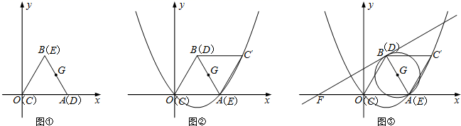

# Mathematics - 题目 3602

**ID**: 9a17c68da25d4e368b89f1aeca3082ca
**年级**: Grade 9
**难度**: Hard
**题型**: Calculation

## 题目
如图①②，在平面直角坐标系中，边长为2的等边 $ΔCDE$ 恰好与坐标系中的 $\Delta OAB$ 重合，现将 $ΔCDE$ 绕边 $AB$ 的中点 $G(G$ 点也是 $DE$ 的中点），按顺时针方向旋转 $180{}^\circ $ 到△ $C{{}_{1}}DE$ 的位置．（1）求 $C{{}_{1}}$ 点的坐标；​​​​​​​‌（2）求经过三点 $O$ 、 $A$ 、 $C{{}_{1}}$ 的抛物线的解析式；（3）如图③， $\odot G$ 是以 $AB$ 为直径的圆，过 $B$ 点作 $\odot G$ 的切线与 $x$ 轴相交于点 $F$ ，求切线 $BF$ 的解析式；（4）抛物线上是否存在一点 $M$ ，使得 $S{{}_{\Delta AMF}}:S{{}_{\Delta OAB}}=16:3$ ．若存在，请求出点 $M$ 的坐标；若不存在，请说明理由．

## 解答

1. 解：（1）将等边 $ΔCDE$ 绕边 $AB$ 的中点 $G$ 按顺时针方向旋转 $180{}^\circ $ 到△ $C{{}_{1}}DE$ ，
2. 则有，四边形 $OAC^{′}B$ 是菱形，所以 $C{{}_{1}}$ 的横坐标为3，
3. 根据等边 $ΔCDE$ 的边长是2，
4. 利用等边三角形的性质可得 $C{{}_{1}}(3,\sqrt {3})$ ；
5. （2） $\because $ 抛物线过原点 $O(0,0)$ ，设抛物线解析式为 $y=ax{^{2}}+bx$ ，
6. 把 $A(2,0)$ ， $C\prime (3,\sqrt {3})$ 代入，得 $\begin{cases}4a+2b=0\\9a+3b=\sqrt {3}\end{cases}$ ，
7. 解得 $a=\frac {\sqrt {3}}{3}$ ， $b=-\frac {2\sqrt {3}}{3}$ ，
8. $\therefore $ 抛物线解析式为 $y=\frac {\sqrt {3}}{3}x{^{2}}-\frac {2\sqrt {3}}{3}x$ ；
9. （3） $\because \angle ABF=90{}^\circ $ ， $\angle BAF=60{}^\circ $ ，
10. $\therefore \angle AFB=30{}^\circ $ ，
11. 又 $\because AB=2$ ，
12. $\therefore AF=4$ ，
13. $\therefore OF=2$ ，
14. $\therefore F(-2,0)$ ，
15. 设直线 $BF$ 的解析式为 $y=kx+b$ ，
16. 把 $B(1,\sqrt {3})$ ， $F(-2,0)$ 代入，得 $\begin{cases}k+b=\sqrt {3}\\-2k+b=0\end{cases}$ ，
17. 解得 $k=\frac {\sqrt {3}}{3}$ ， $b=\frac {2\sqrt {3}}{3}$ ，
18. $\therefore $ 直线 $BF$ 的解析式为 $y=\frac {\sqrt {3}}{3}x+\frac {2\sqrt {3}}{3}$ ；
19. （4）①当 $M$ 在 $x$ 轴上方时，存在 $M(x,\frac {\sqrt {3}}{3}x{^{2}}-\frac {2\sqrt {3}}{3}x)$ ，
20. $S{{}_{ΔAMF}}:S{{}_{ΔOAB}}=[\frac {1}{2}\times 4\times (\frac {\sqrt {3}}{3}x{^{2}}-\frac {2\sqrt {3}}{3}x)]:[\frac {1}{2}\times 2\times \sqrt {3}]=16:3$ ，
21. 得 $x{^{2}}-2x-8=0$ ，解得 $x{{}_{1}}=4$ ， $x{{}_{2}}=-2$ ，
22. 当 $x{{}_{1}}=4$ 时， $y=\frac {\sqrt {3}}{3}\times 4{^{2}}-\frac {2\sqrt {3}}{3}\times 4=\frac {8\sqrt {3}}{3}$ ，
23. 当 $x{{}_{1}}=-2$ 时， $y=\frac {\sqrt {3}}{3}\times (-2){^{2}}-\frac {2\sqrt {3}}{3}\times (-2)=\frac {8\sqrt {3}}{3}$ ，
24. $\therefore M{{}_{1}}(4,\frac {8\sqrt {3}}{3})$ ， $M{{}_{2}}(-2,\frac {8\sqrt {3}}{3})$ ；
25. ②当 $M$ 在 $x$ 轴下方时，不存在，设点 $M(x,\frac {\sqrt {3}}{3}x{^{2}}-\frac {2\sqrt {3}}{3}x)$ ，
26. $S{{}_{ΔAMF}}:S{{}_{ΔOAB}}=[-\frac {1}{2}\times 4\times (\frac {\sqrt {3}}{3}x{^{2}}-\frac {2\sqrt {3}}{3}x)]:[\frac {1}{2}\times 2\times \sqrt {3}]=16:3$ ，
27. 得 $x{^{2}}-2x+8=0$ ， $b{^{2}}-4ac<0$ 无解，
28. 综上所述，存在点的坐标为 $M{{}_{1}}(4,\frac {8\sqrt {3}}{3})$ ， $M{{}_{2}}(-2,\frac {8\sqrt {3}}{3})$ ．

## 知识点

**中文**:
  - 二次函数的综合
  - 菱形的判定与性质综合
  - 切线的性质定理
  - 待定系数法求二次函数解析式

**English**:
  - Comprehensive Quadratic Function Problems
  - Determination and Properties of Rhombuses
  - Tangent Properties Theorem
  - Finding Quadratic Expressions by Undetermined Coefficients

---
