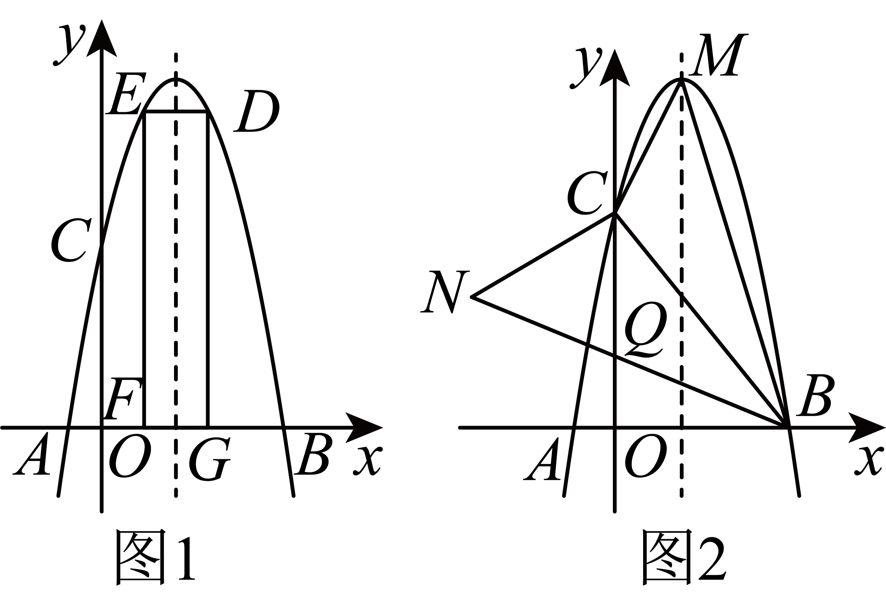

# Mathematics - 题目 3872

**ID**: 9ab5a7c96e6144159344b3e53ac39674
**年级**: Grade 9
**难度**: Hard
**题型**: Calculation

## 题目
已知抛物线与x轴交于 $A\left ({-1,0}\right )$ ， $B\left ({5,0}\right )$ 两点，与y轴交于点 $C\left ({0,5}\right )$ ．（1）求出抛物线的解析式；​​​​​​​‌（2）如图1，点D是抛物线上位于对称轴右侧的一个动点，且点D在第一象限内，过点D作x轴的平行线交抛物线于点E，作y轴的平行线交x轴于点G，过点E作 $EF\bot x$ 轴，垂足为点F，当四边形 $DEFG$ 的周长最大时，求点D的坐标；（3）如图2，点M是抛物线的顶点，将 $\mathrm{△}MBC$ 沿 $BC$ 翻折得到 $\vartriangle NBC$ ， $NB$ 与y轴交于点Q，在对称轴上找一点P，使得 $\mathrm{△}PQB$ 是以 $QB$ 为直角边的直角三角形，请直接写出点P的坐标．

## 解答

1. （1）解：∵抛物线与x轴交于 $A\left ({-1,0}\right )$ ， $B\left ({5,0}\right )$ 两点，
2. 设抛物线的解析式为 $y=a\left ({x+1}\right )\left ({x-5}\right )$ ，
3. 把 $C\left ({0,5}\right )$ 代入解析式，得 $5=a\left ({0+1}\right )\times \left ({0-5}\right )$ ，
4. 解得： $a=-1$ ，
5. ∴抛物线的解析式为 $y=-\left ({x+1}\right )\left ({x-5}\right )$ ，即 $y=-x{^{2}}+4x+5$ ；
6. （2）解：∵抛物线的解析式为： $y=-x{^{2}}+4x+5=-{\left({x-2}\right)^{2}}+9$ ，
7. ∴抛物线图象的对称轴为： $x=2$ ，
8. 设 $D\left ({x,-x{^{2}}+4x+5}\right )\left ({2<x<5}\right )$ ，
9. ∵ $DE{\rm{/\mskip-4mu/}}x$ 轴，
10. ∴ $E\left ({4-x,-x{^{2}}+4x+5}\right )$ ，
11. ∵过点D作x轴的平行线交抛物线于点E，作y轴的平行线交x轴于点G，过点E作 $EF\bot x$ 轴，∴四边形 $DEFG$ 是矩形，
12. ∴四边形 $DEFG$ 的周长 $=2DG+2DE$
13. $=2\left ({-x{^{2}}+4x+5}\right )+2\left [x-\left ({4-x}\right )\right ]$
14. $=-2x{^{2}}+12x+2$
15. $=-2{\left({x-3}\right)^{2}}+20$ ，
16. ∵ $-2<0$ ，
17. ∴当 $x=3$ 时，四边形 $DEFG$ 的周长最大，则 $-3{^{2}}+4\times 3+5=8$ ，
18. ∴当四边形 $DEFG$ 的周长最大时，点D的坐标为 $\left ({3,8}\right )$ ；
19. （3）解：过C作 $CH$ 垂直抛物线对称轴于H，过N作 $NK\mathrm{⊥}y$ 轴于K，
20. 
21. ∴ $\angle NKC=\angle MHC=90{}\degree $ ，
22. 由翻折得 $CN=CM,\angle BCN=\angle BCM$ ，
23. ∵ $B\left ({5,0}\right ),C\left ({0,5}\right )$ ．∴ $OB=OC$ ，∴ $\angle OCB=\angle OBC=45{}\degree $ ，
24. ∵ $CH\bot $ 对称轴于H，∴ $CH{\rm{/\mskip-4mu/}}x$ 轴，
25. ∴ $\angle BCH=\angle OBC=45{}\degree $ ，
26. ∴ $\angle BCH=\angle OCB=45{}\degree $ ，
27. ∴ $\angle BCN-\angle OCB=\angle BCM-\angle BCH$ ，即 $\angle NCK=\angle MCH$ ，
28. ∴ $\vartriangle MCH≌\vartriangle NCK\left ({{\rm{A}}{\rm{A}}{\rm{S}}}\right )$ ，
29. ∴ $NK=MH,CK=CH$ ，
30. ∵抛物线的解析式为： $y=-{\left({x-2}\right)^{2}}+9$ ，
31. ∴对称轴为 $x=3,M\left ({2,9}\right )$ ，
32. ∴ $MH=9-5=4,CH=2$ ，
33. ∴ $NK=MH=4,CK=CH=2$ ，
34. ∴ $OK=OC-CK=3$ ，
35. ∴ $N\left ({-4,3}\right )$ ，
36. 设直线 $BN$ 的解析式为 $y=k^{′}x+b^{′}$ ，
37. ∴ $\begin{cases}-4k^{′}+b^{′}=3\\5k^{′}+b^{′}=0\end{cases}$ ，
38. 解得： $\begin{cases}k^{′}=-\frac {1}{3}\\b^{′}=\frac {5}{3}\end{cases}$ ，
39. ∴直线 $BN$ 的解析式为： $y=-\frac {1}{3}x+\frac {5}{3}$ ，
40. 将 $x=0$ 代入 $y=-\frac {1}{3}x+\frac {5}{3}$ ，则 $y=\frac {5}{3}$ ，∴ $Q\left ({0,\frac {5}{3}}\right )$ ，
41. 设 $P\left ({2,p}\right )$ ，
42. ∴ $PQ{^{2}}=2{^{2}}+{\left({p-\frac {5}{3}}\right)^{2}}=p{^{2}}-\frac {10}{3}p+\frac {61}{9}$ ， $BP{^{2}}={\left({5-2}\right)^{2}}+p{^{2}}=9+p{^{2}}$ ， $BQ{^{2}}=5{^{2}}+{\left({\frac {5}{3}}\right)^{2}}=25+\frac {25}{9}=\frac {250}{9}$ ，
43. 分两种情况：
44. ①当 $\angle BQP=90{}\degree $ 时， $BP{^{2}}=PQ{^{2}}+BQ{^{2}}$ ，
45. ∴ $9+p{^{2}}=p{^{2}}-\frac {10}{3}p+\frac {61}{9}+\frac {250}{9}$ ，
46. 解得： $p=\frac {23}{3}$ ，
47. ∴ $P\left ({2,\frac {23}{3}}\right )$ ；
48. ②当 $\angle QBP=90{}\degree $ 时， $P^{′}Q{^{2}}=BP^{′}{{^{2}}}+BQ{^{2}}$ ，
49. ∴ $p{^{2}}-\frac {10}{3}p+\frac {61}{9}=9+p{^{2}}+\frac {250}{9}$
50. 解得： $p=-9$ ，
51. ∴点 $P^{′}$ 的坐标为 $\left ({2,-9}\right )$ ；
52. 综上，所有符合条件的点P的坐标为 $\left ({2,\frac {23}{3}}\right )$ 或 $\left ({2,-9}\right )$ ．

## 知识点

**中文**:
  - 二次函数的综合

**English**:
  - Comprehensive Quadratic Function Problems

---
