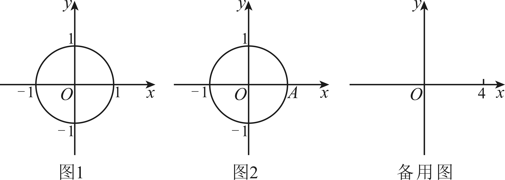

# Mathematics - 题目 1902

**ID**: 9eb7087e51e94bb594f547c7fe6d8506
**年级**: Grade 9
**难度**: Hard
**题型**: Calculation

## 题目
在平面直角坐标系 $xOy$ 中，对于 $\vartriangle ABC$ 与 $\odot O$ ，若 $\vartriangle ABC$ 与 $\odot O$有且只有两个公共点，其中一个公共点为A，另一个公共点在边 $BC$ 上（不与点B，C重合），则称 $\vartriangle ABC$ 为 $\odot O$ 的“点A关联三角形”．（1）如图 ${\rm 1，}\odot O$ 的半径为 ${\rm 1，}C\left ({0,2}\right )$ ．设 $A\left ({a,b}\right )$ ．①当 $a=b=\frac {\sqrt {2}}{2}$ ，说明 $\mathrm{△}AOC$ 为 $\odot O$ 的“点A关联三角形”；​​​​​​​‌②若 $\mathrm{△}AOC$ 为 $\odot O$ 的“点A关联三角形”，则a的最小值为．（2）如图 ${\rm 2，}\odot O$ 的半径为 ${\rm 1，}A\left ({1,0}\right ){\rm ，\mathit{B}}$ 是y轴负半轴上的一个动点，点C在x轴下方， $\vartriangle ABC$ 是等边三角形，且 $\vartriangle ABC$ 为 $\odot O$ 的“点A关联三角形”．设点C的横坐标为m，求m的取值范围．（3） $\odot O$ 的半径为r，直线 $y=x$ 与 $\odot O$ 在第一象限的交点为 ${\rm \mathit{A}．}C\left ({4,0}\right )$ ．若平面直角坐标系 $xOy$ 中存在点B，使得 $\vartriangle ABC$ 是等腰直角三角形，且 $\vartriangle ABC$ 为 $\odot O$ 的“点A关联三角形”，直接写出r的取值范围．

## 解答

1. （1）解：①如图，
2. 
3. ∵ $a=b=\frac {\sqrt {2}}{2}$ ，
4. ∴ $A\left ({\frac {\sqrt {2}}{2},\frac {\sqrt {2}}{2}}\right )$ ，
5. ∴ $OA=\sqrt {{\left({\frac {\sqrt {2}}{2}}\right)^{2}}+{\left({\frac {\sqrt {2}}{2}}\right)^{2}}}=1$ ，
6. 又∵ $\odot O$ 的半径为1，
7. ∴点 $A$ 在 $\odot O$ 上，
8. ∵ $OC$ 交 $\odot O$ 于点 $\left ({0,1}\right )$ ，
9. ∴ $\mathrm{△}AOC$ 为 $\odot O$ 的“点A关联三角形”；
10. ②过点C作 $\odot O$ 的切线 $CA$ ，连接 $OA$ ，
11. 当点A在y轴右侧时，则 $OA=1$ ， $OC=2$ ，
12. ∴ $AC=\sqrt {OC{^{2}}-OA{^{2}}}=\sqrt {3}$ ，
13. 过点A作 $AH\bot y$ 轴于H，
14. 则 $S{{}_{\vartriangle AOC}}=\frac {1}{2}\times AC\cdot OA=\frac {\sqrt {3}}{2}$ ，
15. ∴ $AH=\frac {AC\cdot OA}{OC}=\frac {\sqrt {3}}{2}$ ，
16. ∴ $0\leqslant a\leqslant \frac {\sqrt {3}}{2}$ ，
17. 当点A在y轴左侧时，由对称性得 $-\frac {\sqrt {3}}{2}\leqslant a\leqslant 0$ ，
18. ∴ $-\frac {\sqrt {3}}{2}\leqslant a\leqslant \frac {\sqrt {3}}{2}$ ，
19. ∴a的最小值为 $-\frac {\sqrt {3}}{2}$ .
20. 
21. （2）解：如图2，
22. 
23. ∵ $\vartriangle ABC$ 为 $\odot O$ 的“点A关联三角形”，
24. ∴线段 $AC$ 和 $AB$ 除点A外不与 $\odot O$ 有交点，
25. 当 $AC$ 与 $\odot O$ 相切时，
26. ∴ $AC\bot x$ 轴，此时，点A的横坐标为1，
27. 则点C的横坐标为1，即 $m=1$ ，
28. ∴ $m\geqslant 1$ 时，线段 $AC$ 除点A外不与 $\odot O$ 有交点；
29. 当点B恰好在 $\odot O$ 上，即点B在 $\left ({0,-1}\right )$ 处，记作点 $B^{′}$ ，
30. ∴ $OB^{′}=1$ ，
31. ∵ $A\left ({1,0}\right )$ ，
32. ∴ $OA=1$ ，
33. ∴ $OA=OB^{′}$ ，
34. ∴ $\angle OB^{′}A=45{}\degree $ ，
35. ∵ $\vartriangle ABC$ 为等边三角形，
36. ∴ $B^{′}C^{′}=AB^{′}$ ， $\angle AB^{′}C^{′}=60{}\degree $ ，
37. 在 ${\rm{R}}{\rm{t}}\vartriangle A^{′}OB^{′}$ 中， $AB^{′}=\sqrt {2}$ ，
38. ∴ $B^{′}C^{′}=\sqrt {2}$ ，
39. 过点 $C^{′}$ 作 $C^{′}G\bot y$ 轴于G，
40. ∴ $\angle B^{′}GC^{′}=90{}\degree $ ， $\angle C^{′}B^{′}G=180{}\degree -45{}\degree -60{}\degree =75{}\degree $ ，
41. ∴ $\angle B^{′}C^{′}G=15{}\degree $ ，
42. 在 $C^{′}G$ 上取一点M，连接 $B^{′}M$ ，使得 $B^{′}M=C^{′}M$ ，
43. ∴ $\angle B^{′}MG=30{}\degree $ ，
44. 在 ${\rm{R}}{\rm{t}}\vartriangle B^{′}GM$ 中，则 $GM=\sqrt {3}B^{′}G$ ， $B^{′}M=2B^{′}G$ ，
45. ∴ $C^{′}G=GM+C^{′}M=\left ({\sqrt {3}+2}\right )B^{′}G$ ，
46. 在 ${\rm{R}}{\rm{t}}\vartriangle B^{′}GC^{′}$ 中，根据勾股定理得 $B^{′}G{^{2}}+C^{′}G{^{2}}=B^{′}C^{′}{{^{2}}}$ ，
47. $B^{′}G{^{2}}+\left [\left ({\sqrt {3}+2}\right )B^{′}G\right ]{^{2}}={\left({\sqrt {2}}\right)^{2}}$ ，
48. ∴ $B^{′}G=\frac {\sqrt {3}-1}{2}$ ，
49. ∴ $C^{′}G=\left ({\sqrt {3}+2}\right )\cdot \frac {\sqrt {3}-1}{2}=\frac {1+\sqrt {3}}{2}$ ，
50. ∴ $m<\frac {1+\sqrt {3}}{2}$ 时，线段 $AB$ 除点A外不与 $\odot O$ 有交点；
51. ∴综上所述，m的取值范围为 $1\leqslant m<\frac {1+\sqrt {3}}{2}$ ；
52. （3）解：∵ $\vartriangle ABC$ 为 $\odot O$ 的“点A关联三角形”，
53. ∴分如下情况讨论：
54. ①当 $AB$ 与 $\odot O$ 有交点，直到点 $B$ 落在 $\odot O$ 上时，
55. ∵直线 $y=x$ 与 $\odot O$ 在第一象限的交点为A，
56. ∴ $A\left ({\frac {\sqrt {2}}{2}r,\frac {\sqrt {2}}{2}r}\right )$ ，
57. 过点 $A$ 作 $x$ 轴的平行线，交 $y$ 轴于点 $D$ ，过点 $C$ 作 $CE\bot AD$ ，交 $DA$ 延长线于点 $E$ ，
58. 
59. 则 $\angle ADB=\angle CEA=90\mathrm{°}$ ，
60. ∴ $\angle BAD+\angle ABD=90{}\degree $ ，
61. ∵ $\angle BAC=90{}\degree $ ，
62. ∴ $\angle BAD+\angle CAE=90{}\degree $ ，
63. ∴ $\angle ABD=\angle CAE$ ，
64. ∵ $AB=CA$
65. ∴ $\vartriangle ABD≌\vartriangle CAE\left ({{\rm{A}}{\rm{A}}{\rm{S}}}\right )$ ，
66. ∴ $BD=AE$ ，即 $\frac {\sqrt {2}}{2}r+r=4-\frac {\sqrt {2}}{2}r$ ，
67. 解得 $r=4\sqrt {2}-4$ ，此时不满足题意，
68. ∴ $r>4\sqrt {2}-4$ ；
69. ②当 $AC$ 与 $\odot O$ 相切时，如图，
70. 
71. 由图可知，点 $B$ 与点 $O$ 重合，
72. ∵ $C\left ({4,0}\right )$ ，
73. ∴ $OC=4$ ，
74. ∴ $r=\frac {OC}{\sqrt {2}}=\frac {4}{\sqrt {2}}=2\sqrt {2}$ ，
75. 当 $r>2\sqrt {2}$ 时， $AC$ 与 $\odot O$ 有两个交点，不符合题意，
76. ∴ $r\leqslant 2\sqrt {2}$ ；
77. ③当 $AC$ 与 $\odot O$ 相交时，且点 $C$ 在 $\odot O$ 内，即 $r>4$ ，
78. 过点 $A$ 作 $y$ 轴的平行线，交 $x$ 轴于点 $E$ ，过点 $B$ 作 $BD\bot AE$ ，交 $EA$ 延长线于点 $D$ ，
79. 
80. 同理可证 $\vartriangle ABD{\rm{≌}}\vartriangle CAE$ ，
81. ∴ $BD=AE=\frac {\sqrt {2}}{2}r$ ， $AD=CE=4-\frac {\sqrt {2}}{2}r$ ，
82. ∴ $OE+BD=\frac {\sqrt {2}}{2}r+\frac {\sqrt {2}}{2}r=\sqrt {2}r$ ， $AE+AD=\frac {\sqrt {2}}{2}r+4-\frac {\sqrt {2}}{2}r=4$ ，
83. ∴ $B\left ({\sqrt {2}r,4}\right )$ ，
84. ∴ $OB{^{2}}={\left({\sqrt {2}r}\right)^{2}}+4{^{2}}=2r{^{2}}+16>r{^{2}}$ ，即 $OB>r$ ，
85. ∴点 $B$ 在 $\odot O$ 外，
86. ∴ $BC$ 与 $\odot O$ 必有一个交点，符合题意，
87. ∴ $r>4$ ；
88. ∴综上所述，r的取值范围为 $4\sqrt {2}-4<r\leqslant 2\sqrt {2}$ 或 $r>4$ ．

## 知识点

**中文**:
  - 切线的性质定理
  - 勾股定理
  - 直线和圆的位置关系

**English**:
  - Tangent Properties Theorem
  - Pythagorean Theorem
  - Line and Circle Relationship

---
